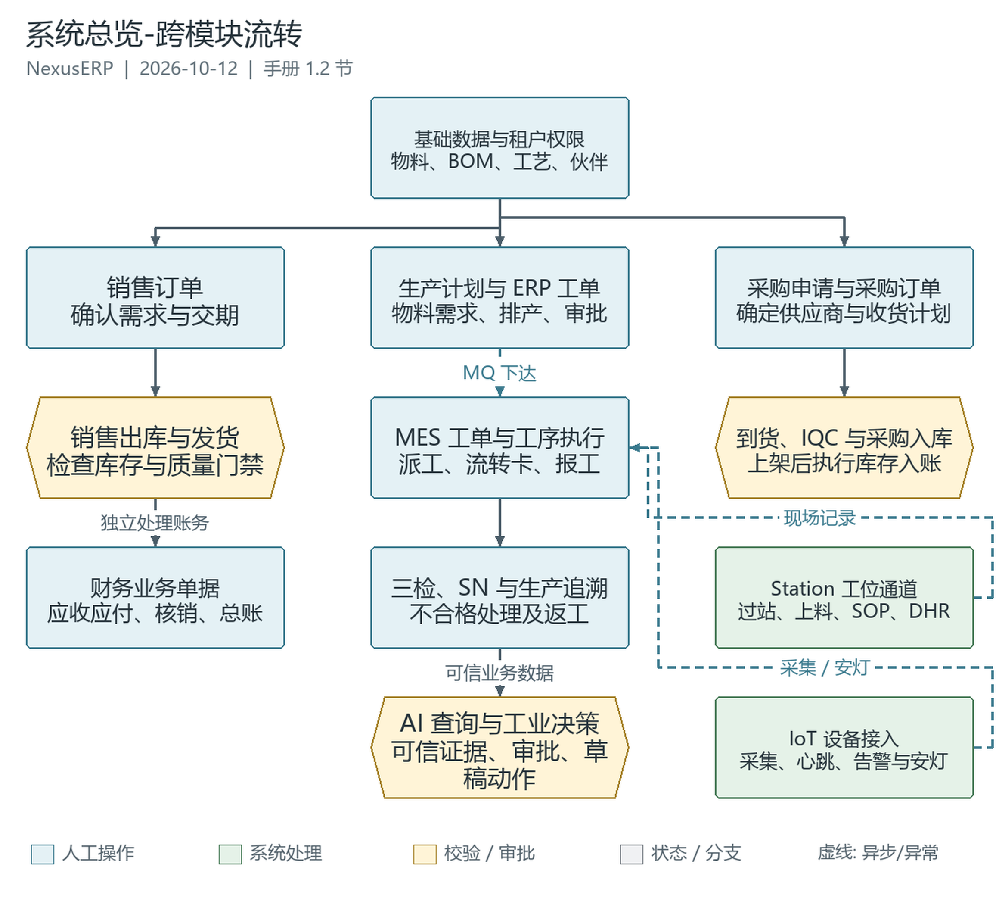
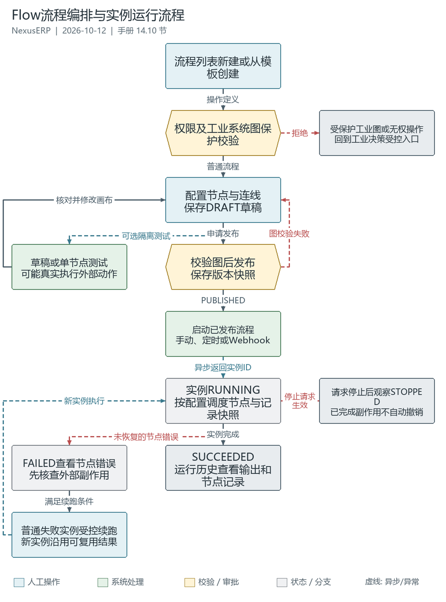

# Nexus-ERP


Nexus-ERP 是一套面向制造业与贸易型企业的综合管理系统，涵盖 **ERP（企业资源计划）、MES（制造执行）、IoT（物联网数据采集）、AI 智能助手与工业决策、CV 视觉识别（人脸 / OCR / 工业缺陷检测）** 五大核心能力，基于 **RuoYi-Vue-Plus v5.6.0** 二次开发而来。围绕"基础数据、销售、采购、生产、仓储、质量、设备、IoT、财务、报表"构建企业业务中台，通过 **PC、App、PDA、Station 工位机**协同作业，并结合流程编排、电子签章与生产追溯，把分散的业务流程连接成可追踪、可协同、可落地的管理闭环。

项目早期基于 RuoYi-Vue 进行扩展，后升级到 **RuoYi-Vue-Plus 分布式多租户架构**，在保留成熟后台能力的基础上，更适合多组织、多角色、多业务线的企业场景。特别地，通过集成 LangChain4j Agent 架构，实现了自然语言驱动的 ERP 数据查询、智能对话与业务辅助决策能力。

- **作者**：王欢
- **许可证**：MIT

[业务功能](#业务功能) · [系统架构](#系统架构) · [业务流程与文档](#业务流程与文档) · [系统截图](#系统截图) · [快速开始](#快速开始)

### 关联开源项目

| 项目                       | 说明                                | 地址 |
|--------------------------|-----------------------------------|------|
| **Nexus-ERP**            | 综合管理系统主仓库（本仓库，Web 端）              | [Gitee](https://gitee.com/NexusERP/nexus-erp)（分支 `plus`） |
| **Nexus-Vision-Service** | 独立视觉识别服务（人脸、OCR、工业缺陷模型推理，FastAPI） | [Gitee](https://gitee.com/NexusERP/nexus-vision-service) |
| **Nexus-App**            | 移动端 App（uni-app，支持人脸打卡、标签拍照识别等）   | [Gitee](https://gitee.com/NexusERP/nexus-app) |
| **Nexus-PDA**            | 手持作业终端（uni-app + Vue 3，仓储、产线、质检、设备扫码作业与统一追溯） | [Gitee](https://gitee.com/NexusERP/nexus-pda) |
| **Nexus-Station**        | 固定工位客户端（Electron，过站报工、SOP、上料、设备联机） | [Gitee](https://gitee.com/NexusERP/nexus-station) |

> 多端共享 Nexus-ERP 后端，但业务页面和作业方式各有侧重：App 面向移动协同，PDA 面向扫码作业，Station 面向固定工位和外设。需要视觉能力时统一经后端 `/cv/*` 代理调用 Vision 服务，不向客户端分发视觉服务密钥。

---
## 项目定位

Nexus-ERP 不只是一个通用后台，而是一个以企业经营流程为核心的业务系统。当前重点聚焦于以下几个方向：

- **打通业务闭环**：从订单、采购、生产到仓储出入库，减少业务断点；并向上延伸至财务核算（总账、应收应付、固定资产、存货成本），打通"业务 → 财务"的完整链路。
- **车间执行管控（MES）**：覆盖工单下发、工序派工、工序报工、生产流转卡、进站出站、SN/批次追踪、安灯告警、SPC 统计、质量检验（IQC/IPQC/OQC）、不合格品（NCR）与返工、E-SOP、工装管理等制造执行核心场景，实现计划层与执行层的无缝衔接。
- **设备互联与数据采集（IoT）**：通过 MQTT 网关对接产线设备、传感器、PLC 等，实现设备状态实时采集、数据流管道处理、告警检测与推送、OEE 分析，为 MES 提供实时数据支撑。
- **统一主数据**：围绕物料、客户、供应商、BOM、工位、仓库等核心主数据建立统一管理体系。
- **AI 智能决策**：基于 LangChain4j Agent 架构，支持自然语言查询 ERP 数据、智能对话、知识图谱、联网搜索、报表生成、异常预警与业务辅助决策，让系统从"记录工具"升级为"智能决策平台"。
- **视觉识别落地**：独立视觉服务（Nexus-Vision-Service）提供人脸识别（考勤打卡、车间操作台登录）与物料标签 OCR 识别（收货上架自动回填），软硬件结合贴近车间实际场景。
- **模型可配置**：可接入云端或本地模型，也可使用业务微调模型；实际效果取决于模型、知识库和工具配置。
- **即时通讯**：内置 IM 模块，支持私聊、群聊、消息推送，打通企业内部沟通链路。
- **移动端 App**：配套 Nexus-App（uni-app），覆盖 Android / iOS / H5 / 微信小程序，支持人脸打卡、标签拍照识别、扫码作业等移动场景。
- **PDA 手持终端**：配套 Nexus-PDA（uni-app + Vue 3），覆盖收货上架、备料发料、移库盘点、产线报工、三检、设备点检和追溯查询。
- **工位机 App**：配套 Nexus-Station（Electron），覆盖工位过站、SN 组件绑定、SOP 查阅、上料防错和外设联机。
- **签署与履历**：印章授权、二级认证、签名留痕与合同 PDF 盖章，结合 DHR 批记录和生产追溯保留业务证据。

---

## 系统架构



 [交互式 HTML 源文件](doc/system/archify-nexus-erp-architecture-20261009-111634/nexus-erp-architecture.html)

- **接入层**：PC 管理端、App、PDA、Station，以及 MQTT 工业设备；人员登录接口与工位设备密钥通道分开管理。
- **应用层**：`NexusApplication` 组装 ERP、MES、IoT、AI、Flow、IM 等模块。当前为模块化单体，不是每个业务模块都独立部署的微服务集群。
- **数据与基础设施**：按数据源划分系统、ERP、MES、IoT 等数据库；Redis 承载缓存、数据流及 SSE 广播，RabbitMQ 承载跨模块异步事件，MinIO / S3 存放文件。
- **外部能力**：Vision、模型服务及可配置的向量存储按使用场景部署；架构图中出现某个组件不表示所有环境都已启用它。

---

## 业务流程与文档



业务流程覆盖"销售需求 → 采购 / 生产 → 仓储 / 质量 → 履约 / 财务"，同时连接 AI 决策、设备数据、工位执行和签署留痕。

| 业务场景 | 流程与说明 | 图形预览 |
|----------|------------|----------|
| 跨模块总览 | [可编辑流程图](doc/flowcharts/系统总览-跨模块流转.drawio) | [PNG](doc/flowcharts/系统总览-跨模块流转.preview.png) |
| 销售与采购 | [销售到收款](doc/flowcharts/erp/销售到收款流程.drawio)、[采购到付款](doc/flowcharts/erp/采购到付款流程.drawio) | [销售](doc/flowcharts/erp/销售到收款流程.preview.png)、[采购](doc/flowcharts/erp/采购到付款流程.preview.png) |
| 生产制造 | [ERP 生产制造](doc/flowcharts/erp/生产制造流程.drawio)、[MES 工单与流转卡](doc/flowcharts/mes/工单下达与流转卡流程.drawio) | [ERP](doc/flowcharts/erp/生产制造流程.preview.png)、[MES](doc/flowcharts/mes/工单下达与流转卡流程.preview.png) |
| 仓储与 PDA | [仓储管理](doc/flowcharts/erp/仓储管理流程.drawio)、[PDA 扫码作业与统一追溯](doc/flowcharts/pda/PDA扫码作业与追溯流程.md) | [仓储 PNG](doc/flowcharts/erp/仓储管理流程.preview.png) |
| 质量管理 | [IQC / IPQC / OQC 三检](doc/flowcharts/mes/三检制流程.drawio)、[NCR 与返工](doc/flowcharts/mes/NCR不合格品与返工流程.drawio) | [三检](doc/flowcharts/mes/三检制流程.preview.png)、[NCR](doc/flowcharts/mes/NCR不合格品与返工流程.preview.png) |
| Station 与 DHR | [工位过站与上料](doc/flowcharts/mes/Station工位过站与上料流程.drawio)、[生产履历与追溯](doc/flowcharts/mes/生产履历与追溯看板流程.drawio) | [Station](doc/flowcharts/mes/Station工位过站与上料流程.preview.png)、[DHR](doc/flowcharts/mes/生产履历与追溯看板流程.preview.png) |
| 工业决策 | [可信快照、方案审批与受控执行](doc/flowcharts/ai/工业决策审批与执行流程.drawio) | [PNG](doc/flowcharts/ai/工业决策审批与执行流程.preview.png) |
| Flow 编排 | [流程设计、发布与实例运行](doc/flowcharts/ai/Flow流程编排与实例运行流程.drawio) | [PNG](doc/flowcharts/ai/Flow流程编排与实例运行流程.preview.png) |
| 工业视觉 | [缺陷检测与人工复核边界](doc/flowcharts/cv/视觉缺陷检测与复核流程.drawio) | [PNG](doc/flowcharts/cv/视觉缺陷检测与复核流程.preview.png) |
| IoT 与消息 | [设备数据管道](doc/flowcharts/iot/数据管道流程.drawio)、[IM / 通知投递](doc/flowcharts/im/消息与通知投递流程.drawio) | [IoT](doc/flowcharts/iot/数据管道流程.preview.png)、[消息](doc/flowcharts/im/消息与通知投递流程.preview.png) |
| 电子签章 | [印章授权与签署](doc/flowcharts/system/电子签章授权与签署流程.drawio) | [PNG](doc/flowcharts/system/电子签章授权与签署流程.preview.png) |
| 财务关账 | [报表与期末关账](doc/flowcharts/fin/报表与期末关账流程.drawio) | [PNG](doc/flowcharts/fin/报表与期末关账流程.preview.png) |

完整图集见 [29 张业务流程图](doc/flowcharts/README.md)及[逐图来源与使用边界](doc/flowcharts/来源与使用边界.md)。

其他入口：[文档中心](doc/README.md) · [用户操作手册](doc/system/user-manual/README.md) · [数据库变更记录](doc/system/数据库增量变更记录.md) · [贡献规范](doc/CONTRIBUTING.md)

---

## 演示地址

- 演示站点：[Nexus-ERP 演示](http://nexuserp.website/index)
- 账号：admin
- 密码：admin123

> 该地址是公开体验入口，本次文档维护未验证其可用性。不要录入真实业务数据、个人敏感信息或私有模型 API Key。
> 演示服务器资源有限，模型响应、对象存储、定时任务和监控服务可能受限或未启动；完整体验请在隔离的本地 / 测试环境部署，并按实际配置核对功能。

---

## 业务功能

### AI 智能助手（AI）

集成 LangChain4j + Agent 架构，提供自然语言驱动的 ERP 数据查询、智能对话与业务辅助决策能力：

- **多模型支持**：通过数据库配置厂商（DeepSeek / 通义千问 / 智谱 / Ollama / MiniMax / MiMo / 自定义 API 等）和模型，运行时动态构建 ChatModel，支持同步和流式两种模式。
- **ERP 数据查询 Agent**：基于 Supervisor + SubAgent 编排，Agent 自动调用工具链（查询表列表 → 查看表结构 → 生成并执行 SQL）回答业务问题。
- **安全防护**：SQL 执行仅允许 SELECT，内置危险关键词黑名单、表名前缀白名单（bd_/so_/pu_/prd_/wm_/sch_），自动注入租户隔离条件，行数限制与超时控制。
- **SSE 实时推送**：AI 回复通过 Redis Pub/Sub + SSE 推送到前端，支持思考中/内容/完成/错误/图表/图片/工具调用/联网搜索来源等多种消息类型。
- **深度思考模式**：支持 reasoning 模型思维链流式推送（AI_THINKING_TOKEN）与持久化，前端以"思考过程"折叠展示。
- **联网搜索**：Tavily / Bing 双引擎，回答强制引用来源 URL；搜索结果以"信息来源"来源卡片（AI_WEB_SEARCH 事件）推送到前端。
- **知识图谱**：LLM 实体/关系抽取 + 标签传播社区发现，构建知识库图结构；图增强检索（1-2 跳邻居 + 社区全局搜索），ECharts 力导向图可视化，存储支持 MySQL / Neo4j。
- **MCP 市场与工具注册表**：ai_tool 统一注册内置/本地/远程工具，市场发现远程工具一键加载，支持 HTTP（SSE）/ STDIO 双传输与熔断降级。
- **RAG 知识库**：文档解析（Tika）、分块、向量化检索（混合检索 + RRF 融合）、专用 Rerank API（百炼/智谱/硅基流动）、Embedding 工厂；支持企业内部文档（SOP、工艺文件、设备手册）智能问答与 URL 导入。
- **文生图**：通义万相文生图，生成图片自动上传 OSS 并推送卡片（AI_IMAGE 事件）。
- **对话管理**：单条消息删除、消息反馈（点赞/点踩）、会话重命名、会话 Markdown 导出、Token 用量统计、业务上下文注入（移动端详情页可携带当前业务对象上下文，让 AI 知道用户正在看什么）。
- **长明细查询优化**：纯 ERP 全量 / 逐条查询可直接路由查询 Agent，减少长正文再次参与 Supervisor 调度；模型截断或调用失败不记为完整成功答案。仍受 SQL 行数、超时和模型 Token 预算限制，不等于无限导出或问题文件批量导入。
- **Prompt 模板与 Text2SQL 示例**：动态模板注入、Few-Shot 示例库，持续提升 SQL 生成准确率。
- **A/B 测试**：AI 回复效果对比实验，支撑模型与 Prompt 迭代优化。
- **前端对话抽屉**：全局 AiChatDrawer 组件，支持 Markdown 渲染、会话管理、聊天历史，可在任意页面唤起。
- **多租户隔离**：异步线程通过 AiRequestContext 传播 tenantId/userId，确保数据查询遵守租户隔离规则。
- **运行参数管理**：通过后台管理 SQL 安全、向量存储、搜索、知识图谱、Flow 与工业决策参数；厂商和默认模型由数据库配置管理，保存后通过缓存重载机制生效。


### AI 流程编排（AI Flow Orchestration）

可视化流程编排引擎，位于独立的 `ruoyi-flow` / `ruoyi-common-flow` 模块，API 保持 `/ai/flow/**`。支持通过拖拽画布设计、执行和监控业务自动化流程，基于自定义 DAG 图模型引擎，**不是 Flowable BPMN 审批引擎**：

- **可视化画布设计器**：基于 Vue Flow 的拖拽式画布，包含节点面板、schema 驱动属性表单、变量选择器（NDV）、框选/复制粘贴/撤销重做/自动布局，支持常驻运行面板
- **AI 智能节点**：LLM 调用（prompt 模板 + {{}} 变量注入）、Agent 智能体（多轮工具调用，可自动调用 ERP 查询类工具）、RAG 知识库检索、ERP 业务工具（库存查询/客户查询等）
- **数据处理节点**：数据库查询（只读 SELECT，自动租户隔离 + 危险语句拦截）、代码转换（JS 表达式字段转换）、变量设置（引用上游节点输出或运行入参）
- **流程控制节点**：条件分支（IF/ELSE，AND/OR 多条件）、循环分批（Split 数组分批 → Loop 循环体 → Aggregate 汇总 → Done 结束）、合并汇总（动态多入端口）、延迟等待
- **集成连接节点**：HTTP 请求（含 SSRF 防护，支持 Header/Body/超时）、MQ 消息发送（RabbitMQ 路由键选择）、邮件发送（HTML 正文）、短信发送（模板参数）、IM 群机器人（企业微信/钉钉）、OSS 文件（上传/读取）
- **通知输出节点**：站内通知（顶部铃铛 + 实时推送，可跳转流程详情）
- **DAG 执行引擎**：自定义图模型引擎，支持条件分支分流、ERROR_PORT 错误处理端口、Split/Aggregate 循环执行、并行分支、执行级续跑（从失败节点重试）、SKIPPED 状态入度簿记
- **触发方式**：手动触发（一键运行 + 入参输入）、定时调度（SnailJob Cron 表达式）、Webhook 触发（入站 HTTP 请求）、设计器测试运行（无需发布，使用画布当前配置）
- **运行监控**：运行实例列表（状态/耗时/节点数/触发方式）、只读画布重放（逐节点时间线动画 + JSON 表格视图）、节点运行详情（输入/输出/错误信息/循环批次）、执行快照持久化（续跑用）
- **流程管理**：版本管理（Draft → Published → Offline 生命周期，每次发布版本+1）、版本历史查看、执行历史筛选、内置种子流程模板（库存预警通知、金额分级处理、HTTP 集成测试、SQL 查询示例等）
- **表达式与变量系统**：SpEL 表达式求值、{{}} 变量模板（引用上游节点输出或运行入参）、NDV 节点数据查看器，支持变量选择器自动补全

> 流程测试可能真实访问外部服务或发送消息，应先确认隔离环境与副作用。包含工业决策节点的受保护系统图不能通过通用画布编辑、测试或重试绕过审批与执行策略。



### 工业交付风险决策

连接销售订单、库存、采购和生产事实，提供可复核的风险分析与受控动作闭环：

- **可信业务快照**：由 ERP 数据适配层组装交付上下文、缺料事实与来源证据，保留版本和新鲜度边界。
- **推演与方案对比**：由服务端执行 APS / 缺料推演、计算工业 KPI 和方案排名；详情页展示风险根因、方案、证据及运行时间线。
- **模型职责受限**：模型仅生成基于证据的定性说明，不自行计算 KPI、构造业务事实或直接写入业务数据。
- **审批与执行**：按风险、业务权限、租户、版本和幂等键控制通知、采购申请草稿、排产草稿等允许动作；源数据变化时可要求重新分析。
- **结果回查**：批准不等于执行成功，草稿不等于正式单据已生效；需核对执行结果并回查 ERP 实际记录。

入口与边界见 [AI 模块文档](doc/ai/README.md)及[工业决策流程](doc/flowcharts/ai/工业决策审批与执行流程.drawio)。

### ERP 业务管理

统一管理企业核心业务数据与流程，涵盖销售、采购、生产、仓储、财务等传统 ERP 模块：

- **基础数据**：物料主数据、物料清单（BOM）、客户/供应商档案、车间、工位、计量单位、物料分类（支持属性模板、拖拽排序与停用级联）。
- **销售**：客户订单、订单头/行管理与全生命周期跟踪，与 MES 质检（OQC）联动回写。
- **采购**：采购申请、采购订单、到货通知、收货入库、采购退货与供应商评估，打通"请购 → 采购 → 收货 → 入库"的供应链主链路。
- **排产调度**：班次与班组管理、工人档案、考勤记录（支持 App 人脸打卡）、假期管理、生产调度排程。
- **生产计划**：生产计划、工单、完工汇报、返工单、委外加工、物料需求计算（齐套/缺料分析）。
- **仓储**：仓库定义、库区/储位管理、库存查询与盘点、收货与发货管理、到货通知、库存预留、上架规则与拣货规则（FIFO / FEFO 策略，到期优先）、生产领料与领料接收、条码/批次/SN 管理与库存追溯、库存预警与价值核算。
- **质检联动**：IQC / IPQC / OQC 检验结果经 MQ 回写（OQC→销售订单、IPQC→工单、IQC→到货通知单行）；需检物料 IQC 合格前不允许上架（上架硬门禁）。
- **来源与履约校验**：采购申请、采购订单、收货和上架等受控路径核对来源单据、数量、证据及版本；按实际接口和权限推进，不把 AI 草稿、审批通过或 MQ 已发送当作履约完成。

#### 财务核心（Finance）

对标主流 ERP（SAP FI/CO）的财务核算体系，打通"业务 → 财务"闭环：

- **总账（GL）**：会计科目、记账凭证、科目余额与试算平衡。
- **应收应付（AR/AP）**：发票登记、收款/付款核销、账龄分析，支持业务单据联动生成。
- **固定资产（FA）**：资产档案、折旧计提与处置。
- **存货成本**：基于库存出入库的价值核算，为成本计算提供数据基础。
- **收款与期末关账**：收款入口、财务报表与期末关账处理。

### MES 制造执行

独立的一级业务模块（`ruoyi-mes`），实现计划层到执行层的制造过程管控：

- **生产管理（pro）**：工单下发、工序派工、工序报工、生产流转卡（进站门禁、跳站）、SN 号管理、批次追踪、MBOM（制造 BOM）管理、工序检验规则与工序指导。
- **批次管理（lt）**：Lot 批次档案、SN↔批次绑定、工单批次消耗，实现从投料到成品的批次级追溯。
- **不合格品（ncr）**：NCR 不合格品单、返工工单、缺陷代码管理、8D 报告，闭环不合格品处置流程。
- **E-SOP（sop）**：富媒体作业指导书 + 版本管理 + 工序绑定 + 查看审计，支持 Flowable 审批后发布。
- **工装管理（tg）**：工装/模治具档案、领用-归还使用记录、保养计划与保养记录。
- **备件管理（eq）**：备件档案、采购申请、维修耗用和退料，结合库存、采购与维修记录保留业务来源。
- **DHR 批记录（dhr）**：聚合工单、工序、物料批次、设备、工装、SOP、质量、采集、SN 和 NCR 分册；支持复核、放行、归档及哈希 / 签名链校验。空分册或校验通过不等于生产合格。
- **固件与测试（flash）**：固件 / 配置与发布包管理、工序绑定、刷写和测试记录、工位心跳，支持与制造 SN 履历关联。
- **安灯管理**：产线安灯（Andon）告警触发与处理，异常事件实时上报。
- **数据采集（dc）**：采集点配置、生产数据记录与回写，对接 IoT 实时数据（支持自动采集）。
- **设备管理（eq）**：独立子系统的设备档案、维护保养计划、维修记录、故障管理，并与 ERP 基础数据（物料、车间、工位）打通。
- **质量管理（qc）**：来料检验（IQC）、过程检验（IPQC）、出货检验（OQC），新增检验单详情查看；检验完成门禁、NCR 处置及追溯与 ERP 质检联动。
- **统计过程控制（spc）**：控制图、数据点采集与分析，基于 SPC 方法监控生产过程稳定性。
- **ERP 桥接**：通过 MesErpBridgeService 与 `ruoyi-erp` 模块交互，获取 BOM、工艺路线、物料、车间等基础数据。

### 视觉识别（CV）

对接独立开源视觉服务 **Nexus-Vision-Service**（FastAPI），提供人脸识别、物料 OCR 与工业缺陷检测。各客户端需要视觉能力时统一经 Nexus-ERP 后端 `/cv/*` 代理调用，视觉服务 API Key 不暴露给客户端；小程序等平台仍需按自身规则配置后端请求域名。

- **人脸识别**：基于 insightface（SCRFD 检测 + ArcFace 特征提取），支持 1:1 验证与 1:N 识别，人脸底库按员工工号（`EMP-xxx`）管理；实际响应时间取决于模型、硬件与网络。
- **考勤打卡**：App 提交人脸打卡，后端记录验证状态；视觉服务异常时支持降级与补偿回填，待验证不等于已验证通过。
- **车间操作台人脸登录**：1:N 识别候选 top-3 → 人工选择 → 1:1 二次确认，兼顾效率与防误识别。
- **物料标签识别**：RapidOCR 识别标签文字 → 正则解析料号/批次/SN → 与物料主数据交叉校验；收货上架弹窗"拍照识别"自动回填料号、批次、SN，支持手动修正。
- **通用目标检测**：内置 YOLOv11n（COCO 80 类）作为通用检测兜底；专用物料 / 缺陷模型在独立 Vision 仓库按场景训练和配置，本仓库不提供模型训练界面。
- **工业缺陷检测**：PC 单图检测页支持金属表面 `defect_metal` 与 PCB `defect_pcb` 场景，展示原图检测框、类别、置信度和耗时；模型缺失或场景不符时拒绝，不降级为通用 YOLO。需要单独部署对应 Vision 模型。
- **检测与业务分离**：无缺陷只表示本次模型未检出；输出需人工复核，不自动生成 QC / NCR、绑定 SN / 批次或写入 DHR，也不是模型训练与批量质检平台。
- **底库管理**：人脸底库注册（支持按系统用户头像批量注册）、底库列表/删除、识别失败人工复核页面。

  | 物料批次识别（收货上架自动回填） | App 人脸识别 |
  |----------------------------------|--------------|
  |  |  |

### 移动端 App（Nexus-App）

配套移动端应用 [Nexus-App](https://gitee.com/NexusERP/nexus-app)（uni-app，Vue 3 + Pinia），面向 Android / iOS / H5 / 微信小程序移动协同，通过主仓库后端接口联动；各平台发布和真机兼容需独立验证：

- **人脸打卡**：移动端提交刷脸考勤，查看后端验证状态与异常处理结果。
- **标签拍照识别**：物料标签拍照 → OCR 识别料号/批次/SN，支持与单据行校验（验证模式）。
- **扫码作业**：仓库扫码、条码扫描等移动作业场景。
- 视觉调用统一走后端 `/cv/*` 代理，App 端不持有视觉服务密钥。

### PDA 手持作业终端（Nexus-PDA）

配套独立仓库 [Nexus-PDA](https://gitee.com/NexusERP/nexus-pda)（uni-app + Vue 3，HBuilderX 工程），面向仓储、产线、质检和设备人员，采用扫码优先的现场作业方式，不与 App 或 Station 混同：

- **仓储作业**：收货上架及明细、备料发料、移库、盘点、退料核销。
- **产线作业**：上料交接、SN 绑定和扫码报工，按服务端状态及数量门禁执行。
- **质量作业**：IQC / IPQC / OQC 三检及 AQL 抽样试算；抽样计算不等于检验合格或自动放行。
- **设备作业**：点检、保养和维保记录。
- **统一追溯**：输入批次、仓储 / 制造 SN、物料编码或 MES 批次号，通过 `/app/pda/trace` 聚合 ERP 正反向库存追溯、MES 批次链及制造 SN 履历；每个数据段按原有权限独立返回。
- **扫码接入**：键盘楔、机型广播、摄像头和手输；广播参数与打印驱动需在选定机型验证。
- **离线待同步**：支持离线写通道的网络类失败可进入队列，恢复后按原幂等键重放；业务校验失败不能用离线重试绕过，待同步不代表已过账，切换账号需清理原任务。

当前客户端为试点范围，具体页面、配置、安装包和发布门禁以 [PDA 仓库文档](https://gitee.com/NexusERP/nexus-pda)为准。流程见 [PDA 扫码作业与追溯](doc/flowcharts/pda/PDA扫码作业与追溯流程.md)，真机扫码、打印、网络恢复和幂等重放仍需按部署环境验收。

### Station 工位执行（Nexus-Station）

配套 [Nexus-Station](https://gitee.com/NexusERP/nexus-station) Electron 客户端，后端设备通道位于 `ruoyi-station`，面向固定工位与外设联机：

- **过站与报工**：前序、工位匹配、重复过站和质量冻结预校验；正式写入时再次守卫，按时间戳与载荷指纹幂等。
- **工位协同**：SN 组件绑定、SOP 版本拉取、上料防错、点检、安灯、刷写 / 测试及心跳台账。
- **安全边界**：设备接口使用独立密钥，不能把免 PC 登录当作免认证。当前设备通道固定租户 `000000`，不支持通过请求任意切换租户。
- **现场边界**：SOP 拉取不等于显式已阅签署，上料台账不等于库存扣减；后端提交不等于 Electron 客户端、外设驱动或离线重放已验收。

### IoT 物联网数据采集

独立的一级业务模块（`ruoyi-iot`），负责设备数据接入、处理与实时推送：

- **设备管理**：产品（Product）与设备（Device）注册管理，设备类型定义、数据上报模板配置。
- **MQTT 接入**：内置 Moquette MQTT Broker，支持设备认证、鉴权、主题订阅，设备通过 MQTT 协议上报数据；不把协议配置枚举当作 OPC UA / Modbus 原生驱动已接通的证明。
- **消息管道（Pipeline）**：MQTT 消息解析（Topic 解析、属性 Payload 提取、数值类型转换）、数据流消费、告警检测（IotAlertChecker）与通知推送。
- **实时数据**：设备最新数据缓存、SSE 实时推送，前端可查看设备实时运行状态。
- **定时任务**：设备心跳检测、历史数据清理、数据流裁剪，保障系统运行稳定性。

### 平台支撑能力

#### 工作流引擎（Flowable）

集成 Flowable 7.0 工作流引擎，支持复杂审批流程、转办、委派、加减签、会签、或签、票签等场景，可与各业务模块深度联动。

#### 电子签章与合同正文

- **印章与授权**：印章台账、授权范围、有效期、停用与撤销，签署时重新核对可用性和业务权限。
- **业务签署留痕**：审批、SOP 已阅、NCR 处置与 DHR 等场景按各自契约记录签名；必要的二级认证不能降级为仅登录。
- **合同 PDF**：当前代码已提供正文上传 / 换版、签章位置选择、追加盖章、CMS 数字签名和文档验签，与业务签名台账分别管理。
- **能力边界**：PDF 使用自签证书，不等于已接入可信 CA、可信时间戳或已满足特定法规；历史签名不可因撤销印章授权而自动视为撤销。

详见 [签章规格与实施记录](doc/system/specs/2026-09-15-esignature-impl-spec.md)及[签署流程](doc/flowcharts/system/电子签章授权与签署流程.drawio)。

#### 即时通讯（IM）

即时消息模块，支持私聊、群聊、消息推送，与系统通知联动，提供企业内部沟通能力。

#### 积木报表（JimuReport）

内置积木报表引擎，支持在线设计报表模板、拖拽式报表配置和数据可视化展示，降低业务报表开发门槛。

#### 支付管理（Pay）

集成支付网关，支持多支付渠道接入，提供统一支付请求、回调处理、退款管理、账单对账等功能。

---

## 系统截图

### 登录与首页

| 登录页 | 首页 |
|--------|------|
|  |  |

### 核心亮点

| 3D 仓库可视化 | AI 知识图谱 |
|---------------|-------------|
|  |  |

### 系统管理

| 用户管理 | 代码生成 |
|----------|----------|
|  |  |

### ERP 系统

#### 基础数据

| 物料管理 |
|----------|
|  |

#### 仓储管理

| 物料入库 | 物料入库表单 | 到货通知单表单 |
|----------|--------------|----------------|
|  |  |  |

| 库存清单 | 库存预警 |
|----------|----------|
|  |  |

#### 销售管理

| 销售订单 |
|----------|
|  |

#### 生产计划

| 生产计划 |
|----------|
|  |

#### 排产调度

| 排班计划 | 考勤记录 |
|----------|----------|
|  |  |

#### 采购管理

| 采购订单 | 采购申请表单 | 采购订单表单 |
|----------|--------------|--------------|
|  |  |  |

### MES 系统

#### 生产订单

| MES 工单 | 流转卡 |
|----------|--------|
|  |  |

#### 生产执行

| 派工管理 |
|----------|
|  |

#### 质量管理

| 质量管理 |
|----------|
|  |

#### 设备管理

| 设备台账 |
|----------|
|  |

#### 数据采集

| 数据采集记录 |
|--------------|
|  |

### IoT 平台

| 产品管理 | 设备管理 | IoT 设备模拟 |
|----------|----------|--------------|
|  |  |  |

### AI 智能助手

| 智能对话 | 知识图谱 |
|----------|----------|
|  |  |

### 视觉识别（OCR）

| 物料批次识别 | 人脸识别 |
|--------------|----------|
|  |  |

### 工作流引擎

| 工作流设计 | 工作流审批 |
|------------|------------|
|  |  |

### 积木报表

| 报表填写 |
|----------|
|  |

### 支付管理

| 支付管理 |
|----------|
|  |

### 即时通讯

| 即时通讯 |
|----------|
|  |

---

## 技术栈

| 类别 | 技术 |
|------|------|
| 后端框架 | Spring Boot 3.5.12 + Java 17 + Maven |
| 前端框架 | Vue 3 + TypeScript + Vite 7 + Element Plus + Pinia |
| 权限认证 | Sa-Token + JWT 无状态认证 |
| ORM | MyBatis-Plus 3.5.16（多租户、分页、数据权限、加密、脱敏） |
| 数据库 | MySQL（主）+ Oracle / PostgreSQL / SQLServer（可选） |
| 缓存 | Redis（Redisson + Spring Cache） |
| 消息队列 | RabbitMQ（工单下发、质检联动、数据采集等业务消息桥接） |
| MQTT | Moquette 内嵌 MQTT Broker（IoT 设备接入） |
| 工作流与编排 | Flowable 7.0 审批 + 独立 Flow DAG 自动化编排 |
| 报表 | 积木报表（JimuReport） |
| 任务调度 | SnailJob |
| 文件存储 | Minio（S3 协议） |
| AI 框架 | LangChain4j 1.18.0 + LangChain4j Agentic 1.18.0-beta28（Supervisor Agent、MCP、知识图谱） |
| 视觉识别 | Nexus-Vision-Service（FastAPI + YOLOv11 + RapidOCR + ArcFace，独立开源服务） |
| 移动端 | Nexus-App（uni-app：Vue 3 + Pinia，Android / iOS / H5 / 微信小程序） |
| PDA | Nexus-PDA（uni-app + Vue 3，HBuilderX 工程，扫码优先手持作业） |
| 工位机 | Nexus-Station（Electron，固定工位与设备外设联机） |
| 电子签章 | 业务签名留痕、哈希链、合同 PDF 盖章 / CMS 签名与验签 |
| SSE 推送 | Redis Pub/Sub + Server-Sent Events |
| 接口文档 | SpringDoc（基于 Javadoc） |

---

## 项目结构

```
nexus-erp/
├── ruoyi-admin/              # Spring Boot 入口 (com.nexus.NexusApplication)，App/PDA 聚合接口
├── ruoyi-common/             # 共享库 (核心、认证、ORM、租户、AI/Flow 契约、CV 客户端、签章、MQ、SSE 等)
├── ruoyi-modules/            # 业务模块
│   ├── ruoyi-system/         #   系统管理（用户、角色、菜单、部门、租户、字典等）
│   ├── ruoyi-erp/            #   ERP 业务（基础数据、销售、采购、排产、仓储、财务核心、视觉识别接入）
│   ├── ruoyi-mes/            #   MES（工单、批次、NCR、SOP、工装备件、DHR、固件测试、质量、设备、SPC）
│   ├── ruoyi-station/        #   Station 设备通道（过站、SN、SOP、上料、安灯、点检）
│   ├── ruoyi-iot/            #   IoT 物联网（设备管理、MQTT、消息管道、实时数据）
│   ├── ruoyi-ai/             #   AI（Agent、工具、MCP、知识库/图谱、工业决策、SSE）
│   ├── ruoyi-flow/           #   独立 DAG 流程编排（引擎、节点、实例、定时、工业决策适配）
│   ├── ruoyi-im/             #   即时通讯（私聊、群聊、消息推送）
│   ├── ruoyi-pay/            #   支付管理
│   ├── ruoyi-report/         #   积木报表与独立数据源鉴权
│   ├── ruoyi-online/         #   在线低代码表单
│   ├── ruoyi-flowable/       #   Flowable 工作流 REST API
│   ├── ruoyi-generator/      #   代码生成器
│   ├── ruoyi-job/            #   分布式任务调度
│   └── ruoyi-demo/           #   框架使用示例
├── ruoyi-extend/             # 扩展服务（监控中心、SnailJob 控制台）
├── plus-ui/                  # 前端项目（Vue 3 + TS）
├── script/sql/               # 全新环境初始化与后续增量（按目标库区分）
├── doc/                      # 模块文档、业务流程图、架构图、部署与用户手册
├── docker-compose-main.yml   # 双机部署主服务器编排
└── docker-compose-assist.yml # 双机部署辅助服务器编排
```

**兄弟项目**（独立仓库，与本仓库联动部署）：

```
nexus-vision-service/     # 视觉识别服务（Python FastAPI：人脸识别 + OCR + YOLO，单容器部署）
nexus-app/                # 移动端 App（uni-app：人脸打卡、标签拍照识别、扫码作业）
nexus-pda/                # 手持终端（uni-app + Vue 3：仓储、产线、质检、设备扫码与追溯）
nexus-station/            # 工位客户端（Electron：过站、SOP、上料、外设联机）
```

---

## AI 架构亮点

AI 对话、通用 Flow 编排与工业决策使用不同入口和安全边界，不能把聊天工具调用等同于已批准的业务执行。

| 层次 | 当前职责 | 流程入口 |
|------|----------|----------|
| 对话与 Agent | `AiServiceFacade` 路由请求，`ChatModelFactory` 读取模型配置，Supervisor / 查询 Agent 调用工具并通过 SSE 返回 | [对话与 Agent 编排](doc/flowcharts/ai/AI对话与Agent编排流程.drawio) |
| 数据与知识 | 只读 ERP 查询、RAG、知识图谱和来源检索；分别遵守权限、租户和返回量约束 | [AI 数据查询](doc/flowcharts/ai/AI数据查询流程.drawio)、[知识库导入与检索](doc/flowcharts/ai/知识库导入与检索流程.drawio) |
| 流程与决策 | Flow 执行显式节点；工业决策另经可信快照、策略守卫、审批状态机和幂等执行 | [Flow](doc/flowcharts/ai/Flow流程编排与实例运行流程.drawio)、[工业决策](doc/flowcharts/ai/工业决策审批与执行流程.drawio) |

**核心特性**：
- **动态模型管理**：厂商和模型配置存储在数据库，ChatModelFactory 运行时构建 + 缓存，无需重启。
- **多租户安全**：SQL 自动注入 tenant_id 条件，仅允许白名单表前缀查询，异步线程传播租户上下文。
- **流式体验**：SSE 推送思考过程 + 内容 + 完成信号，前端实时渲染。
- **知识图谱**：LLM 抽取实体关系构建知识图谱，图增强检索支撑深度问答。
- **联网搜索**：Tavily / Bing 双引擎 + 来源卡片，回答可溯源。
- **MCP 工具生态**：统一工具注册表 + MCP 市场，远程工具一键接入。
- **可扩展 Agent**：基于 LangChain4j Agentic 的 Supervisor 架构，可轻松新增垂直场景 Agent（ERP 查询 / 联网搜索 / 知识图谱等）。

---

## 快速开始

### 环境要求

- JDK >= 17
- Maven >= 3.8
- Node >= 20.19.0
- MySQL（根目录 Docker 编排当前使用 `mysql:5.7`；其他版本须验证 SQL 与驱动兼容性，不能把 8.x 当作本仓库现行镜像）
- Redis >= 6
- RabbitMQ（ERP / MES 工单、质检、收货、完工等异步联动链路需要）
- MinIO / S3 兼容对象存储（文件、知识库文档、SOP、签署 PDF 等功能需要）
- Nexus-Vision-Service（可选，仅视觉功能需要；工业缺陷检测还需对应场景模型）
- 可用模型服务与所选向量存储（按 AI / RAG 配置部署，不要求所有环境启用图中全部组件）

### 克隆与配置

```bash
git clone --branch plus https://gitee.com/NexusERP/nexus-erp.git
cd nexus-erp
```

- 根据实际环境配置系统 / ERP / MES / IoT 等数据源，以及 Redis、RabbitMQ、对象存储与必要的外部服务。
- Maven 环境为 `local` / `dev` / `prod`，默认 `dev`；`application.yml` 含 Maven 资源过滤占位符，本地运行可显式选择 `-P local`。
- 多租户与 API 加密默认开启；前后端加密配置必须一致，不能以接口加密代替 HTTPS。
- 密钥、数据库密码和模型凭证应安全注入，不输出完整配置，也不把仓库默认值当作生产安全值。

### 数据库初始化

仅在**已明确授权的全新空库**中按配置导入对应主 SQL；目标库名以环境配置为准，不把不同业务库的表全部导入 ERP 库。

| 主 SQL | 对应范围 |
|--------|----------|
| [ry-vue.sql](script/sql/ry-vue.sql) | 系统库：用户、菜单、权限、AI / Flow / IM 与签章等共享定义 |
| [ry-erp.sql](script/sql/ry-erp.sql) | ERP 库：基础数据、销售、采购、生产计划、仓储与财务 |
| [ry-mes.sql](script/sql/ry-mes.sql) | MES 库：制造执行、质量、设备、SOP、DHR 等 |
| [ry-iot.sql](script/sql/ry-iot.sql) | IoT 库：产品、设备、属性与告警 |
| [app.sql](script/sql/app.sql) | 移动端相关定义，按部署方案确认适用库与导入顺序 |

> 主初始化 SQL 含 `DROP TABLE`，**存量环境禁止直接重导**。先核对基线、备份和迁移授权，再按[数据库变更记录](doc/system/数据库增量变更记录.md)处理增量。
> 2026-10-08 的历史增量清理不代表现有数据库已迁移；后续新增迁移仍需单独核对，不因历史清理授权自动删除或执行。

### 后端启动

下面是部署时按需执行的命令，文档维护 / 预览不需要编译或启动服务。先在根目录构建并安装模块依赖，再只运行应用入口模块：

```bash
mvn clean install -DskipTests -P local
mvn -pl ruoyi-admin spring-boot:run -P local
```

也可在 IDE 运行 `com.nexus.NexusApplication`。后端默认端口为 `8080`，不要在根聚合 POM 直接运行应用。

### 前端启动

```bash
cd plus-ui
npm install
npm run dev
```

前端开发服务器默认监听 `http://localhost:80`，通过 `/dev-api` 代理到后端 `http://localhost:8080`。

### 视觉服务部署（可选）

视觉识别功能依赖独立服务 [Nexus-Vision-Service](https://gitee.com/NexusERP/nexus-vision-service)（Python FastAPI）。部署、数据库初始化、模型下载 / 训练及 CPU / GPU 镜像选择，以该仓库当前文档为准：

```bash
git clone https://gitee.com/NexusERP/nexus-vision-service.git
cd nexus-vision-service
```

- 后端配置前缀为 `nexus.vision`，默认服务地址为 `http://localhost:5001`；API Key 应安全注入，不能向客户端暴露或沿用开发默认值作为生产密钥。
- 单图工业缺陷检测需部署 `defect_metal` / `defect_pcb`，并确认服务能返回实际生效场景；通用模型不能替代缺陷模型。
- 全新系统库的 CV 菜单及权限种子位于 `script/sql/ry-vue.sql`；存量库另行迁移并给角色授权。

### 移动端 App 启动（可选）

```bash
git clone https://gitee.com/NexusERP/nexus-app.git
cd nexus-app
npm install          # 或使用 HBuilderX 打开运行
```

App 请求后端接口（打卡、拍照识别、扫码等），需将请求地址指向本仓库后端服务。

### PDA 与 Station（可选）

```bash
git clone https://gitee.com/NexusERP/nexus-pda.git
git clone https://gitee.com/NexusERP/nexus-station.git
```

- **PDA**：使用 HBuilderX 导入工程，按独立仓库文档设置后端地址、扫码广播、应用标识和签名证书；`npm install` 用于安装其测试工具链，不等于业务编译或 APK 打包。
- **Station**：按 Electron 客户端文档配置后台地址、设备 / 工位、设备密钥、外设驱动与离线队列，现场核对过站、SOP、上料和网络恢复。
- 两者都需要对应后端接口、权限 / 租户和业务准备；仅克隆源码或主仓库构建通过不等于终端已可用。

### 后端打包

```bash
mvn clean package -DskipTests -P prod
```

### 前端打包

```bash
cd plus-ui
npm run build:prod
```

### 测试与检查

以下为修改业务代码时的验证入口，按变更模块和机器资源安排执行，不是阅读文档所需步骤：

```bash
# 根目录；必须显式开启测试并清空环境 Tag 过滤
mvn test -DskipTests=false "-Dprofiles.active="

# plus-ui 目录
npm run type-check
npm run test:unit
npm run build:prod
```

根 POM 默认跳过测试，Surefire 还会按 `profiles.active` 过滤用例。必须检查 `Tests run` 大于 0，不能仅凭 `BUILD SUCCESS` 判定已测试；跳过的测试和本地检查不代表生产验收。

### Docker 双机部署

现行入口为仓库**根目录** [docker-compose-main.yml](docker-compose-main.yml) 与 [docker-compose-assist.yml](docker-compose-assist.yml)：主服务器承载数据库、Redis、RabbitMQ、MinIO、前端与业务应用，辅助服务器承载 MonitorAdmin 和 SnailJobServer。

部署前核对 `.env`、网络地址、密钥、备份与目标数据库。部署步骤见 [Docker 部署文档](doc/system/deployment/docker部署文档.md)；本文不自动启停服务，也不把历史编排副本当作现行部署入口。

---

## 未来期望

Nexus-ERP 的长期目标不只是"能用"，而是逐步成长为一个具备完整业务闭环和可扩展能力的企业级平台。

### 短期目标

- 补齐现有模块的关键业务流程，让销售、生产、仓储、基础数据形成稳定闭环（工单状态流转、库存调拨、盘点、报价、退货等已陆续落地）。
- 提升页面交互与业务联动体验，让核心单据真正可落地使用。
- 深化 AI 智能助手与工业决策：完善业务证据、长明细查询、审批执行和结果回查，扩大真实业务回归覆盖。
- 推进 PDA / Station 试点的真机扫码、打印、外设和离线重放验收。
- 在现有金属 / PCB 缺陷检测基础上扩大现场样本验证，明确人工复核与质量单据衔接。

### 中期目标

- 完善 MES 现场推广：核对 Lot 消耗、SN / 组件关系、SOP / NCR、工装备件和 DHR 源数据完整性。
- 深化 IoT 数据与 MES 联动：验证真实设备接入、告警恢复、调度运行和数据归档，不以协议枚举代替驱动验收。
- 深化库存估值、上架 / 拣货规则、库存预留和安全库存预警，验证并发作业与业务回写。
- 在已有 Agent / Flow 编排基础上拓展场景，保持工业决策受保护图、人工审批与业务权限边界。
- 财务核心深化：成本核算（F3 完整版）、与各业务模块的自动凭证联动。

### 长期目标

- 在已有总账、应收应付、固定资产代码基础上完善成本核算与经营分析，分别核对业务联调和部署验收。
- 建立更完善的报表与 BI 能力，支持管理层从数据视角查看经营状态。
- 持续增强工作流和自动化能力，让业务系统从"记录工具"升级为"流程驱动平台"。
- 沉淀出更适合中小制造企业的 ERP 实践方案，形成可复用、可演进的行业模板。
- 打造 AI 驱动的智能 ERP 平台，实现自然语言交互式业务操作、智能决策辅助与自动化流程执行。
- 深化专用视觉模型和活体识别的现场验证，以及已可配置的 Milvus / Neo4j 的容量、运维与数据安全验证。

---

## License

MIT License。保留原始 RuoYi-Vue-Plus 开源协议文件即可。
