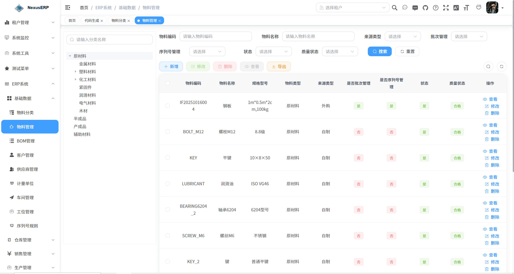
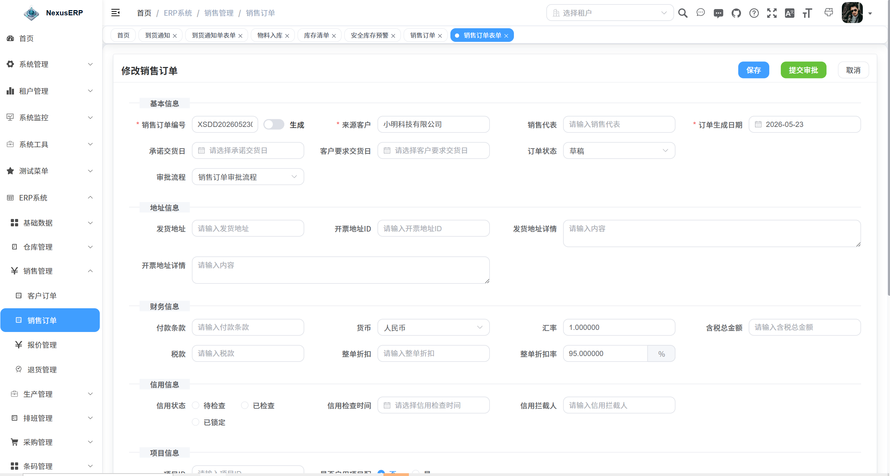
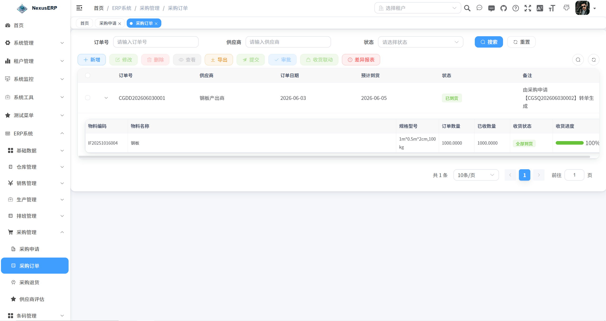
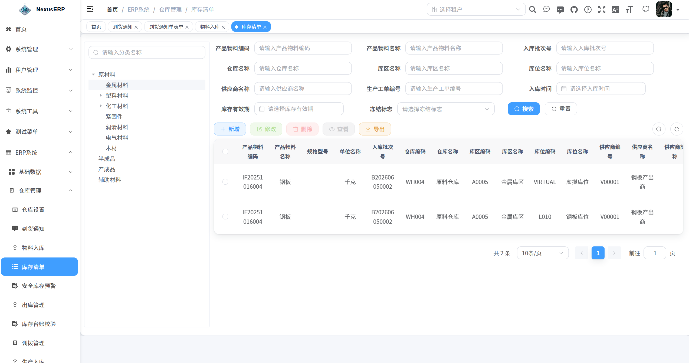
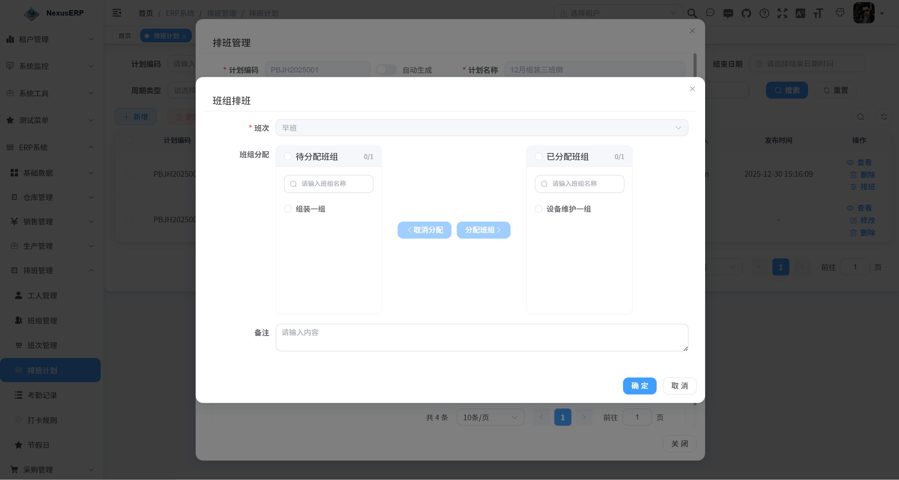
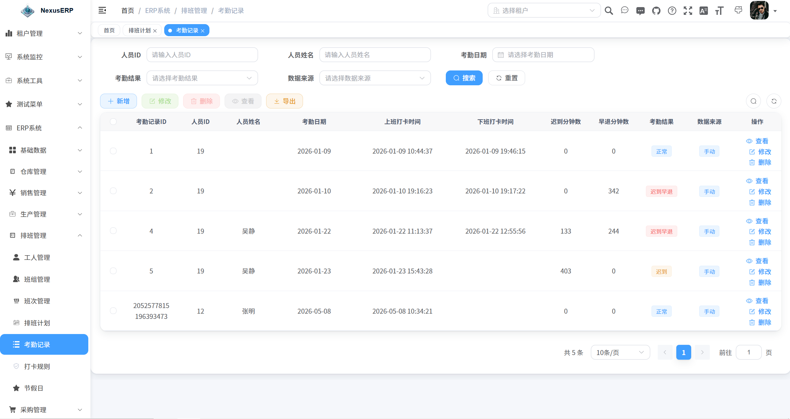
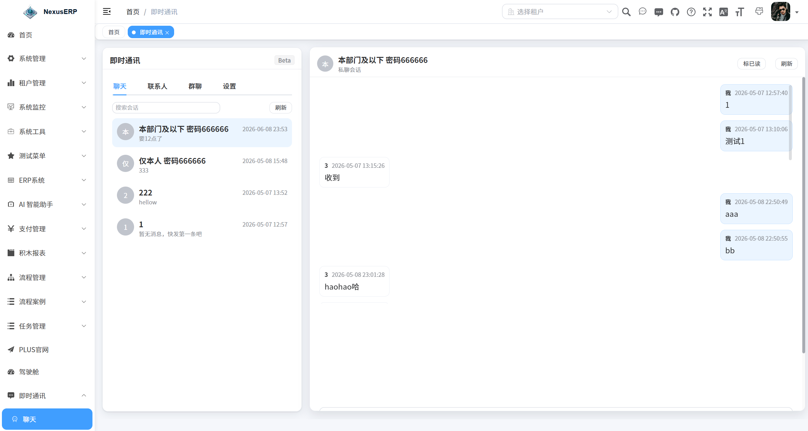

# NexusERP 1.0 正式上线！专为中小制造企业打造的智能ERP，来了

**经过漫长的打磨与迭代，NexusERP 1.0 今天正式上线了。**

做制造业的朋友大概都有过这样的体验：公司用的系统要么是"大而全"但操作复杂到怀疑人生，要么是"小而美"但业务一复杂就撑不住。想上一套ERP，动辄几十万的实施费用让人望而却步；用Excel"凑合着管"，又总是数据对不上、流程追不动。

NexusERP 想解决的，就是这个问题。

---

## 它是什么？

一句话概括：**NexusERP 是一套面向制造业与贸易型企业的开源ERP管理系统**。

它不是那种"看起来什么都有，用起来什么都不行"的花瓶系统。从基础数据、销售、采购、生产、仓储到排产调度，NexusERP 把企业日常经营中最核心的业务流程串成了一条完整的链路——数据可追踪、流程可协同、操作可落地。

---

## 能做什么？来看看核心能力

### 基础数据：一套"干净"的主数据

搞过ERP的人都知道，主数据管理是一切的基础，也是最容易出问题的地方。物料编码混乱、BOM版本对不上、客户信息散落各处……这些都是"看不见的坑"。

NexusERP 提供了统一的基础数据管理：物料主数据（支持编码自动生成）、多级物料分类、多版本BOM（含完整性校验和树形展开）、客户档案、供应商档案、车间与工位、计量单位换算体系等。所有业务模块共享同一套主数据，从源头保证数据一致性。

### 销售管理：从报价到出库，闭环打通

销售端的完整流程是这样的：客户询价 → 创建报价单 → 确认报价 → 一键转为销售订单 → 审批通过 → 驱动生产和出库。

报价单确认后可以一键转换为销售订单，不用再重复录入一遍。销售订单支持完整的状态流转（新建 → 审批 → 确认 → 履行 → 关闭/取消），每一步都有据可查。退货流程同样完整，关联原订单，审批后自动扣减库存。

### 采购管理：从"缺什么"到"买回来"

采购流程最怕两件事：一是不知道该买什么、买多少；二是买了之后到货没到、入了多少对不清楚。

NexusERP 的做法是：支持从低库存自动生成采购申请——系统扫描所有物料库存，低于安全库存的自动帮你生成申请，不用再手动一个个查。采购申请审批通过后一键转采购订单，订单审批后自动生成到货通知和入库单。收货差异报表让你对"订了多少、到了多少、差多少"一目了然。

对了，还集成了供应商评估功能，交货及时率、质量合格率、价格竞争力自动计算，A/B/C/D等级一目了然，历史趋势折线图和等级分布饼图也安排上了。

### 生产管理：计划 → 需求 → 工单，一条线拉通

生产管理可能是 NexusERP 花心思最多的模块。

创建生产计划后，系统自动根据BOM展开计算物料需求（支持多层级BOM递归展开），然后一键生成生产工单。工单有完整的生命周期：下达 → 开始 → 完工 → 关闭，支持审批流程，支持关联车间、工位、班组。

除了标准生产流程，还覆盖了几个实际场景中很常见但很多系统不管的功能：委外加工（含发料/收货全流程）、返工管理（含出库/入库/报废回写）、产能日历（从排班计划自动生成，支持占用/释放），以及生产报工。

### 仓储管理：比"能记录"更进一步

仓储这块，NexusERP 做得比较扎实。基础层面支持仓库 → 库区 → 库位三级管理，库位支持批量自动生成。出入库类型覆盖了采购入库（含上架确认流程）、生产入库、销售出库、生产领料、杂项出入库、库存调拨，每种都有完整的单据和流程。

进阶层面有几个亮点值得关注：库存盘点支持生成明细 → 实盘录入 → 审批 → 过账调整完整流程；库存台账校验可以自动核对账面数和事务数是否一致，差异自动标红；安全库存预警可以手动触发全量扫描，分级预警；批次管理和序列号管理是追溯的基础；物料追溯支持正向（原材料→成品）和反向（成品→原材料）两种模式，树形视图直观展示完整链路。

### 排产调度：让排班不再头疼

班次定义、班组管理、工人档案、排班计划、员工排班、打卡规则、考勤记录、节假日管理——该有的都有。比较贴心的是节假日管理做了日历可视化视图（带农历显示），以及移动端打卡功能，工人可以直接用手机打卡。

### 工作流引擎：审批这件事，交给流程

NexusERP 集成了 Flowable 7.0 工作流引擎，支持可视化流程设计。销售订单、采购订单、工单、退货、调拨、盘点等主要业务单据都接入了审批流程。

### AI 智能助手：用聊天的方式查数据

这个功能我个人觉得是最有意思的。NexusERP 内置了 AI 对话助手，支持自然语言查询 ERP 数据。比如你可以直接问"上个月采购了多少金额的原材料？"，AI 会自动查询相关表、生成 SQL、执行查询并返回结果。

支持多种AI模型接入（DeepSeek、通义千问、智谱、Ollama），支持知识库检索（RAG），安全方面也做了限制——只允许 SELECT 查询、表名白名单、自动注入租户隔离条件。

### 还有这些

除了上面详细介绍的，还有：支付管理（多支付渠道接入）、积木报表（拖拽式报表设计）、即时通讯、代码生成器、多租户架构……

---

## 技术栈一览

简单列一下，给技术同学参考：

后端基于 Spring Boot 3.5 + MyBatis-Plus，认证用的 Sa-Token + JWT，数据库支持 MySQL（主）+ Oracle/PostgreSQL/SQLServer（可选），缓存用 Redis + Redisson，工作流是 Flowable 7.0，AI框架是 LangChain4j。

前端是 Vue 3 + TypeScript + Vite 7 + Element Plus + Pinia，组件库和开发体验都跟上了主流。

---

## 怎么体验？

说了这么多，不如自己动手试试。

**在线演示地址：http://nexuserp.website/index**
**账号：admin**
**密码：admin123**

> 演示环境主要用于体验功能，建议不要录入真实业务数据。

**开源仓库：https://gitee.com/helloworld_wh18/nexus-erp**

NexusERP 采用 MIT 开源协议，欢迎 Star、Fork、提 Issue，也欢迎参与共建。

---

## 写在最后

NexusERP 1.0 不是终点，而是一个起点。

接下来还会继续完善质量管理、设备管理、批次追溯、财务基础等能力，也会持续增强 AI 智能助手的场景覆盖——目标是让 AI 不只是一个"查数据的工具"，而是真正成为能辅助业务决策的智能伙伴。

做ERP这件事，道阻且长。但我们相信，好的工具不应该是大企业的专属，中小企业同样值得拥有一套"用得起、用得好、用得久"的ERP系统。

NexusERP 1.0，来了。欢迎试用，欢迎反馈。
