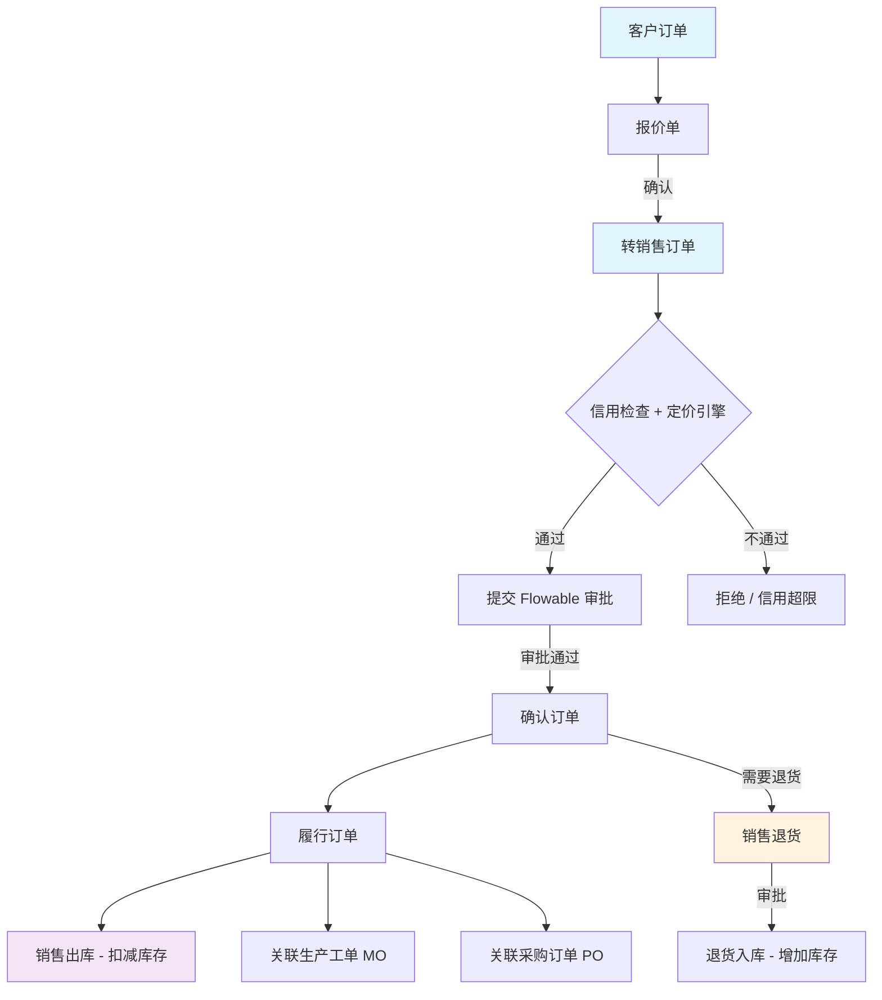
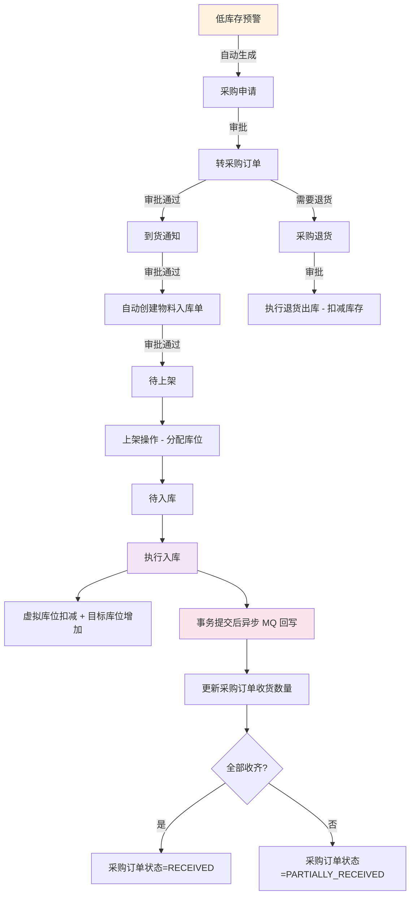
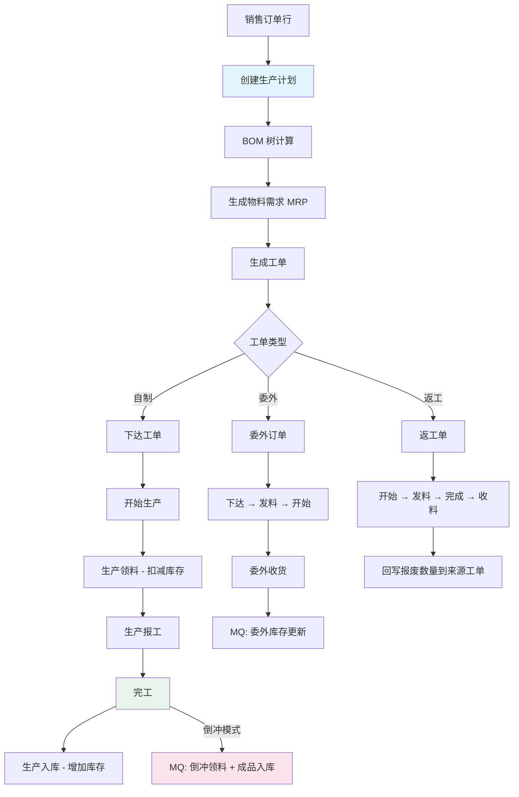
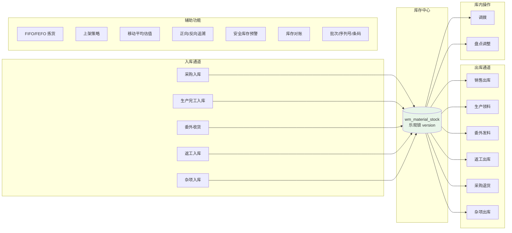
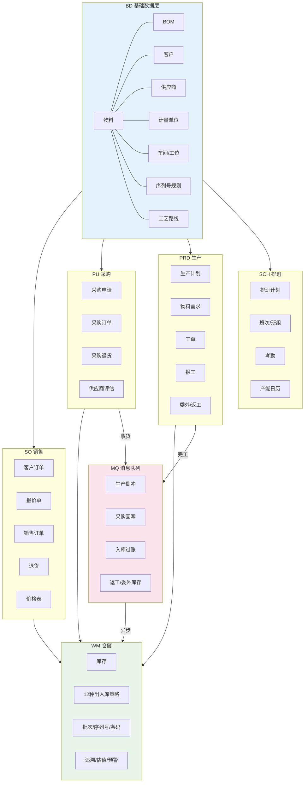
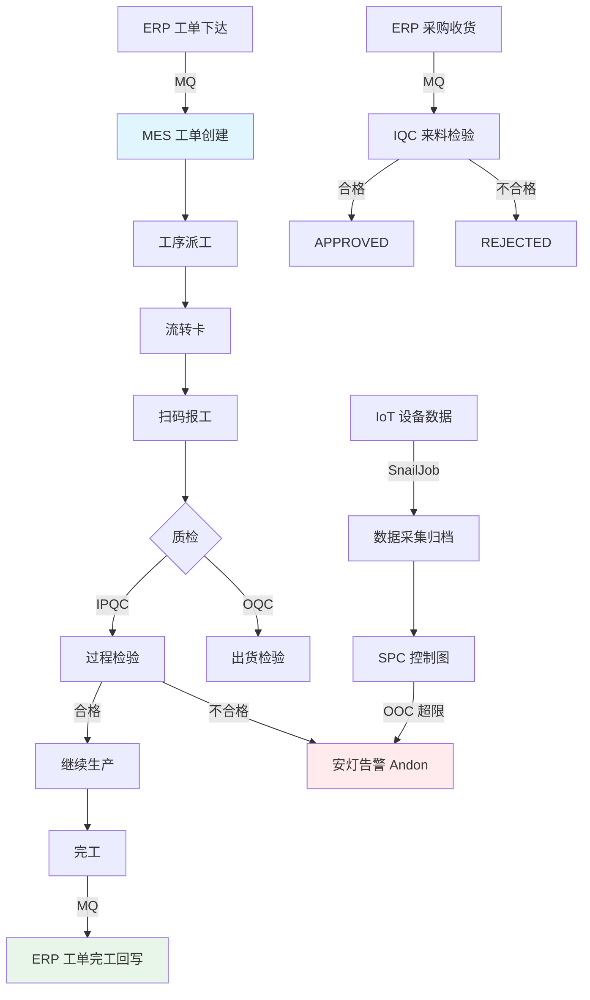
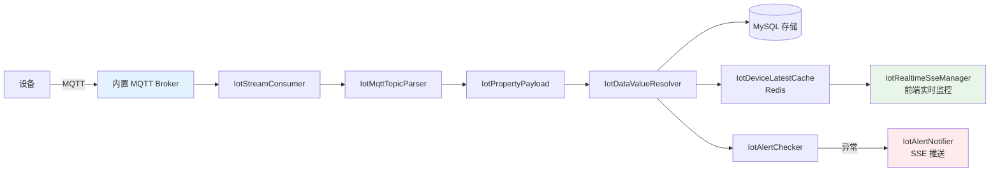

# NexusERP 功能开发进度

> 更新日期: 2026-07-29
> 状态图例: ✅ 已完成 | 🚧 进行中 | ⬜ 未开发 | 🗑️ 暂时搁置

---

## 一、总体概览

| 模块 | 功能点数 | ✅ 已完成 | 🚧 进行中 | ⬜ 未开发 | 🗑️ 搁置 |
|------|---------|----------|----------|----------|---------|
| **ERP 基础数据 (bd)** | 20 | 20 | 0 | 0 | 0 |
| **ERP 销售管理 (so)** | 14 | 13 | 1 | 0 | 0 |
| **ERP 采购管理 (pu)** | 15 | 14 | 0 | 1 | 0 |
| **ERP 生产管理 (prd)** | 18 | 17 | 1 | 0 | 0 |
| **ERP 排产调度 (sch)** | 15 | 13 | 0 | 2 | 0 |
| **ERP 仓储管理 (wm)** | 39 | 36 | 2 | 1 | 0 |
| **ERP 跨模块 (MQ/枚举)** | 14 | 13 | 0 | 1 | 0 |
| **MES 制造执行** | 36 | 36 | 0 | 0 | 0 |
| **IoT 物联网** | 18 | 16 | 0 | 2 | 0 |
| **AI 智能助手** | 25 | 21 | 2 | 2 | 0 |
| **IM 即时通讯** | 9 | 8 | 1 | 0 | 0 |
| **Pay 支付** | 5 | 4 | 0 | 1 | 0 |
| **Workflow 工作流** | 27 | 25 | 0 | 2 | 0 |
| **Report 报表** | 3 | 2 | 0 | 1 | 0 |
| **合计** | **258** | **238** | **7** | **13** | **0** |

---

## 二、跨模块业务流程图

### 2.1 销售到收款 (Order-to-Cash)

### 2.2 采购到付款 (Procure-to-Pay)

### 2.3 生产制造 (Manufacturing)

### 2.4 仓储管理全景

### 2.5 跨模块总览

### 2.6 MES 制造执行流程

### 2.7 IoT 数据流

---

## 三、ERP 模块功能进度

### 3.1 基础数据 (bd)

#### 第一层：基础 CRUD

| 功能 | 后端 | 前端 | 状态 |
|------|------|------|------|
| 物料管理 CRUD + 导入导出 | BdMaterialController | bd/material/index.vue | ✅ |
| 物料分类 CRUD (树形) | BdMaterialCategoryController | bd/category/index.vue | ✅ |
| 计量单位 CRUD | BdUnitOfMeasureController | bd/measure/index.vue | ✅ |
| 客户信息 CRUD + 导入导出 | BdClientController | bd/client/index.vue | ✅ |
| 供应商信息 CRUD + 导入导出 | BdVendorController | bd/vendor/index.vue | ✅ |
| 车间信息 CRUD + 导入导出 | BdWorkshopController | bd/workshop/index.vue | ✅ |
| 工作中心 CRUD + 导入导出 | BdWorkstationController | bd/workstation/index.vue | ✅ |
| 工序定义 CRUD + 导入导出 | BdProcessController | bd/process/index.vue | ✅ |
| 序列号规则 CRUD (MOD10/MOD11) | BdSerialNumberRuleController | bd/serial-number-rule/index.vue | ✅ |

#### 第二层：关联与规则

| 功能 | 后端 | 前端 | 状态 |
|------|------|------|------|
| 物料-供应商关系管理 CRUD | BdMaterialVendorController | bd/material-vendor/index.vue | ✅ |
| 物料-供应商价格对比报表 | BdMaterialVendorReportController | — | ✅ |
| BOM 管理 CRUD + 树形展开 | BdBomController | bd/bom/index.vue | ✅ |
| BOM 明细 CRUD + 导入导出 | BdBomDetailController | bd/bom/form.vue | ✅ |
| BOM 替代料管理 | BdBomAlternativeController | bd/bom/alternative/ | ✅ |
| 工艺路线 CRUD + 工序步骤 | BdRoutingController | bd/routing/index.vue | ✅ |

#### 第三层：高级能力

| 功能 | 后端 | 前端 | 状态 |
|------|------|------|------|
| BOM 虚拟件跳层 + 来源类型编码统一 | BdBomController (enhanced) | bd/bom/index.vue | ✅ |
| BOM 成本卷积 | BdBomController.costRollup | — | ✅ |
| BOM 比较 | BdBomController.compare | — | ✅ |
| BOM N+1 消除 (批量预加载) | BdBomMapper batch methods | — | ✅ |
| 物料-供应商 isDefault 唯一性约束 | BdMaterialVendorController | — | ✅ |

---

### 3.2 销售管理 (so)

#### 第一层：基础 CRUD

| 功能 | 后端 | 前端 | 状态 |
|------|------|------|------|
| 客户订单 CRUD + 导入导出 | SoCustomerOrderController | so/customerorder/index.vue | ✅ |
| 销售报价单 CRUD + 导入导出 | SoQuotationController | so/quotation/index.vue | ✅ |
| 销售价格表 CRUD + 导入导出 | SoPriceListController | so/price-list/index.vue | ✅ |
| 销售合同 CRUD + 导入导出 | SoContractController | so/contract/index.vue | ✅ |
| 销售发票 CRUD + 导入导出 | SoInvoiceController | so/invoice/index.vue | ✅ |

#### 第二层：业务流转

| 功能 | 后端 | 前端 | 状态 |
|------|------|------|------|
| 销售订单 CRUD + 状态流转 | SoSalesOrderHeaderController | so/orderheader/index.vue | ✅ |
| 报价确认 → 转销售订单 | SoQuotationController.convertToOrder | so/quotation/form.vue | ✅ |
| 销售退货 CRUD + 确认/执行 | SoReturnController | so/return/index.vue | ✅ |
| 信用检查 + 定价引擎 | ICreditCheckService / IPricingEngineService | — | ✅ |
| Flowable 审批流集成 | SoSalesOrderHeaderController.submit/proc | — | ✅ |
| 销售订单行联动 (MO/PO) | SoSalesOrderLine.linkedMoId/linkedPoId | — | ✅ |

#### 第三层：高级能力

| 功能 | 后端 | 前端 | 状态 |
|------|------|------|------|
| 销售执行报表 + 客户排名 | SoSalesReportController | so/report/index.vue | ✅ |
| SO 履行流程重构 (跨模块联动) | SoSalesOrderHeaderController.fulfill | — | ✅ |
| 销售订单行 → 生产完工 → 入库联动 | 跨模块 MQ | — | 🚧 |

---

### 3.3 采购管理 (pu)

#### 第一层：基础 CRUD

| 功能 | 后端 | 前端 | 状态 |
|------|------|------|------|
| 采购申请 CRUD + 状态流转 | PuPurchaseRequisitionController | pu/requisition/index.vue | ✅ |
| 采购订单 CRUD + 状态流转 | PuPurchaseOrderController | pu/order/index.vue | ✅ |
| 采购合同 CRUD + 导入导出 | PuContractController | pu/contract/index.vue | ✅ |
| 采购退货 CRUD + 确认/执行 | PuPurchaseReturnController | pu/return/index.vue | ✅ |
| 供应商评估 CRUD + 计算 | PuVendorEvaluationController | pu/vendor-evaluation/ | ✅ |
| 部门请购单 CRUD | PoRequisitionController | po/requisition/index.vue | ✅ |

#### 第二层：业务流转

| 功能 | 后端 | 前端 | 状态 |
|------|------|------|------|
| 采购申请 → 转采购订单 | PuPurchaseRequisitionController.convert | — | ✅ |
| 采购订单审批流 (Flowable) | PuPurchaseOrderController.submit/proc | — | ✅ |
| 采购订单状态枚举 (完整状态机) | PurchaseOrderStatusEnum | — | ✅ |
| 采购订单行收货差异处理 | PuPurchaseOrderLineController | — | ✅ |
| 采购合同 → 采购订单联动 | PuContractController | pu/contract/index.vue | ✅ |
| 低库存自动生成采购申请 | generate-from-low-stock | — | ✅ |

#### 第三层：高级能力

| 功能 | 后端 | 前端 | 状态 |
|------|------|------|------|
| 采购执行报表 + 供应商交付率 | PuPurchaseReportController | pu/report/index.vue | ✅ |
| 采购比价 | — | pu/price-comparison/index.vue | ✅ |
| 部门请购 → 采购申请联动 | PoRequisition → PuRequisition | — | ⬜ |

---

### 3.4 生产管理 (prd)

#### 第一层：基础 CRUD

| 功能 | 后端 | 前端 | 状态 |
|------|------|------|------|
| 生产计划 CRUD + 版本管理 | PrdProductionPlanController | prd/prdplan/index.vue | ✅ |
| 生产工单 CRUD + 审批 | PrdWorkOrderController | prd/prdwork/index.vue | ✅ |
| 生产报工 CRUD + 工时统计 | PrdWorkReportController | prd/report/index.vue | ✅ |
| 物料需求清单 CRUD | PrdMaterialRequirementController | prd/requirement/index.vue | ✅ |
| 返工订单 CRUD + 状态流转 | PrdReworkOrderController | prd/rework/index.vue | ✅ |
| 委外订单 CRUD + 状态流转 | PrdSubcontractController | prd/subcontract/index.vue | ✅ |

#### 第二层：业务流转

| 功能 | 后端 | 前端 | 状态 |
|------|------|------|------|
| 生产计划 → BOM 计算 → 物料需求 | PrdProductionPlanController | — | ✅ |
| 物料需求 → 生成工单 (MRP) | PrdProductionPlanController | — | ✅ |
| 工单状态枚举 (完整状态机) | WoStatusEnum | — | ✅ |
| 产能日历管理 + 占用/释放 | PrdCapacityCalendarController | prd/capacity-calendar/ | ✅ |
| 工单资源分配 (设备/工装/人力) | PrdWorkOrderResourceController | prd/work-order-resource/ | ✅ |
| 工单状态原子更新防并发 | complete() 使用消息数量 | — | ✅ |

#### 第三层：高级能力

| 功能 | 后端 | 前端 | 状态 |
|------|------|------|------|
| 生产效率报表 | PrdProductionReportController | prd/report/index.vue | ✅ |
| 完工入库单号自动生成 + 库位选择 | WmProductionRecptController | wm/productionrecpt/ | ✅ |
| 生产计划 → 工单 → 完工状态流转全链路 | 跨模块 | — | 🚧 |
| 生产领料可用库存实时展示 | WmProductionIssueController | — | ✅ |
| MES 工单完工回写 ERP | ErpWorkOrderCompletedConsumer | — | ✅ |
| 倒冲模式 (完工后 MQ 异步扣减) | ProductionBackflushConsumer | — | ✅ |

---

### 3.5 排产调度 (sch)

#### 第一层：基础 CRUD

| 功能 | 后端 | 前端 | 状态 |
|------|------|------|------|
| 班次定义 CRUD | SchShiftController | sch/shift/index.vue | ✅ |
| 班组设置 CRUD | SchTeamController | sch/team/index.vue | ✅ |
| 生产工人档案 CRUD | SchWorkerController | sch/worker/index.vue | ✅ |
| 考勤记录 CRUD | SchAttendanceController | sch/attendance/index.vue | ✅ |
| 节假日设置 CRUD | SchHolidayController | sch/holiday/index.vue | ✅ |
| 打卡规则 CRUD | SchPunchRuleController | sch/punch-rule/index.vue | ✅ |

#### 第二层：业务流转

| 功能 | 后端 | 前端 | 状态 |
|------|------|------|------|
| 排班计划 CRUD | SchPlanController | sch/plan/index.vue | ✅ |
| 计划-班组关联 | SchPlanTeamController | sch/plan/ | ✅ |
| 班组排班模板 (周/月) | SchTeamScheduleController | sch/plan/ | ✅ |
| 员工排班明细 | SchEmployeeScheduleController | sch/employee-schedule/ | ✅ |
| 产能日历 → 工单占用/释放 | PrdCapacityCalendarController | — | ✅ |

#### 第三层：移动端

| 功能 | 后端 | 前端 | 状态 |
|------|------|------|------|
| App 端打卡考勤 (签到/签退/统计) | AppSchAttendanceController | 移动端 | ✅ |
| App 端排班查询 | AppSchAttendanceController | 移动端 | ✅ |
| WiFi/蓝牙位置验证打卡 | 打卡规则配置 | — | ⬜ |
| 考勤异常自动告警 | — | — | ⬜ |

---

### 3.6 仓储管理 (wm)

#### 第一层：基础结构

| 功能 | 后端 | 前端 | 状态 |
|------|------|------|------|
| 仓库管理 CRUD + 树形 | WmWarehouseController | wm/warehouse/index.vue | ✅ |
| 库区管理 CRUD | WmStorageAreaController | wm/warehouse/ | ✅ |
| 库位管理 CRUD + 批量生成 | WmStorageLocationController | wm/warehouse/ | ✅ |
| 库存清单 CRUD + 按分类查看 | WmMaterialStockController | wm/stock/index.vue | ✅ |
| 库存事务记录查询 | WmMaterialStockTxController | — | ✅ |
| 3D 仓库可视化 (M1 基础渲染) | WmWarehouseController.3d | wm/warehouse/3d.vue | ✅ |
| 3D 仓库 M2 交互增强 + M3 货架排版 | — | wm/warehouse/3d.vue | ✅ |

#### 第二层：入库通道

| 功能 | 后端 | 前端 | 状态 |
|------|------|------|------|
| 到货通知 CRUD | WmArrivalNoticeController | wm/arrivalnotice/ | ✅ |
| 到货通知行 CRUD | WmArrivalNoticeLineController | — | ✅ |
| 物料入库单 CRUD + 审批 | WmMaterialReceiveController | wm/receive/ | ✅ |
| 入库单行/明细 CRUD | WmMaterialReceiveLineController | wm/receive/ | ✅ |
| 执行入库 (虚拟库位→目标库位) | WmMaterialReceiveController.executeReceive | — | ✅ |
| 上架操作 (分配库位 + 确认) | WmMaterialReceiveController.confirmShelf | — | ✅ |
| 完工入库 (生产入库) | WmProductionRecptController | wm/productionrecpt/ | ✅ |
| 杂项入库 + 执行 | WmMiscRecptController | wm/miscrecpt/ | ✅ |

#### 第三层：出库通道

| 功能 | 后端 | 前端 | 状态 |
|------|------|------|------|
| 销售出库 CRUD + 审批 | WmSalesIssueController | wm/sales-issue/ | ✅ |
| 生产领料 + 执行 | WmProductionIssueController | wm/productionissue/ | ✅ |
| 杂项出库 + 执行 | WmMiscIssueController | wm/miscissue/ | ✅ |
| 采购退货出库 | PuPurchaseReturnController | pu/return/ | ✅ |

#### 第四层：库内操作

| 功能 | 后端 | 前端 | 状态 |
|------|------|------|------|
| 库存调拨 CRUD + 审批 + 执行 | WmTransferController | wm/transfer/ | ✅ |
| 盘点管理 CRUD + 生成明细 + 过账 | WmStockTakingPlanController | wm/stocktaking/ | ✅ |
| 安全库存预警 CRUD | WmStockAlertController | wm/stock-alert/ | ✅ |
| 库存台账校验 | WmStockReconciliationController | wm/reconciliation/ | ✅ |

#### 第五层：辅助功能

| 功能 | 后端 | 前端 | 状态 |
|------|------|------|------|
| 拣货策略 (FIFO/FEFO) | WmPickingRuleController | wm/pickingrule/ | ✅ |
| 上架策略 | WmPutawayRuleController | wm/putawayrule/ | ✅ |
| 库存估值 (移动平均法) | WmValuationController | wm/valuation/ | ✅ |
| 正向/反向追溯 | WmTraceController | wm/trace/ | ✅ |
| 批次管理 CRUD | WmBatchController | wm/batch/ | ✅ |
| 序列号管理 CRUD | WmSnController | wm/sn/ | ✅ |
| 条码管理 CRUD + 生成 | WmBarcodeController | wm/barcode/ | ✅ |
| 条码规则配置 | WmBarcodeConfigController | wm/barcode/config/ | ✅ |
| 库存汇总 + 库龄分析报表 | WmInventoryReportController | wm/report/index.vue | ✅ |

#### 第六层：库存预留 (Phase B)

| 功能 | 后端 | 前端 | 状态 |
|------|------|------|------|
| 库存预留 DDL + Entity + Mapper | WmStockReservation | — | ✅ |
| 库存预留 Service + 事务类型 | WmStockReservationService | — | ✅ |
| SO 确认 + 工单下达 + 出库消费集成 | 跨模块联动 | — | ✅ |
| 库存预留前端页面 | — | wm/reservation/ | 🚧 |
| 拣货策略库存预留优化 | 拣货+预留联动 | — | ✅ |

#### 搁置/未开发

| 功能 | 说明 | 状态 |
|------|------|------|
| 按仓库/库区/库位过滤库存查询 | 已部分实现（按仓库过滤） | 🚧 |
| 多仓库间自动调拨建议 | 未开发 | ⬜ |

---

### 3.7 跨模块 (MQ / 枚举)

| 功能 | 实现 | 状态 |
|------|------|------|
| 生产完工倒冲消费者 | ProductionBackflushConsumer | ✅ |
| 采购收货回写消费者 | PurchaseReceiveWritebackConsumer | ✅ |
| 入库消息分发消费者 | StockInConsumer | ✅ |
| 返工库存消费者 | ReworkStockConsumer | ✅ |
| 委外库存消费者 | SubcontractStockConsumer | ✅ |
| 工单下达消费者 (MES 占位) | WorkOrderReleaseConsumer | ✅ |
| MES 工单完工 → ERP 回写 | ErpWorkOrderCompletedConsumer | ✅ |
| IQC 完成 → ERP 质检状态回写 | ErpIqcCompletedConsumer | ✅ |
| 库存操作类型枚举 (14 种) | StockOperationTypeEnum | ✅ |
| 工单状态枚举 (7 状态 + 转换矩阵) | WoStatusEnum | ✅ |
| 采购订单状态枚举 (9 状态) | PurchaseOrderStatusEnum | ✅ |
| 跨库事务补偿框架 (7 层可靠性) | WmMqSendService + mq_message_record | ✅ |
| MQ 重试计数机制 | 修复后 | ✅ |
| 消息死信队列处理 | — | ⬜ |

---

## 四、MES 模块功能进度

### 4.1 生产管理 (pro)

#### 第一层：基础能力

| 功能 | 后端 | 前端 | 状态 |
|------|------|------|------|
| MES 工单 CRUD + 状态流转 | ProWorkOrderController | pro/workorder/ | ✅ |
| 工序派工 (分配工人/工位) | ProDispatchController | pro/dispatch/ | ✅ |
| 流转卡 CRUD + 进度跟踪 | ProFlowCardController | pro/flow-card/ | ✅ |
| 流转卡创建数量校验 | ProFlowCardController | — | ✅ |
| 扫码报工 (ScanExecute) | ProDispatchController | pro/dispatch/ScanExecute.vue | ✅ |

#### 第二层：追溯与告警

| 功能 | 后端 | 前端 | 状态 |
|------|------|------|------|
| SN 序列号管理 + 生成/分配 | ProSnController | pro/sn/ | ✅ |
| 组件级正向/反向追溯 | ProTraceabilityController | pro/sn/trace.vue | ✅ |
| 安灯告警 CRUD + SSE 推送 | ProAndonController | pro/andon/ | ✅ |
| MBOM (制造 BOM) 管理 | MesMbomController | pro/mbom/ | ✅ |

#### 第三层：主数据桥接

| 功能 | 说明 | 状态 |
|------|------|------|
| MES 主数据 - BOM 查看 | 复用 ERP BdMaterialBomController | ✅ |
| MES 主数据 - 物料查看 | 复用 ERP BdMaterialController | ✅ |
| MES 主数据 - 工艺路线查看 | 复用 ERP BdRoutingController | ✅ |
| MES-IoT 设备软链接 | MesErpBridgeService | ✅ |

---

### 4.2 数据采集 (dc)

| 功能 | 后端 | 前端 | 状态 |
|------|------|------|------|
| 采集点配置 (AUTO/MANUAL) | DcCollectionPointController | dc/collection-point/ | ✅ |
| 数据记录查询 + 归档 | DcDataRecordController | dc/data-record/ | ✅ |
| IoT 自动归档 dc_data_record | IotDataArchiveTask (SnailJob) | — | ✅ |
| AUTO 采集点 IoT 数据同步 | SnailJob 定时任务 | — | ✅ |

---

### 4.3 设备管理 (eq)

| 功能 | 后端 | 前端 | 状态 |
|------|------|------|------|
| 设备台账 CRUD + 状态跟踪 | EqEquipmentController | eq/equipment/ | ✅ |
| 保养计划 CRUD | EqMaintenancePlanController | eq/maintenance/ | ✅ |
| 维修记录 CRUD + 成本 | EqRepairController | eq/repair/ | ✅ |
| 设备点检执行 + 异常联动安灯 | EqEquipmentController.inspection | eq/inspection/ | ✅ |
| 保养到期 SnailJob + SSE + 安灯 | MaintenanceDueTask | — | ✅ |
| 设备点检前端页面 + API | — | eq/inspection/ | ✅ |
| 设备 OEE 综合效率分析 | — | — | ✅ |
| 设备备件管理 | — | — | ✅ |

---

### 4.4 质量管理 (qc)

| 功能 | 后端 | 前端 | 状态 |
|------|------|------|------|
| IQC 来料检验 CRUD + 合格/不合格 | QcIqcController | qc/iqc/ | ✅ |
| IQC 自动创建 (ERP 收货审批触发) | IqcAutoCreateConsumer | — | ✅ |
| IPQC 过程检验 CRUD | QcIpqcController | qc/ipqc/ | ✅ |
| OQC 出货检验 CRUD | QcOqcController | qc/oqc/ | ✅ |
| 不合格品处理流程 (MRB/NCR) | — | — | ✅ |
| 质量追溯 (批次→检验记录) | — | — | ✅ |

---

### 4.5 统计过程控制 (spc)

| 功能 | 后端 | 前端 | 状态 |
|------|------|------|------|
| 控制图定义 (X-bar/R 等, UCL/LCL/CL) | SpcControlChartController | spc/control-chart/ | ✅ |
| 数据点管理 | SpcDataPointController | spc/data-point/ | ✅ |
| SPC OOC 超限自动触发安灯 | SnailJob + Andon | — | ✅ |
| 过程能力分析 (Cp/Cpk) | — | — | ✅ |
| 控制图趋势分析前端可视化 | — | — | ✅ |

---

## 五、IoT 模块功能进度

### 5.1 设备管理 (device)

| 功能 | 后端 | 前端 | 状态 |
|------|------|------|------|
| 产品 (设备模板) CRUD | IotProductController | product/ | ✅ |
| 设备实例注册/管理 | IotDeviceController | device/ | ✅ |
| 设备在线/离线状态 | IotDeviceStatusCache (Redis) | — | ✅ |
| 设备密钥自动生成 | IotDeviceController | — | ✅ |
| 设备数据查询 | IotDeviceController | — | ✅ |
| 实时数据 SSE 推送 | IotRealtimeSseManager | device/realtime.vue | ✅ |

### 5.2 消息管道 (pipeline)

| 功能 | 说明 | 状态 |
|------|------|------|
| MQTT 消息流消费 | IotStreamConsumer | ✅ |
| Topic 解析 | IotMqttTopicParser | ✅ |
| 属性提取 | IotPropertyPayload | ✅ |
| 数据类型转换 | IotDataValueResolver | ✅ |
| 实时告警检测 | IotAlertChecker | ✅ |
| 告警通知推送 | IotAlertNotifier | ✅ |
| 设备最新数据缓存 (Redis) | IotDeviceLatestCache | ✅ |

### 5.3 定时任务

| 功能 | 说明 | 状态 |
|------|------|------|
| 设备心跳检测 (15min 超时→OFFLINE) | IotDeviceHeartbeatTask | ✅ |
| 历史数据清理 (90 天) | IotDataCleanupTask | ✅ |
| Redis Stream 裁剪 (100K 上限) | IotStreamTrimTask | ✅ |

### 5.4 未开发

| 功能 | 说明 | 状态 |
|------|------|------|
| 设备 OTA 固件升级 | 远程升级 | ⬜ |
| 设备分组/标签管理 | 批量管理 | ⬜ |

---

## 六、AI 模块功能进度

### 6.1 核心 AI 能力

| 功能 | 后端 | 前端 | 状态 |
|------|------|------|------|
| AI 厂商管理 CRUD | AiProviderController | model/provider.vue | ✅ |
| 模型配置 CRUD + 动态构建缓存 | AiModelController | model/index.vue | ✅ |
| AI 对话 (SSE 流式响应) | AiChatController | assistant/index.vue | ✅ |
| 会话管理 + 历史记录 | AiChatController | — | ✅ |
| Prompt 模板管理 | AiPromptTemplateController | prompt/index.vue | ✅ |
| Token 用量统计 + 趋势/排名 | AiTokenUsageController | tokenUsage/ | ✅ |
| SQL Few-Shot 示例管理 | AiSqlExampleController | sqlExample/ | ✅ |
| A/B 测试 (异步执行 + 人工评分) | AiAbTestController | abTest/ | ✅ |
| 文生图 (通义万象 + OSS 持久化) | AiImageController | imageGen/ | ✅ |

### 6.2 知识库与检索

| 功能 | 后端 | 前端 | 状态 |
|------|------|------|------|
| 知识库/文档/分块 CRUD | AiKnowledgeController | knowledge/ | ✅ |
| 文档上传 + 重试 | AiKnowledgeController | — | ✅ |
| 检索测试 | AiKnowledgeController | — | ✅ |
| 知识图谱构建/查询/邻居/社区/全局 | AiKnowledgeGraphController | knowledge/graph.vue | ✅ |
| 知识图谱全屏功能 | — | knowledge/graph.vue | ✅ |

### 6.3 MCP 工具

| 功能 | 后端 | 前端 | 状态 |
|------|------|------|------|
| MCP 工具 CRUD + 测试执行 | McpToolController | mcp/ | ✅ |
| MCP 市场 (远程工具列表 + 一键加载) | McpMarketController | mcp/market.vue | ✅ |

### 6.4 AI 高级能力

| 功能 | 说明 | 状态 |
|------|------|------|
| 推理模式 (Reasoning) | S2-B | ✅ |
| 多厂商路由 + Rerank | S2-B | ✅ |
| 联网搜索 | S2-C | ✅ |
| 异步线程租户上下文传播 | AiRequestContext | ✅ |
| 自部署 NexusAI 集成 | 自有模型 | ✅ |
| RAG + 知识图谱混合检索 | GraphRAG | 🚧 |
| Agent 自主工具调用 (多轮) | LangChain4j Agentic | 🚧 |
| 跨系统 Agent 编排 (MES/IoT/ERP) | Phase 3 | ⬜ |
| 工作流 Agent (审批自动化) | Phase 4 | ⬜ |

---

## 七、IM 即时通讯功能进度

| 功能 | 后端 | 前端 | 状态 |
|------|------|------|------|
| 私聊消息发送/接收 | ImChatController | chat/index.vue | ✅ |
| 群聊消息发送/接收 | ImChatController | — | ✅ |
| 会话列表 | ImChatController | — | ✅ |
| 群组 CRUD + 成员管理 | ImChatController | — | ✅ |
| 消息撤回 | ImChatController | — | ✅ |
| 系统通知 CRUD + 标记已读 | SysUserNotificationController | 系统组件 | ✅ |
| SSE 实时消息推送 | ImRealtimePush | — | ✅ |
| App 端即时通讯 (好友/群组/消息) | AppImController | 移动端 | ✅ |
| 消息已读/未读状态 | — | — | 🚧 |

---

## 八、Pay 支付功能进度

| 功能 | 后端 | 前端 | 状态 |
|------|------|------|------|
| 统一支付入口 (支付宝/微信) | PayController | paytest/ | ✅ |
| 支付订单管理 CRUD | PayOrderController | order/ | ✅ |
| 发票管理 CRUD | PayInvoiceController | invoice/ | ✅ |
| 支付回调处理 | PayController | — | ✅ |
| 对账功能 | — | — | ⬜ |

---

## 九、Workflow 工作流功能进度

### 9.1 流程设计

| 功能 | 后端 | 前端 | 状态 |
|------|------|------|------|
| 流程分类管理 | WfCategoryController | category/ | ✅ |
| 流程模型管理 | WfModelController | model/ | ✅ |
| BPMN 流程设计器 | — | package/ProcessDesigner.vue | ✅ |
| 流程部署管理 | WfDeployController | deploy/ | ✅ |
| 设计器表单管理 | WfNformController | nform/ | ✅ |
| 业务自定义表单 | WfCustomFormController | custom-form/ | ✅ |

### 9.2 流程执行

| 功能 | 后端 | 前端 | 状态 |
|------|------|------|------|
| 待办任务列表 | WfTaskController | work/todo.vue | ✅ |
| 已办任务列表 | — | work/finished.vue | ✅ |
| 我发起的流程 | — | work/own.vue | ✅ |
| 可认领任务 | — | work/claim.vue | ✅ |
| 抄送列表 | — | work/copy.vue | ✅ |
| 发起新流程 | — | work/start.vue | ✅ |
| 流程详情查看 | — | work/detail.vue | ✅ |
| 流程详情嵌入业务表单 | WfCustomFormController | — | ✅ |

### 9.3 ERP 审批流集成

| 功能 | 状态 |
|------|------|
| 销售订单审批 | ✅ |
| 销售退货审批 | ✅ |
| 采购申请审批 | ✅ |
| 采购订单审批 | ✅ |
| 采购退货审批 | ✅ |
| 生产工单审批 | ✅ |
| 物料入库审批 | ✅ |
| 销售出库审批 | ✅ |
| 调拨单审批 | ✅ |
| 盘点计划审批 | ✅ |
| 到货通知审批 | ✅ |
| 自定义审批规则引擎 | ⬜ |
| 催办/加签/转办 | ⬜ |

---

## 十、Report 报表功能进度

| 功能 | 前端 | 状态 |
|------|------|------|
| 报表仪表盘 (JimuReport) | report/dashboard/ | ✅ |
| 报表设计器 (JimuReport) | report/design/ | ✅ |
| 自定义数据源报表 | — | ⬜ |

---

## 十一、搁置/未开发功能汇总

### 🗑️ 暂时搁置

| 模块 | 功能 | 原因/备注 |
|------|------|----------|
| AI | Phase 3-6 (MES/IoT/跨系统/工作流 Agent) | 待 MES/IoT 成熟后启动 |

### ⬜ 未开发 (按优先级排列)

| 优先级 | 模块 | 功能 | 预估工时 |
|--------|------|------|----------|
| P1 | ERP | 库存预留前端页面 | 1d |
| P2 | IoT | 设备 OTA 固件升级 | 3d |
| P2 | IoT | 设备分组/标签管理 | 1d |
| P2 | AI | RAG + 知识图谱混合检索优化 | 2d |
| P2 | AI | Agent 多轮自主工具调用 | 3d |
| P3 | ERP | 部门请购→采购申请联动 | 1d |
| P3 | ERP | 多仓库间自动调拨建议 | 2d |
| P3 | ERP | WiFi/蓝牙位置验证打卡 | 2d |
| P3 | ERP | 考勤异常自动告警 | 1d |
| P3 | IM | 消息已读/未读状态 | 1d |
| P3 | Pay | 对账功能 | 2d |
| P3 | Report | 自定义数据源报表 | 1d |
| P3 | Workflow | 自定义审批规则引擎 | 3d |
| P3 | Workflow | 催办/加签/转办 | 2d |
| P3 | MQ | 消息死信队列处理 | 1d |

---

## 十二、相关文档索引

| 文档 | 路径 |
|------|------|
| ERP 业务流转分析 | [erp/NexusERP_业务流转分析.md](./erp/NexusERP_业务流转分析.md) |
| ERP 编码生成规则 | [erp/NexusERP_编码生成规则设计方案.md](./erp/NexusERP_编码生成规则设计方案.md) |
| ERP 主文档 | [erp/NexusERP_ERP文档.md](./erp/NexusERP_ERP文档.md) |
| MES 主文档 | [mes/NexusERP_MES文档.md](./mes/NexusERP_MES文档.md) |
| IoT 主文档 | [iot/NexusERP_IoT文档.md](./iot/NexusERP_IoT文档.md) |
| AI 开发计划 | [ai/plans/NexusERP_AI开发计划.md](./ai/plans/NexusERP_AI开发计划.md) |
| 三模块升级方案 | [system/NexusERP_三模块共同升级方案.md](./system/NexusERP_三模块共同升级方案.md) |
| 代码审计报告 | [system/NexusERP_代码审计报告与修复进度.md](./system/NexusERP_代码审计报告与修复进度.md) |
| BOM 增强变更文档 | [erp/archive/2026-06-26-erp-bom-enhancement-requirement-change.md](./erp/archive/2026-06-26-erp-bom-enhancement-requirement-change.md) |
