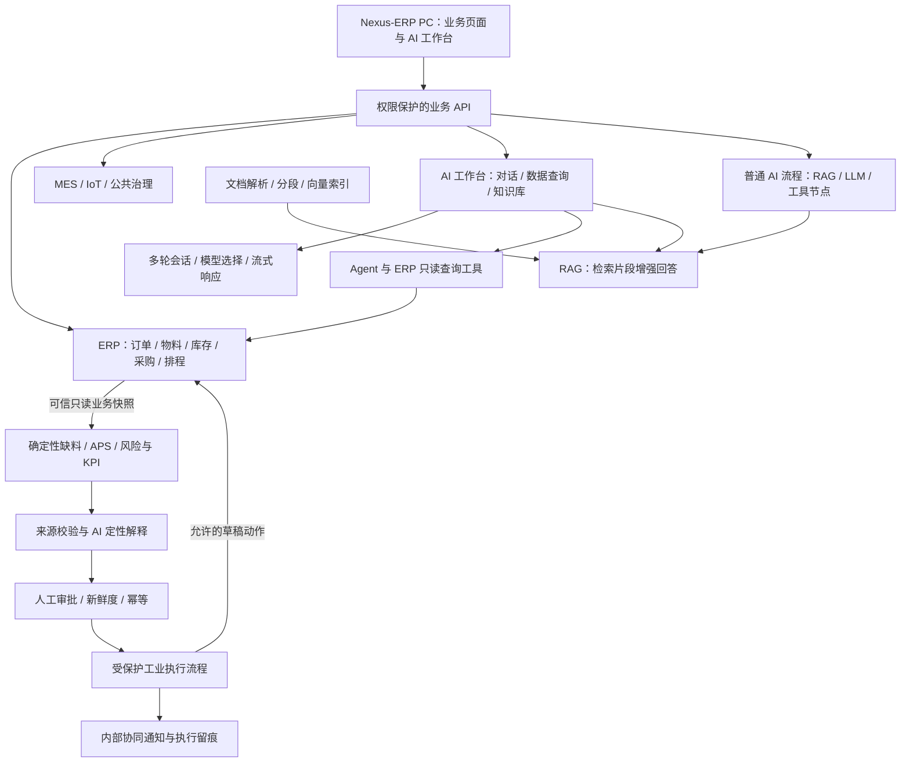

# Nexus-ERP：融合 AI 对话、企业知识与可信决策的开源工业软件

## AI 工作台 × ERP 数据查询 × 知识库 RAG × 流程编排 × 工业决策

**参赛展示主线：对话与业务查询 → 企业知识检索 → AI 流程编排 → 工业交付风险闭环。**

| 项目 | 说明 |
|---|---|
| 适配赛事 | 2026 上海开源软件应用创新大赛 |
| 报名赛道 | AI+ 工业软件赛道（由参赛负责人确认；实际回执另行核验） |
| 主项目 | Nexus-ERP 后端与 PC 管理端；其他 Nexus 项目作为关联扩展简述 |
| 项目负责人 | 王欢（按 Nexus-ERP README 登记；其他贡献者与素材授权提交前核对） |
| 文档核对日期 | 2026-10-07（北京时间） |
| 材料状态 | 作品介绍文字底稿；尚未在本次整理中导出、校对正式 PDF 或核验报名与提交回执 |

> **核心主张：事实可回查、推演可复算、动作须授权、执行可追踪。**
> 本文区分源码实现、历史实测与待验收事项，不把本地软件验证表述为生产部署或现场硬件验收。赛事依据见[官方入口](https://www.oschina.net/os2026/)；源码与报告索引见文末。

## 作品摘要

Nexus-ERP 是面向制造业与贸易型企业的开源综合管理系统，以销售、采购、生产、仓储及制造执行为业务底座，将 AI 对话、ERP 数据查询、企业知识库、流程编排与工业决策集成到同一 PC 管理端。本次参赛聚焦 **AI+ 工业软件**：不是平均展示业务模块，也不是只演一个审批界面，而是展示 AI 如何帮助用户理解问题、获取数据、利用企业知识，并在明确边界内承接业务行动。

AI 工作台支持多轮对话、会话记录、模型选择与流式响应；数据查询模式通过 Agent 和受控查询工具读取 ERP 事实；知识库支持文档管理、解析分段、向量化、检索测试与 RAG 增强回答，并提供知识图谱扩展；Flow 将检索、模型与工具组织为可查看节点结果的流程。模型、提示词、MCP 和用量管理提供可配置的 AI 平台支撑。

以工业交付风险为贯穿示例，用户先在 AI 工作台咨询与查询，再检索处置指引，最后从业务页面进入结构化决策：确定性服务计算缺料、产能和方案 KPI，AI 负责解释，人工批准后仅创建允许的草稿或发送通知。**通用聊天、知识问答与受控工业决策是不同链路，聊天回答不会自动获得业务写入授权。**

作品强调“能对话、能查数、能用企业知识、能编排流程，以及有证据、有授权的工业落地”。Nexus-ERP 始终是主项目；关联移动端、工位端与视觉服务只作简述。

## 一、为什么需要这套系统

一次交付风险判断通常横跨多个岗位和系统：计划员查看工单与排程，采购员跟踪到货，仓库核对库存，车间记录生产进度，质量人员处理检验与扣押。困难不只在于“有没有数据”，更在于这些事实能否被共同理解并形成有责任边界的行动。

| 业务痛点 | 作品的应对方式 |
|---|---|
| 查数依赖复杂报表或开发人员写查询，业务人员难以连续追问 | AI 对话与数据查询入口结合工具调用，查询结果回到 ERP 页面核对 |
| 经验分散在 SOP、手册和处置文档中，难以在业务问题发生时找到 | 文档解析、分段与检索增强，将相关企业资料组织进回答 |
| 工单、需求、库存、在途采购和产能分散，人工反复核对 | 围绕具体业务对象装配带时间、来源和版本的事实快照 |
| 缺料与产能瓶颈相互影响，只看一个报表难以判断交期 | 使用缺料模拟与有限产能排程比较多个候选方案 |
| AI 解释看似合理，却无法确认数字从哪里来 | 数值由确定性代码产生，叙述引用受校验的证据；证据不足则明确拒绝或保留不确定性 |
| 建议与业务执行脱节，或自动化越过审批与权限 | 分离分析和执行；人工选择动作，服务端检查权限、新鲜度与幂等 |
| 管理端、移动端和工位端各自记录，难以回查 | 通过共同后端与业务标识协作；已核验的联动和待验收的端侧功能分别说明 |

**目标用户**包括计划、采购、仓储、车间、质量人员及生产管理者。演示以交付风险问题串起对话、查数、知识与执行，不把聊天能力包装成替代岗位责任或企业审批制度。

## 二、Nexus-ERP 的业务底座与系统架构

### 2.1 主项目的核心能力

| 能力 | 在 Nexus-ERP 中的职责 | 本次材料的展示重点 |
|---|---|---|
| ERP 业务 | 基础数据、销售、采购、生产计划与排程、仓储，并扩展财务业务包与报表 | 工单、需求、库存、采购与已保存计划形成可核对的业务上下文 |
| MES 制造执行 | 派工、流转、SN/批次追踪、报工、设备、IQC/IPQC/OQC、SPC、不合格品与返工、SOP 等 | 简述计划与制造记录的衔接，不逐页罗列功能 |
| IoT 设备数据 | MQTT 接入、设备认证与主题鉴权、数据消费、告警、实时推送及设备管理扩展 | 说明设备数据接入边界，不声称现场设备全部验收 |
| AI 与流程 | 多轮对话、Agent 查询、RAG/知识图谱、模型与工具配置、Flow 编排及工业决策 | 主演示覆盖对话、知识库与流程，再展示受控工业落地 |
| 公共治理 | 多租户、业务权限、工作流、通知、审计、CV 接口和电子签章等 | 说明授权与可追踪机制，不以代码存在代替人工或生产验收 |

这些能力是现有源码范围，不是全部都已通过生产验收的承诺。财务结账、支付实款、PDF 盖章和设备升级不作为本次交付风险演示的必要环节。

### 2.2 主项目架构

**架构边界：**普通 AI 流程和受保护工业执行图分开；聊天、RAG 与 MCP 的输出不自动继承工业决策的数值证据认证。MES/IoT 属于业务支撑，不表示所有设备信号已进入交付评分。当前工业决策通过 ERP Port 读取与执行；NexusAI 是主项目内能力名称，不是另一个独立仓库。

### 2.3 关联扩展（简述）

Nexus-App 提供移动业务与审批协作，Nexus-Station 提供工位作业端，Nexus-Vision-Service 提供独立视觉接口。它们可扩展主项目的移动与现场协同，但本次介绍和录屏均以 Nexus-ERP 为主，不将未核验的多端联动列为必录镜头。

## 三、AI 模块：不仅有决策，还有对话、知识与流程

### 3.1 AI 工作台与多轮对话

智能助手提供 **“自动”“对话”“数据查询”“知识库”** 四种入口，可选择已启用模型，接收流式内容，保存和继续会话。页面还能展示工具调用过程，并提供会话导出、消息反馈等交互。

演示先用“对话”整理交付问题，再在同一会话追问岗位检查清单，让评委看到 AI 是可持续交互的工作入口，而不是一页静态说明。自由对话用于理解与表达，不据此宣称它已读取真实库存或完成证据认证。

### 3.2 Agent 与 ERP 数据查询

“数据查询”模式结合 Supervisor/查询与报告 Agent、内置业务工具和表结构/SELECT 工具获取 ERP 信息。源码中有库存、采购、销售、生产等工具，查询链包含表范围、只读 SQL、租户条件和返回规模约束。

演示选择一个授权的演示物料，查询当前库存及单位，展示实际工具过程，再回业务页面核对结果；必要时可展示基于查询的报告/图表。**工具结束标识不等于查询正确**：错误信息、空结果和模型归纳都要如实说明，不把普通对话写成业务事实。

### 3.3 企业知识库与 RAG

知识库管理提供文档上传、处理状态、分段查看、向量索引及重建入口；检索测试可设置 Top K、阈值、混合检索和重排序。后台组织文档解析、分段、Embedding、向量检索与重排等服务，再将片段注入模型上下文形成 RAG 回答。

主演示展示“演示处置指引 → 已处理文档/片段 → 检索测试 → 知识库模式回答”，使 AI 的企业知识入口可见，不仅展示一句生成结果。文档范围、检索命中和回答内容要分别核对。

**当前实现边界：**聊天页没有知识库选择下拉框，普通 PC 请求未携带指定 knowledgeId，不能假造“选择某库”的操作，也不能从管理页命中推断聊天使用完全相同的检索范围/参数。普通 RAG 提示在无资料时允许一般知识回答，并非强制拒答；管理页主要显示检索片段，不承诺聊天答案都有自动来源卡片、点击引用或逐句认证。

### 3.4 知识图谱扩展

知识库页面提供图谱构建及实体、关系、社区摘要展示，后台有抽取、聚类和全局检索等实现。图谱可辅助理解资料中的对象与关联；若录制环境已有完成构建的授权图谱，可短镜展示，否则只说明代码入口，不用静态图冒充实测。

模型抽取的关系和摘要不是已认证的 ERP 数值事实，不直接作为库存、交期或资源 KPI 的可信来源。

### 3.5 AI 流程编排

普通 Flow 提供画布、参数配置、运行/测试与实例记录，节点包含 RAG 检索、LLM 调用、Agent 和 ERP 工具等。演示使用独立只读“检索 → 模型整理”流程，查看配置、节点状态和真实输出，说明能力可复用而非只固定在聊天窗口。

RAG 节点可以输出 documentName、documentId、chunkId 等结构化来源字段；它与通用聊天展示不同，不将某个节点的来源能力扩写成全模块自动强制引用。受保护工业图不能被这一普通画布任意改写，也不声称通用流程已具备任意人工审批暂停/恢复。

### 3.6 模型、提示词、工具与用量管理

主项目提供厂商/模型配置与动态工厂、提示词管理、MCP 工具接入及 Token 用量入口，支持按实际启用模型和授权工具组合能力。正式视频用少量模型列表与已核验扩展展示即可，不现场修改凭据或进行密集后台配置。

特别地，MCP 筛选按“本次请求 → 会话保存配置 → 全部已启用工具”取值；聊天页空选不会显式禁用，**空选不是禁用外部工具**。录前必须核对工具策略和外部读写授权；Token 用量是统计指标，不是 API Token 凭据，也不保证等于厂商最终账单。

## 四、落地场景：把 AI 能力连接到工业交付风险

1. **咨询与查数：**围绕工单问题在 AI 工作台连续追问，并通过数据查询获取可核对的演示记录。通用聊天不会自动启动决策，转入决策时明确从业务页操作。
2. **利用企业知识：**检索演示处置指引，解释岗位分工和需要复核的事项。文档规则提供定性参考，不替代 ERP 数量、单位、到货和产能事实。
3. **冻结业务事实并确定性推演：**校验租户与业务读取范围，装配工单、需求、库存、采购行、路线、日历和已保存排程。比较保留当前计划、EDD、CR 等实际候选；区分历史 KPI 和方案预测，单位/来源不足则限制计算与排名。
4. **AI 解释与人工选择：**在结构化页面查看摘要、KPI、方案、证据和时间线。这里的模型不能改变数值评分、可信引用、排名或动作白名单；模型失败可降级，必要证据缺失则失败关闭。
5. **审批后受限执行并回查：**允许动作是采购申请草稿、排产方案草稿、内部催货协同通知与管理者通知。采购/排产草稿有必需审批约束，批准和执行重核来源、新鲜度、权限与幂等，再回 ERP 核对对象和状态。

本场景不自动发布排产、不自动审批采购、不执行不可逆库存扣减，也不让模型绕过业务服务写表。催货建议不是供应商确认；部分成功与补偿按实际条件展示，不宣称跨库与外部副作用无条件全局原子。草稿创建、方案预测、真实到货与客户交付收益分别说明，不填写没有现场数据支撑的降本增效比例。

## 五、作品的技术特点与差异化

### 5.1 在业务、知识与确定性计算之间分工

AI 工作台负责多轮交互，Agent 通过查询工具获取数据，RAG 提供企业资料，Flow 组织能力调用；进入受控工业决策后，数值 KPI 与排名由确定性代码产生，模型只解释结果。决策使用结构化 DTO 与业务 Port，不依赖解析聊天 Markdown 决定按钮、状态或业务动作。

这不是把整套 AI 限制为“只写解释”，而是按风险分工：普通聊天/RAG 的生成结果需要复核，受控决策的事实、数值与执行权限另受服务端约束。

### 5.2 证据不仅“可点击”，还要能回查

证据绑定业务对象、指标、快照版本和来源事实。历史排程利用率使用与任务资源、日期范围匹配的已保存日历工时，并复核覆盖与一致性；缺少可信基线时不以候选排程值冒充历史。

当前代码还加强逐物料基础单位、需求分母与缺口比例的核验，避免将不同单位的数量直接相加后用于排名。采购动作进一步绑定服务端冻结的来源与合同约束；缺失认证不是让模型自由填空的入口。这些新增约束的最终发布版验证仍须单独完成。

### 5.3 分开分析、审批和执行

分析流给出结构化候选；人工审批由 Decision 服务约束；受保护的 Flow 执行图只承接已批准动作。通用画布不能任意替换工业受保护图，模型不能自行扩大白名单。

源码实现了过期审批拒绝、重复审批与执行控制、下游草稿结果验证及条件补偿，相关控制还保留了历史 HTTP 验收证据。

### 5.4 以业务中台为基础，而非孤立 AI 演示

Nexus-ERP 的主数据、单据、库存、采购、排程与制造记录为决策提供业务上下文；获批后的草稿和通知仍由原业务服务承接。PC 端能够围绕同一业务对象展示事实、候选、证据、审批与执行记录，而非将分析孤立在聊天窗口中。

这里的价值是**在已有业务系统内形成可扩展、可审计的工业决策链路**，不是声称所有模块和外部集成都已完成联合验收。

## 六、已保存的验证证据，以及它们能证明什么

> 下表引用仓库中带日期的报告。本次材料整理没有重新启动业务服务、连接数据库或重跑后端/前端全量构建。报告结果只适用于各自注明的构建、环境、契约版本和用例，不自动适用于 2026-10-07 之后的代码，也不是正式竞赛或生产验收。新加入的对话、RAG、图谱及普通 AI Flow 演示本次只作源码核查，尚未在录制环境验真，不能并入旧 40 案例通过数。

| 日期与证据 | 已记录结果 | 解释与限制 |
|---|---|---|
| 2026-09-27，[v2 黄金契约 40 案例真实回归](../benchmark/delivery-risk/reports/2026-09-27-golden-v2-40-regression.md) | 40/40 符合该轮 v2 黄金契约；终态为 5 个 SUCCEEDED、29 个 WAITING_APPROVAL、6 个预期证据拒绝 FAILED | 不是 40 个业务执行成功。该轮未审批或执行动作；34 个模型节点成功，摘要为 31 个 FLOW_LLM、3 个模板降级 |
| 同一 v2 回归的性能记录 | 请求至 Runner 观察终态 P50/P95 为 23.745/52.584 秒 | 最多四路并发且部分组件共享；仅用于描述该轮环境，不能声称生产 SLA 或与其他环境直接比较 |
| 2026-09-27，[摘要与 HTTP CONTROL 验收](../benchmark/delivery-risk/reports/2026-09-27-summary-control-http-acceptance.md) | 后续首轮 39/40 PASS；超时案例单独复测 1/1 PASS。报告另记录 11 个安全子项及 2 个基线/库存对账项 | 原超时记录保留；不能把首轮与单例复测拼成“单轮 40/40 性能通过”。控制测试含故障注入，不是所有生产异常的穷尽证明 |
| 2026-10-07，[本地软件业务主链对账](../full-flow/reports/2026-10-07-erp-原领料六件过站与销售发货主链实际对账进展.md) | 记录采购、分批收货/IQC、入库、领料、六件逐件制造/IPQC、生产入库、销售/OQC与发货履约的正常 API 执行及只读对账 | 属于已授权的本地开发测试环境，不代表实物、供应商确认、客户合同、传感器或现场检验验收 |
| 2026-10-07，[仓储写入口修复与回归记录](../full-flow/reports/2026-10-07-erp-仓储写入口与未计价口径修复进展.md) | 报告记录后端 7632 用例零失败/错误/跳过；PC 标准单测中 Node 原生部分 549 用例全通过，并记录 lint、build、type-check | 计数口径以原报告为准，不将额外脚本或定向子集重复相加；不等于全部外部集成或页面人工验收 |

**保留失败与契约变化：**原黄金契约的实测为 16/40；v2 调整有独立审查、批准记录和 v1 归档，不能包装为“从未失败”。后续 CONTROL 阶段使用过多个构建，报告明确仍需最终单一产物的完整重测。当前又新增来源认证、采购约束及排名护栏，因此旧 40 案例报告更不能替代最新版本验收。

评审复核应关注四类证据：**输入与契约版本、原始运行结果、事实/业务对象对账、失败与边界记录**，而不只看一个汇总通过率。复现入口见 [Benchmark 指南](../benchmark/delivery-risk/README.md)，其中旧检查点须结合有日期的后续报告阅读。

### 本次离线复核（2026-10-07）

2026-10-07 首轮材料核查实际运行了以下不访问业务数据库的检查。本轮主项目定位与视频脚本编辑未重跑这些测试，保留首轮通过与报错记录：

| 命令（主仓库根目录执行） | 本次结果 | 证明范围 |
|---|---|---|
| `python -B doc/ai/benchmark/delivery-risk/scripts/test-fixtures.py -v` | 17/17 通过 | 当前固定案例、黄金版本归档及演示 SQL 的离线契约；不是最新决策算法的真实运行结果 |
| `python -B doc/ai/benchmark/delivery-risk/scripts/test-run-benchmark.py -v` | 15/15 通过 | 本机临时模拟 HTTP 服务上的 Runner 契约；不访问 ERP 或 MySQL |
| `python -B doc/ai/benchmark/delivery-risk/scripts/test-isolated-init.py -v` | 5 项中 4 项通过、1 项 ERROR | 当前主 SQL 与隔离导入器尚不兼容；不得称为完整复现预检通过 |

**已定位的复现阻断：**`script/sql/ry-erp.sql` 第 8161 行包含 `DROP PROCEDURE IF EXISTS`，命中 `init-isolated-demo.py` 对存储过程 DDL 的显式禁止规则。对当前文件和最小输入的离线检查均可复现拒绝。本次没有调用初始化或任何数据库写入，也没有修改该安全护栏。应在审查隔离范围和具体 DDL 后对齐初始化方法并重测，不能为了参赛临时绕过安全限制。

## 七、应用价值与开源价值

### 7.1 应用价值：让业务理解与决策过程可以协作

- 对业务人员：用连续对话与自然语言查询减少查数入口切换，用知识检索定位文档与岗位检查事项；回答仍需核对数据和来源。
- 对计划人员：在同一业务对象下比较物料和产能影响，而非只得到无来源的自然语言结论。
- 对采购、仓储与车间人员：围绕具体缺口、来源记录、通知和草稿承接行动，保留岗位授权与业务流程。
- 对管理者：同时查看风险、方案、不确定性与执行留痕，区分“建议采取”与“已经执行”。

上述是系统的设计价值和可观察能力；经济收益、使用规模、行业推广效果与客户满意度尚没有本稿可核验的实测数据，不虚构节省工时或降本比例。

### 7.2 开源价值：AI 链路、算法与安全边界都可阅读

- 公开代码组织覆盖会话/模型、工具与查询、知识处理/RAG、Flow 节点、业务 Port 和 PC 组件，方便定位不同 AI 能力的输入与输出。
- 提供固定案例、版本化黄金期望、隔离演示数据、HTTP Runner 与有日期的报告，支持检查正确性和失败行为。
- 工业决策通过业务 Port、确定性服务与流程适配器组织，可研究、替换或扩展，不将关键业务规则封装在不可检查的模型调用中。
- 主仓库提供 [贡献说明](../../../CONTRIBUTING.md) 与 [安全报告入口](../../../SECURITY.md)；后续社区建设以实际贡献和维护记录衡量，不编造活跃人数或生态规模。

### 7.3 尊重上游与第三方权属

Nexus-ERP 基于 **RuoYi-Vue-Plus v5.6.0** 二次开发。原有后台基础、认证/权限、框架组件及其上游贡献不归为 Nexus 原创。本作品重点介绍工业业务与对话、企业知识、流程及决策的集成；第三方框架、引擎和算法单独致谢，实际附带的扩展项目另行保留其上游署名和授权。

Nexus-ERP 声明 MIT，但**仓库许可证不等于所有依赖、训练数据及模型权重均采用 MIT**。若附带视觉扩展，需另核 Ultralytics 的 AGPL-3.0/商业许可路径、InsightFace 预训练模型及演示数据的使用条件；不笼统宣称“全部模型可无条件商用”。依据见 [Ultralytics 官方许可说明](https://www.ultralytics.com/license)、[InsightFace 官方许可说明](https://github.com/deepinsight/insightface#license) 及视觉仓库的数据来源声明。

## 八、当前限制与后续方向

| 范围 | 当前边界 / 后续工作 |
|---|---|
| 最终发布版验证 | 来源认证、采购合同、单位口径和排名链路持续完善；需冻结发布产物后重跑 40 案例、安全控制与稳定性验证 |
| 隔离初始化 | 本次离线安全预检因主 SQL 存储过程 DDL 报错；需对齐隔离初始化方法并重测，当前不宣称“一键复现已通过” |
| AI 录制验证 | 对话/Agent 查询需真实模型与工具结果；知识库需文档处理/索引与检索验证；普通 Flow 需真实实例。源码存在不等于录制环境可用 |
| RAG 与来源 | 聊天页未指定知识库且无资料时可用一般知识回答；检索片段、回答、图谱与 ERP 认证证据分别核验 |
| 演示范围 | 以 Nexus-ERP PC 为主；移动端、工位端和视觉只作关联说明，未核验的联动不计入主演示闭环 |
| Station 与 IoT | 软件通道与客户端代码不等于真实设备验收；传感器、串口、烧录器、离线行为和现场过站分别验证 |
| 视觉模型与数据 | 演示训练指标不等于业务现场效果；先核对许可、场景与误识别边界，再开展现场验证 |
| 电子签章 | 不将代码实施等同人工端到端签署验收；PDF 盖章属于独立范围 |
| 业务收益 | 本地软件主链已留有报告；客户现场的交付改善与经济收益仍需实测 |
| 演示交付 | 本稿不是成片、正式 PDF、发布制品或提交回执；录制和导出后另行校对 |

后续工作优先收敛**主项目最终产物可复现、安全与事实一致性、业务动作可回查**，再扩展更多工业决策场景与端侧协同，而不是以增加聊天功能数量代替工业可靠性。

## 九、建议演示主线与提交前核验

按[官网评审维度](https://www.oschina.net/os2026/)组织材料：技术创新（30%）对应第三、五节，场景落地（30%）对应第四、六节，开源治理（20%）对应第七节，长期发展（20%）对应第八节。权重仅说明评审关注点，不预估本作品得分。

### 9.1 一条 AI 业务故事讲清楚作品

**工业问题 → AI 多轮对话 → ERP 工具查询 → 知识库检索/RAG → AI 流程编排 → 结构化交付决策 → 人工批准与草稿回查。**

主要画面全部围绕 Nexus-ERP PC 展开。约七分钟内部方案中，AI 对话、查询、知识库、普通 Flow/模型能力及工业决策合计约 **5 分 45 秒**；ERP 概览压到 20 秒，原始事实核对 20 秒，报告/边界说明 20 秒。关联项目只在片尾一句带过，建议不超过 5 秒。该分配不是官方时长要求。

录制时用隔离演示数据；不能运行的环节保留真实状态或明确说明，不剪辑伪造闭环。具体分镜、旁白、录制门槛与异常处理见[演示视频脚本](演示视频脚本.md)。

### 9.2 提交门槛

- [ ] 核对实际报名赛道、Nexus-ERP 主作品名称、成员信息及全部署名/素材授权。
- [ ] 冻结 Nexus-ERP 参赛分支/标签和完整提交 SHA；核验匿名代码访问、README、LICENSE 及第三方声明。若实际使用关联扩展，再补充其版本和授权。
- [ ] 先解决已定位的隔离初始化兼容问题并重测安全预检，再基于同一最终发布产物重跑所需 Benchmark、控制与稳定性测试；登记环境、契约和构建 hash，保留失败与原始报告。
- [ ] 分别核验真实对话/工具查询、文档索引与 RAG 范围、普通 Flow 实例、决策方案资格、审批与下游对象；未核验的能力不写成已完成。
- [ ] 录制并匿名检查正式演示视频，标明真机/模拟器、模拟接口与故障注入的边界；60 秒精华版作为传播素材另行准备，不写成官方必交要求。
- [ ] 导出并人工检查 PDF 的架构图、表格分页、中文字体、可点击链接、数据口径和上游致谢。
- [ ] 去除令牌、密钥、内部地址和真实个人/业务数据；登记 PDF、视频和发布制品的 SHA-256。
- [ ] 以官方公告与报名通知核对时间，再取得实际提交回执；不以 Git 提交或本地文件代替赛事提交。

**赛事时间核对：**2026-10-07 查询的官网将开放报名与作品提交统一列为 **2026-10-16 24:00 前（北京时间）**，入围名单公布为 **2026-10-21**、线下总决赛为 **2026-10-29**。早期资料中的 2026-10-11 已不是当前官网列出的报名/交付截止日期；仓库旧技术设计的 2026-10-09 是内部提交目标，不是官方截止日期。后续变更以[官网](https://www.oschina.net/os2026/)及报名通知为准。实际交付可登记到[提交核验清单](提交核验清单.md)，但该清单的旧日期与旧状态也需要提交前重新核实。

## 附录 A：源码与证据索引

### A.1 主仓库可复核入口

| 要核对的内容 | 源码 / 文档位置 |
|---|---|
| AI 对话与模式、会话和流式交互 | [智能助手页面](../../../plus-ui/src/views/ai/assistant/index.vue) / [模式配置](../../../plus-ui/src/views/ai/constants.ts) / [对话编排](../../../ruoyi-modules/ruoyi-ai/src/main/java/com/nexus/ai/service/facade/AiServiceFacade.java) |
| ERP 查询、Agent 与工具 | [Agent 接口](../../../ruoyi-modules/ruoyi-ai/src/main/java/com/nexus/ai/agent/) / [工具](../../../ruoyi-modules/ruoyi-ai/src/main/java/com/nexus/ai/tool/) / [SQL 查询与校验](../../../ruoyi-modules/ruoyi-ai/src/main/java/com/nexus/ai/service/query/) |
| 知识库、解析、索引与 RAG | [知识库页面](../../../plus-ui/src/views/ai/knowledge/index.vue) / [RAG 服务](../../../ruoyi-modules/ruoyi-ai/src/main/java/com/nexus/ai/service/rag/) |
| 知识图谱 | [图谱页面](../../../plus-ui/src/views/ai/knowledge/graph.vue) / [图谱服务](../../../ruoyi-modules/ruoyi-ai/src/main/java/com/nexus/ai/service/kg/) |
| 普通 AI Flow | [设计器](../../../plus-ui/src/views/ai/flow/designer/index.vue) / [实例详情](../../../plus-ui/src/views/ai/flow/monitor/InstanceDetail.vue) / [AI 节点](../../../ruoyi-modules/ruoyi-flow/src/main/java/com/nexus/flow/node/ai/) |
| 模型、提示词与用量 | [模型工厂](../../../ruoyi-modules/ruoyi-ai/src/main/java/com/nexus/ai/service/chat/ChatModelFactory.java) / [提示词](../../../ruoyi-modules/ruoyi-ai/src/main/java/com/nexus/ai/service/prompt/) / [Token 用量](../../../ruoyi-modules/ruoyi-ai/src/main/java/com/nexus/ai/service/token/) |
| 工业决策共享 DTO、枚举与业务 Port | [ruoyi-common-ai / decision](../../../ruoyi-common/ruoyi-common-ai/src/main/java/com/nexus/common/ai/decision/) |
| ERP 快照、缺料/APS、来源认证与受限动作 | [ERP 工业决策适配器](../../../ruoyi-modules/ruoyi-erp/src/main/java/com/nexus/erp/ai/adapter/) |
| 风险、排名、证据、摘要、审批与执行服务 | [AI 工业决策服务](../../../ruoyi-modules/ruoyi-ai/src/main/java/com/nexus/ai/service/decision/) |
| 受保护工业节点与流程适配 | [工业节点](../../../ruoyi-modules/ruoyi-flow/src/main/java/com/nexus/flow/node/industrial/) / [Flow 适配器](../../../ruoyi-modules/ruoyi-flow/src/main/java/com/nexus/flow/adapter/) |
| 结构化展示与审批入口 | [PC 决策页面](../../../plus-ui/src/views/ai/decision/) / [PC 决策组件](../../../plus-ui/src/components/ai/decision/) |
| 主项目业务底座 | [ERP](../../../ruoyi-modules/ruoyi-erp/src/main/java/com/nexus/erp/) / [MES](../../../ruoyi-modules/ruoyi-mes/src/main/java/com/nexus/mes/) / [IoT](../../../ruoyi-modules/ruoyi-iot/src/main/java/com/nexus/iot/) |
| 固定案例、历史报告与隔离复现 | [Benchmark 目录](../benchmark/delivery-risk/) / [黄金契约版本](../benchmark/delivery-risk/golden/versions/) |
| 历史技术边界与开发目标 | [正式技术设计](../2026-09-23-工业交付风险闭环决策参赛设计.md) / [实施计划](../plans/2026-09-23-工业交付风险闭环决策实施计划.md)；不以计划替代实现证明 |
| 环境迁移边界 | [本地迁移记录](../merge/2026-09-28-plus本地数据库迁移与合并记录.md) / [数据库增量登记](../../system/数据库增量变更记录.md)；不代表生产迁移 |

### A.2 主代码入口与关联参考

主作品代码入口：[Nexus-ERP / Gitee](https://gitee.com/NexusERP/nexus-erp)。本次资料核查开始时为本地提交 `4fb6e56d`、分支 `codex/full-flow-acceptance-20260928`；另一个会话仍在修复，最终参赛 SHA、发布状态及匿名访问需提交前复核。

关联参考：[Nexus-App](https://gitee.com/NexusERP/nexus-app)、[Nexus-Station](https://gitee.com/NexusERP/nexus-station)、[Nexus-Vision-Service](https://gitee.com/NexusERP/nexus-vision-service)。本稿不据此宣称多端工业决策联动已发布或通过验收。

### A.3 安全复现约定

先检查脚本和配置，再在明确授权的隔离环境复现。不要向已有 ERP 或生产库导入含 `DROP TABLE` 的主初始化脚本，不自动执行 seed/reset、迁移、审批或业务写入。记录非零测试用例数与失败数，不能仅凭 `BUILD SUCCESS` 判断已测；不要把不同分支、不同构建或单例复测合并为一次完整验收。
