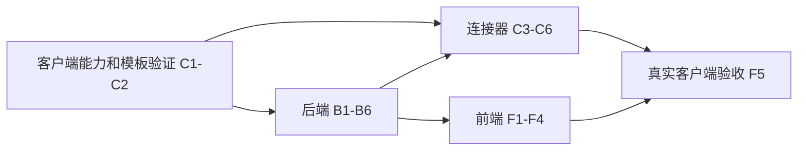

# 嘉立创 EDA PCB 草稿生成与产物预览实施计划

> **For agentic workers:** REQUIRED SUB-SKILL: 使用 `executing-plans` 逐任务执行；步骤采用 `- [ ]` 跟踪。执行方式以用户授权为准。

**Goal:** 在 Nexus AI 中发起 PCB 模板草稿任务，经本地连接器调用嘉立创 EDA，归档源工程和派生产物，并在网页中查看静态线路图与 OBJ 三维模型。

**Architecture:** Nexus 保存设备、任务和产物；Windows 连接器主动通过 HTTPS 短轮询领取任务，在本机通过 STDIO MCP 调用嘉立创 EDA。AI 使用受控工程工具创建异步任务；产物经任务专属上传入口写入私有 OSS，预览按用户和租户鉴权读取。

**Tech Stack:** Java / Spring Boot / MyBatis-Plus / MySQL 5.7；Node.js 24 LTS / TypeScript / MCP SDK；Vue 3 / Element Plus / Three.js；JUnit 5 / Mockito / H2 / Node test runner。

---

> 文档编号：NexusERP-AI-2026-EDA-PLAN-001
> 版本：v1.0
> 状态：实施任务未开始；本文件记录计划，不代表功能或客户端验收通过
> 创建日期：2026-10-16
> 分支：`codex/easyeda-pcb-draft-preview-20261016`
> 代码基线：`183667d1`，来自 `plus`；已有设计文档在拆分前位于暂存区，属于本次任务
> 关联：[已确认设计](../specs/2026-10-15-ai-嘉立创EDA-PCB草稿生成与产物预览设计规范.md)、[协议 v1](../specs/2026-10-16-ai-工程连接器协议v1.md)、[文档规范](../../CONTRIBUTING.md)

## 1. 本次交付与执行顺序

本次交付详细计划和接口约定。后续实施使用三个子计划，按依赖推进；每个子计划能使用合成数据独立验证，不要求连接现有业务数据库。

| 顺序 | 子计划 | 任务 | 可独立验收的结果 |
|---|---|---|---|
| 1 | [本地连接器](./2026-10-16-ai-嘉立创EDA-本地连接器实施计划.md) | C1–C2 | 确认真实客户端能力、确定模板和导出格式，产出可复用样本 |
| 2 | [后端任务与产物](./2026-10-16-ai-嘉立创EDA-后端任务与产物实施计划.md) | B1–B6 | 使用模拟设备完成绑定、领取、回报、上传和鉴权读取 |
| 3 | [本地连接器](./2026-10-16-ai-嘉立创EDA-本地连接器实施计划.md) | C3–C6 | Windows CLI 完成任务恢复、MCP 调用、导出上传和诊断 |
| 4 | [前端预览与联调](./2026-10-16-ai-嘉立创EDA-前端预览与联调实施计划.md) | F1–F5 | 任务页、AI 卡片、静态线路、BOM/DRC、OBJ 和真实端到端验收 |

B1 的协议类型和 F1 的前端纯逻辑可在 C2 能力验证期间编写，但不得把合成 OBJ、模拟 MCP 或模板原样复制称为真实 PCB 草稿生成成功。默认在当前分支内顺序执行；真实客户端验收、存量库迁移和生产部署分别记录适用环境与执行授权。



## 2. 已核对的事实

- `ruoyi-modules/ruoyi-ai/src/main/java/com/nexus/ai/mcp/service/McpClientManager.java` 的 `LOCAL` 进程运行在后端机器，不等于网页用户的电脑；既有远程 MCP 内网白名单保持原策略。
- `AiServiceFacade` 当前只向查询/报表角色注入 `QUERY,ALL` / `ALL` 工具；现有外部工具能力还包含资料读取证据检查。工程动作需要独立角色和 `ENGINEERING` 类别，避免被普通查询使用。
- 共享 AI 实体和 Mapper 位于 `ruoyi-common-ai`；`ruoyi-ai` 不应为方便调用而直接依赖 `ruoyi-system`。通过 common 中的身份与存储接口，由 system 实现适配。
- `ruoyi-common-core` 的 `OssService` 仅提供 URL 查询，没有上传、私有读取和哈希校验契约；`SysOssController` 是系统级通用入口，不能直接当作设备上传授权。
- `plus-ui` 已安装 Three.js 和对应类型，现有单测以 Node test runner 配合 esbuild 为主，首期沿用这一方式。
- 2026-10-16 检测到本机 Node 为 `v24.21.0`；仅通过文件元数据检测到本机存在 `lceda-pro.exe`，文件和产品版本均为 `4.1.60`；尚未运行编辑器、创建工程或验证导出。
- 同日读取嘉立创官方 CLI 和 `get3DFile()` 文档：CLI 支持 `doctor`、工程会话和 STDIO MCP；3D 导出接口标注 BETA。首期在隔离模板目录验证并固定版本，正式环境使用需依据届时官方支持状态单独评估。

## 3. 固定的实施决策

1. 本地连接器首期采用 **Node.js + TypeScript 命令行工具**，不引入 Electron 安装包、托盘和自动启动。命令为 `doctor`、`pair`、`run`、`unpair`；用户在自己的 Windows 登录会话运行 `run`，需要编辑时显示嘉立创窗口。
2. 通信采用 **HTTPS 短轮询**：领取每 3 秒一次；心跳每 15 秒一次；领取租约 90 秒，每 30 秒续约。设备连续 45 秒无心跳显示离线。无须服务器连接用户 IP，也无须启用仓库默认关闭的 WebSocket。
3. 元数据只进 `master`：`ai_engineering_device`、`ai_engineering_task`、`ai_engineering_artifact` 三表。配对码、短期上传票据使用 Redis TTL；步骤明细和产物清单使用有界 JSON，不另建通用流程引擎。
4. 任务通过 `attempt + leaseToken + revision` 防止旧连接器回调覆盖新状态；状态变更采用数据库条件更新。外部编辑器发生不确定写入后不自动重做，进入人工检查后创建新请求。
5. 源工程是不可覆盖的任务目录快照；首期使用白名单模板和结构化参数。模型不能提交脚本、命令、目录或软件执行文件路径。
6. 首期必需产物：源工程 ZIP、至少一张 PNG、规范化 BOM JSON、DRC JSON、OBJ。网表必须尝试导出；MTL/纹理由实际导出决定。缺失产物明确显示，不用空文件补齐。
7. 设备经任务专属短期票据向 Nexus 上传，服务端流式计算 SHA-256 和大小后写 OSS；首期失败可整文件重传，**不实现分片续传**。同内容重传幂等，超限在上传前后均拒绝。
8. 使用明确指定的私有 OSS 配置。预览经 Nexus 鉴权代理返回 Blob，下载与预览均校验任务归属；首期不向浏览器暴露桶凭证或要求跨域直连。保留 OSS ID，不在数据库保存临时下载 URL。
9. PNG 使用图片查看器；OBJ 使用 `OBJLoader` / `MTLLoader` 和 `OrbitControls`，MTL 引用只解析清单内的材质/纹理。STEP、GLB 转换、逐网络交互不进入首期。
10. AI 工具调用返回任务 ID 与 `WAITING_DEVICE` 等实际状态，聊天结束不代表 PCB 已完成。已有 SSE 用于提醒，重新进入页面以持久化任务接口为准。

## 4. 文件结构与职责

以下是实施目标文件，当前未创建。每个子计划提供逐文件清单；新目录名称不意味着需要创建新 Maven 模块。

| 范围 | 路径 | 职责 |
|---|---|---|
| Java 契约 | `ruoyi-common/ruoyi-common-ai/src/main/java/com/nexus/common/ai/engineering/` | 状态、命令、身份与存储 Port、产物清单 |
| 共享持久化 | `ruoyi-common/ruoyi-common-ai/src/main/java/com/nexus/common/ai/domain/entity/AiEngineering*.java` 与 `mapper/AiEngineering*Mapper.java` | 三表实体和 Mapper |
| 后端业务 | `ruoyi-modules/ruoyi-ai/src/main/java/com/nexus/ai/engineering/` | 设备认证、任务状态、领取租约、上传和读取 |
| AI 调度 | `ruoyi-modules/ruoyi-ai/src/main/java/com/nexus/ai/agent/EngineeringAgent.java` 与 `tool/EasyedaEngineeringTool*.java` | 受控动作注册和独立角色 |
| system 适配 | `ruoyi-modules/ruoyi-system/src/main/java/com/nexus/system/engineering/` | 当前用户权限、密码变更失效、私有 OSS 和 sys_oss |
| 本地连接器 | `ruoyi-extend/nexus-engineering-connector/` | 独立 npm 项目，不进入 Maven 聚合 |
| 前端 | `plus-ui/src/api/ai/engineering.ts`、`src/views/ai/engineering/`、`src/components/ai/engineering/` | 设备、任务、产物及聊天卡片 |
| 初始化和迁移 | `script/sql/ry-vue.sql`、`script/sql/update/2026-10-16-ai-engineering-pcb.sql` | 三表、菜单和工具字典；仅写脚本，执行另核环境授权 |

## 5. 提交格式与中文注释

历史提交使用 `type(scope): 中文说明`，例如 `fix(report): 补齐报表表字段中文注释与菜单SVG图标`。本功能使用 `docs(ai)`、`feat(ai)`、`feat(connector)`、`feat(ui)`、`test(ai)`，每个任务提交只包含该任务文件。提交前检查 `git diff --cached --stat`，不得带入其他工作；不自动推送和合并。

新增或实质修改的 Java 类、接口、record、枚举、对外方法必须有中文 Javadoc。注释说明业务用途、租户/用户边界、状态或副作用；方法填写真实的 `@param`、`@return`、必要的 `@throws`。内部 CAS、上传确认、凭证撤销和路径检查也写中文注释说明原因。TS/Vue/连接器的对外类型和关键函数使用中文 JSDoc；SQL 表和列使用中文 COMMENT。

示例是后续 B3 的服务方法约定，不在计划阶段新增 Java 源文件：

```java
/**
 * 为当前用户创建 PCB 模板草稿任务。
 *
 * <p>仅向已绑定设备派发结构化参数；相同幂等键和请求摘要返回原任务，
 * 摘要变化则拒绝。此方法不等待本地编辑器，也不写入 ERP BOM 或 MES 工单。</p>
 *
 * @param actor 服务端捕获的租户、用户与权限身份
 * @param command 已校验的模板、设备和设计参数
 * @return 持久化任务及其当前状态
 * @throws ServiceException 设备无权使用、模板无效或幂等参数冲突时抛出
 */
public EngineeringTaskVo createDraft(EngineeringActor actor, EngineeringTaskCommand command);
```

## 6. 里程碑与退出条件

| 里程碑 | 完成条件 | 必须保留的证据 |
|---|---|---|
| M0 能力验证 | C1–C2：真实模板参数变化可见，导出 PNG/OBJ/源工程 | 客户端与模板版本、文件清单/哈希、截图、失败项 |
| M1 服务端闭环 | B1–B6：合成设备完成全流程并通过越权与重复请求测试 | 非零 JUnit 报告、H2 隔离数据源、接口回执 |
| M2 本地执行 | C3–C6：真实 MCP 执行，断线/重启不重复生成 | Node 非零用例报告、脱敏日志、产物 manifest |
| M3 网页预览 | F1–F4：PNG、OBJ、BOM/DRC 可读且资源可释放 | 单测、类型检查、构建、浏览器交互证据 |
| M4 人工验收 | F5：从一句话到真实文件预览，明确局部失败及 DRC 缺陷 | 限定环境端到端记录，不代替生产部署记录 |

M0 不通过时，保留阻塞事实并修正适配计划；其他不依赖真实导出的合成测试可以继续。缺少真实 OBJ 或模板证据时不能将 M2/M4 标为完成。

## 7. 设计需求覆盖

| 设计章节 | 对应任务 |
|---|---|
| 草稿、只读预览和范围 | C1–C2、F2–F5 |
| MCP 与连接器边界 | B6、C3–C5 |
| 配对、身份和凭证撤销 | B2、C3、F1 |
| 任务、租约、幂等、取消和恢复 | B1、B3、C4、F1 |
| OSS、哈希、清单和私有读取 | B4–B5、C5、F2–F3 |
| BOM、DRC、线路和 OBJ | C2、C5、F2–F3 |
| AI 对话、工具消息和长任务 | B6、F4 |
| 跨租户、文件路径和资源限制 | B2–B5、C3–C6、F3 |
| 真实客户端验证和中文注释 | C1–C2、F5、每任务检查点 |

## 8. 本次文档检查与后续实施检查

本次只运行文档校验：所有 Markdown 相对链接可解析、代码块成对、无未填写占位、计划任务引用一致、`git diff --check`。不运行业务测试、不启动嘉立创 EDA、不迁移现有库，不将这些未执行项目写成通过。

实施后完整检查命令在三个子计划末尾。Java 使用空环境 Tag 和非零用例计数；前端执行功能单测、全量类型检查和生产构建。已有基线失败须记录原始输出，不修改无关模块以掩盖失败。

提交后状态应是：新分支中包含设计、协议、三个子计划和本总计划，业务代码与真实数据库尚未改变。

## 9. 官方资料

- [嘉立创 CLI 与 MCP](https://prodocs.lceda.cn/cn/api/guide/cli.html)
- [嘉立创 OBJ/STEP 导出与 BETA 说明](https://prodocs.lceda.cn/cn/api/reference/pro-api.pcb_manufacturedata.get3dfile.html)
- [MCP 客户端开发](https://modelcontextprotocol.io/docs/develop/build-client)
- [Three.js OBJLoader](https://threejs.org/docs/pages/OBJLoader.html)
- [Node.js 发行周期](https://nodejs.org/en/about/previous-releases)

外部能力核对日期为 2026-10-16。客户端与 SDK 在 C1 锁定实际版本，运行证据记入能力报告。
