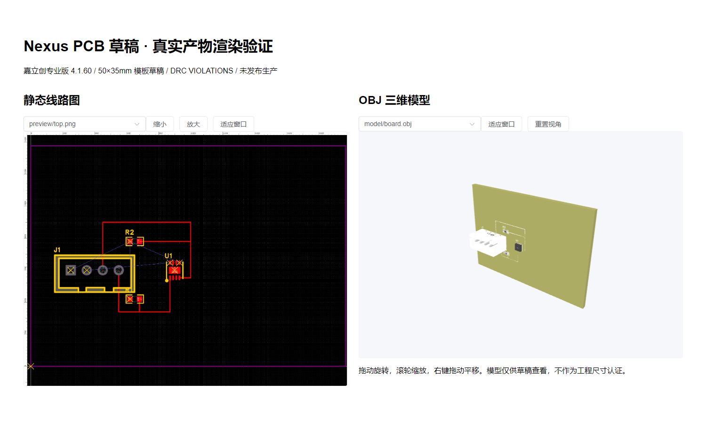

# 嘉立创EDA客户端能力验证报告

> 日期：2026-10-16；环境：Windows 10，本分支隔离worktree和专属临时工程。
> 状态：真实模板参数化、七类产物导出及隔离组件浏览器渲染已验证；生产部署和现有数据库迁移未执行。
> 关联：[连接器计划](./2026-10-16-ai-嘉立创EDA-本地连接器实施计划.md)、[操作指南](../guides/NexusERP_工程连接器使用指南.md)。

## 1. 实际版本与兼容差异

- Node.js：24.21.0；npm：11.19.0。
- 嘉立创CLI/桥接：4.1.60.198f38ab；编辑器API返回4.1.60。
- MCP TypeScript SDK：1.32.1；fflate：0.8.3，均写入连接器package-lock。
- 原生 `doctor`、`open --path`、`invoke` 调用成功；`--mcp stdio` 实际返回：

```json
{"ok":false,"error":{"code":"MCP_NOT_SUPPORTED","message":"MCP mode is not supported by the CLI client (it would start a resident server in a short-lived process)"}}
```

安装版本与在线文档存在差异：open要求工程路径；invoke最大预算为60秒；OBJ导出返回ZIP，内含OBJ和MTL。固定脚本通过官方扩展API运行，连接器自己的STDIO MCP桥接提供六个受控动作；真实SDK握手、tools/list和连接检查均已验证。不把CLI的帮助声明当作原生MCP可用证明。

## 2. 自建模板与设计结果

模板 `temperature-humidity-demo@1.0.0` 包含SHT30、四针接插件、两个4.7kΩ电阻及初步I2C走线，源工程在隔离客户端创建后保存。模板ZIP摘要：

```text
0d603c67a2a7c9625bb202b54b4464a1961848fefcffc91f69d408170ea95b0d
```

它是集成演示模板，未完成电气评审、完整原理图和电源布线，不可用于制造。本期参数化仅修改板框，不宣称自然语言可完成任意电路设计。

| 本地任务 | 参数 | 器件数 | 导出 | DRC |
|---|---|---:|---|---|
| `202610160000000007` | 50×35mm / 双层 | 4 | 7类全部成功 | VIOLATIONS，8条违规 |
| `202610160000000008` | 60×40mm / 双层 | 4 | 7类全部成功 | VIOLATIONS，8条违规 |

两组板框经过真实API修改与保存；PNG、OBJ和源工程摘要不同。导出结果按内容重新计算SHA-256。小型报告、BOM和模型来源于真实编辑器，没有用合成文件替换失败产物。

| 产物类型 | 50×35mm 字节数 | 60×40mm 字节数 |
|---|---:|---:|
| `PCB_MODEL_MTL` | 745 | 745 |
| `PCB_MODEL_OBJ` | 686802 | 686798 |
| `PCB_PREVIEW_2D` | 171408 | 152275 |
| `PCB_BOM` | 898 | 898 |
| `PCB_DRC_REPORT` | 1374 | 1374 |
| `PCB_NETLIST` | 10131 | 10131 |
| `PCB_SOURCE` | 26480 | 26479 |

## 2.1 通过真实STDIO MCP重复验证

阶段确认修复后，运行可分发的 `scripts/probe-easyeda.mjs --config .runtime/probe-config.json --create-demo`，经连接器自有STDIO MCP及官方CLI/API再次生成两组板框。任务 `1792128327629726`（50×35mm）和 `1792128352836535`（60×40mm）各收到6次 `nexus/stage` 确认，均导出7类文件，错误数组为空，DRC仍为8条违规。未连接Nexus或OSS。

[脱敏原始摘要](../evidence/2026-10-16-easyeda-mcp-probe.json)保存逐文件SHA-256、字节数、参数和阶段；PNG/源工程在重复导出时可能有渲染或工程元数据变化，因此以每次摘要为准。探测脚本只关闭本次新建的编辑器会话。

## 3. 适配中复现并处理的问题

- 编辑器新窗口载入有延迟：先轮询无设计副作用的ready检查，确认板框和器件加载完成后才执行生成。
- 4.1.60不允许用Line创建板框：使用官方Polyline及多边形API。
- 编辑器只允许向工程内路径导出：输出目录位于任务工程的exports目录，并在写入前检查junction和符号链接。
- 3D的File.name没有稳定扩展名：以ZIP签名核实并安全解包，不按名称猜测OBJ文本。
- 常驻编辑器可能继承CLI输出管道：以CLI进程退出为界，不等用户关闭窗口。

## 4. 浏览器组件验证

使用本分支实际PNG和OBJ预览组件，在隔离Vite测试页加载上述真实产物，没有连接现有Nexus数据库。浏览器为Edge 131.0.2903.51，headless + SwiftShader。PNG显示、空清单后OBJ到达、OBJ/MTL加载、旋转、缩放及缺MTL统一材质降级通过，页面无JavaScript异常（[浏览器记录](../evidence/2026-10-16-pcb-browser-result.json)）；旋转前后像素变化位于模型区域。



这份截图是隔离组件验证，不是已登录生产Nexus的运行截图。真实用户配对、现有环境数据迁移、完整人工验收和生产部署须另行记录。

## 5. 原始证据保存

本地运行产物位于连接器未跟踪的 `.runtime/tasks/`，摘要清单位于 `.runtime/evidence/capabilities.json`。本次只提交可分发自建模板、代码、验证说明和不含身份信息的截图；不提交运行凭证、设备Token、客户工程和临时执行目录。测试创建的编辑器会话按已记录sessionId关闭，用户既有服务与工程不作清理。
