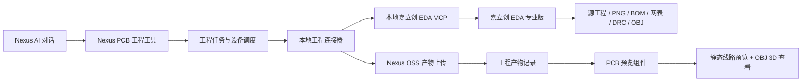

> 文档编号: NexusERP-AI-2026-EDA-001
> 版本: v1.1
> 状态: 分支代码已实现，隔离回归与客户端验证见实施记录；现有环境尚未启用
> 创建日期: 2026-10-15
> 最后更新: 2026-10-16
> 作者: Nexus
> 关联文档: [AI 文档导航](../README.md)、[文档规范](../../CONTRIBUTING.md)、[详细实施计划](../plans/2026-10-16-ai-嘉立创EDA-PCB草稿与产物预览实施计划.md)、[协议 v1](./2026-10-16-ai-工程连接器协议v1.md)

# 嘉立创 EDA PCB 草稿生成与产物预览设计规范

> **2026-10-16 实施校正：**本机嘉立创4.1.60.198f38ab的原生 `--mcp stdio` 返回 `MCP_NOT_SUPPORTED`。本分支使用连接器自己的受控STDIO MCP桥接调用官方CLI/API，诊断标识为 `CLI_COMPAT`。文中“本地嘉立创EDA MCP”在该版本对应此适配，不表示原生服务已可用。板框参数化、PNG/OBJ/源工程已在隔离模板上真实验证，模板未完成电气评审且DRC有违规；[验证报告](../plans/2026-10-16-ai-嘉立创EDA-客户端能力验证报告.md)及[使用指南](../guides/NexusERP_工程连接器使用指南.md)记载实际边界。

## 1. 目标与范围

本期为 Nexus 增加一条从 AI 对话到本地嘉立创 EDA 的工程设计验证链路：用户在 Nexus 中用自然语言提出 PCB 初步设计需求，Nexus 选择已绑定的工程师电脑，本地轻量级工程连接器调用已安装的嘉立创 EDA 专业版创建或打开 PCB 草稿，导出设计产物并回传 Nexus，Nexus 将产物保存到 OSS 并提供静态线路预览和 OBJ 三维预览。

本期的目标验收场景是：

> “使用温湿度采集板模板，在嘉立创 EDA 中创建一个 PCB 草稿，打开本地编辑器，导出线路预览、BOM、DRC 结果和 3D 模型，并在 Nexus 中显示。”

本期只处理“草稿生成与只读预览”。设计成果仍由工程师在嘉立创 EDA 中继续编辑；Nexus 不在本期内实现网页 PCB 编辑器，也不直接把草稿发布为可执行的 MES 生产版本。

## 2. 现状与设计依据

当前 Nexus 已有可复用的 AI MCP 与文件能力：

- `ruoyi-modules/ruoyi-ai/src/main/java/com/nexus/ai/mcp/service/McpClientManager.java` 已支持 STDIO 本地 MCP 和 Streamable HTTP 远程 MCP。
- `ruoyi-modules/ruoyi-ai/src/main/java/com/nexus/ai/tool/BuiltinToolRegistry.java` 已支持内置工具注册、启用状态过滤和运行时工具 Bean 获取。
- `ruoyi-modules/ruoyi-ai/src/main/java/com/nexus/ai/service/sse/AiSseMessageHelper.java` 已支持工具开始、工具结束及流式状态消息。
- `ruoyi-modules/ruoyi-system/src/main/java/com/nexus/system/controller/system/SysOssController.java` 已提供 OSS 文件上传和下载接口。
- `plus-ui/package.json` 已包含 `three`，可作为 OBJ 预览的基础依赖。

嘉立创 EDA 专业版提供桌面客户端 CLI、本地 MCP 能力和编辑器扩展 API。官方 CLI 文档列出了 STDIO/HTTP MCP 启动方式、工程打开、会话管理、扩展调用和文件类结果返回能力。首期以官方客户端已支持的能力为准，并固定验证客户端版本，避免把实验性接口当作生产承诺。

## 3. 产品边界

### 3.1 本期包含

- Nexus AI 对话识别 PCB 草稿生成意图。
- 选择用户已绑定且在线的本地工程连接器。
- 调用本地嘉立创 EDA 专业版创建或打开草稿工程。
- 使用已审核的 PCB 模板作为初始设计依据。
- 导出 PCB 源工程压缩包、静态线路预览、BOM、网表、DRC 结果和 OBJ 三维模型。
- 上传产物到 Nexus OSS，并保存产物元数据、哈希和任务关联。
- 在 Nexus 中查看线路预览、BOM、检查结果、任务日志和 OBJ 三维模型。
- 支持任务超时、失败、取消、断线重试和部分产物成功。

### 3.2 本期不包含

- 在浏览器中编辑原理图、PCB 走线或封装。
- 解析全部 PCB 几何数据并实现交互式网络高亮、图层编辑和实时布线。
- STEP 转 GLB/glTF 及其他 CAD 格式转换。
- 自动采购、自动下单、自动投产或直接修改 ERP/MES 生产主数据。
- 生产版本审批和制造发布闭环。
- 对任意 JavaScript 或任意本地路径开放给 AI 执行。
- 同时适配其他 CAD/EDA 软件。

## 4. 总体架构



### 4.1 两种连接模式

开发验证允许使用直连模式：Nexus 后端以 MCP Client 连接工程师电脑上嘉立创 EDA 的 HTTP MCP 服务。该模式要求 Nexus 后端可以访问工程师电脑的地址，适合单机或受控局域网演示；不得将工程师电脑的 MCP 端口直接暴露到公网。

首期目标实现采用本地连接器模式：连接器在工程师电脑上主动连接 Nexus，接收任务并在本机通过 STDIO 或本机 HTTP MCP 调用嘉立创 EDA。Nexus 不主动探测或访问用户电脑，任务、状态和文件上传均由连接器发起或在已认证连接内完成。该模式支持多台工程师电脑，也避免将内网地址和本地 MCP 端口作为业务配置长期保存。

本地连接器不是 CAD/EDA 编辑器。它只提供设备绑定、任务接收、软件检测、MCP 调用、文件上传、状态回报和本地临时目录管理。

### 4.2 MCP 职责边界

Nexus 侧向 AI 暴露具名的 PCB 工程动作；本地连接器负责把这些动作映射为嘉立创 EDA MCP 调用。AI 不直接构造和执行任意扩展脚本。

首期动作：

- `easyeda_check_connection`：检查连接器、嘉立创 EDA 和客户端版本。
- `easyeda_open_project`：在本地打开已绑定的草稿工程。
- `easyeda_create_pcb_draft`：基于允许使用的模板创建草稿。
- `easyeda_export_pcb_artifacts`：导出本期约定的设计产物。
- `easyeda_run_drc`：运行设计规则检查并回传报告。
- `easyeda_submit_design_draft`：将产物固化为 Nexus 草稿记录，不触发生产发布。

`easyeda_create_pcb_draft` 的输入必须是结构化参数，包括模板标识、项目名称、工作目录、板层、板框约束、器件需求和幂等键。模型生成的自然语言只作为任务说明，不能直接作为本地脚本执行内容。

## 5. 任务与连接器生命周期

### 5.1 设备绑定

工程师在 Nexus 中生成一次性配对码；连接器登录或输入配对码后获得短期设备凭证。服务端保存设备归属的租户、用户、设备名称、操作系统、连接器版本、嘉立创 EDA 版本、能力列表、最后心跳和在线状态。

连接器只接受归属用户和租户的任务。用户解绑设备、修改密码、禁用工具或租户停用时，服务端立即使设备凭证失效。

### 5.2 任务状态

任务状态固定为：

```text
CREATED -> WAITING_DEVICE -> RUNNING -> SUCCEEDED
                                  ├-> PARTIAL_SUCCESS
                                  ├-> FAILED
                                  └-> CANCELED
```

超过有效期仍未被领取的任务进入 `EXPIRED`。任务状态转移由服务端校验，连接器只能提交当前任务允许的状态和步骤结果。

任务必须带有幂等键。连接器重试领取或上传时，服务端以租户、用户、幂等键和任务版本去重，不能重复创建草稿记录或重复绑定同一产物。

### 5.3 任务步骤

首期步骤固定为：

1. 检查连接器和嘉立创 EDA 能力。
2. 创建任务临时目录。
3. 创建或打开草稿工程。
4. 生成或更新 PCB 初稿。
5. 运行 DRC。
6. 导出线路预览、BOM、网表、DRC、OBJ 和源工程。
7. 为每个产物计算 SHA-256。
8. 使用短期上传授权上传产物到 Nexus OSS。
9. 关闭或保留本地编辑器会话，回报最终状态。

创建草稿只允许写入任务专属临时目录或用户明确绑定的工程目录，不覆盖已有工程。用户需要继续编辑时，预览页提供打开本地工程或下载源工程的入口。

## 6. 产物模型与文件处理

### 6.1 产物类型

首期固定以下产物类型：

| 类型 | 格式 | 用途 |
|---|---|---|
| `PCB_SOURCE` | 工程目录 ZIP | 归档、下载、继续编辑 |
| `PCB_PREVIEW_2D` | PNG，允许附加 SVG | 静态线路预览 |
| `PCB_BOM` | CSV、XLSX 或 JSON | 器件和物料核对 |
| `PCB_NETLIST` | 官方导出格式或 JSON | 后续连接关系分析 |
| `PCB_DRC_REPORT` | JSON 和可读文本 | 检查结果显示 |
| `PCB_MODEL_OBJ` | OBJ | Nexus 中的三维查看 |
| `PCB_MODEL_MTL` | MTL | OBJ 材质 |
| `PCB_MODEL_TEXTURE` | PNG/JPG 等 | 三维材质纹理 |

OBJ 相关文件使用一个产物组关联，前端通过 manifest 得到 OBJ、MTL 和纹理的签名地址。源工程和大型模型文件不进入 AI 对话上下文，也不以长期 Base64 字段存储。

### 6.2 上传策略

小型状态信息可以通过任务接口返回。文件统一由连接器使用短期上传授权上传到 Nexus OSS；上传接口只允许写入当前租户、当前用户和当前任务的对象前缀。

每个产物保存：

- 任务 ID和产物类型；
- OSS ID和原始文件名；
- MIME 类型、文件大小和 SHA-256；
- 生成步骤、客户端版本和模板版本；
- 创建时间、上传时间和失效时间；
- 是否为最终可见产物。

上传完成后，服务端重新校验文件大小和哈希，不能只相信连接器提交的元数据。首期产物下载经 Nexus 鉴权代理读取私有 OSS，并在每次请求时校验用户、租户和任务权限；不保存临时签名地址，不向浏览器暴露桶凭证。

### 6.3 逻辑数据模型

本期增加三类持久化数据，字段以实施计划中的实际数据库规范为准：

- `ai_engineering_device`：本地连接器设备、绑定关系、能力和心跳。
- `ai_engineering_task`：自然语言请求、结构化参数、设备、状态、步骤、幂等键、错误信息和时间戳。
- `ai_engineering_artifact`：任务产物、OSS 关联、文件摘要、版本信息和 manifest 关联。

三类数据均必须带租户字段、创建人字段、逻辑删除字段和审计时间。PCB 的设计版本和工程变更模型留到生产发布阶段，不在本期重复建立 ERP BOM 或 MES MBOM。

## 7. 前端预览

### 7.1 PCB 任务和产物页

在 AI 对话工具调用消息中展示任务卡片：

- 当前设备和嘉立创 EDA 连接状态；
- 当前步骤和进度；
- 已生成产物数量；
- 失败步骤和重试入口；
- 打开本地工程、下载源工程和进入产物预览页的入口。

产物预览页分为四个区域：

1. **线路预览**：展示 PNG，支持缩放、适应窗口、正反面或多张图切换。
2. **BOM 与检查**：展示 BOM 表格、DRC 状态、错误数量和原始报告下载。
3. **3D 预览**：使用 `three` 的 OBJ/MTL loader 加载 OBJ 及其材质，支持旋转、缩放、平移和重置视角。
4. **源文件**：展示工程包、生成参数、模板版本、客户端版本、哈希和下载入口。

本期线路预览是静态图像，不承诺点击走线、网络高亮或浏览器内编辑。3D 预览优先支持 OBJ；STEP 仅作为源产物或下载产物保留，STEP 转换不纳入本期。

### 7.2 任务状态刷新

短任务沿用现有 AI SSE 工具开始/结束消息；长任务以任务 ID为准，通过任务查询接口轮询状态。浏览器断线后重新进入页面，仍可根据任务 ID恢复状态和产物列表，不依赖对话窗口内存。

## 8. 安全与权限

- 本地连接器采用一次性配对码和短期刷新凭证，不在工具配置、日志或 AI 消息中保存长期 Token。
- 首期不要求工程师电脑开放公网入站端口；正式模式由连接器主动建立出站连接或轮询。
- 服务端对设备、任务、产物执行租户、用户和权限校验。
- 本地动作只使用白名单命令和固定动作参数，不接受模型生成的任意 JavaScript、Shell 命令或任意文件路径。
- 临时目录位于连接器专属目录，路径经过规范化检查，禁止通过参数逃逸到系统目录。
- 上传限制文件大小、数量、MIME 类型和总任务配额；异常压缩包不得在服务端无约束解压。
- 生产发布、业务 BOM 更新和 MES 工单关联不由本期工具自动执行，必须保留后续人工审批边界。
- 日志只记录任务 ID、设备 ID、步骤和错误类别，不输出文件内容、Token、私钥或完整连接配置。

## 9. 故障处理

| 故障 | 处理方式 |
|---|---|
| 连接器离线 | 任务保持 `WAITING_DEVICE`，超过有效期进入 `EXPIRED` |
| 嘉立创 EDA 未安装或版本不支持 | 任务失败，返回安装和版本检查结果 |
| 编辑器会话占用 | 不覆盖当前工程，返回忙碌状态，允许用户稍后重试 |
| 单个产物导出失败 | 保留已上传产物，任务进入 `PARTIAL_SUCCESS` |
| 上传中断 | 查询清单确认哈希后整文件重传，首期不做分片，避免重复记录 |
| DRC 发现错误 | 任务可以成功生成草稿，但标记 `PARTIAL_SUCCESS`，前端突出显示错误 |
| AI 对话断线 | 任务继续执行，用户从任务中心或产物页恢复查看 |
| 重复提交 | 以幂等键返回已有任务和产物，不重复创建工程 |

## 10. 验收标准

### 10.1 功能验收

- 用户可以绑定一台 Windows 工程师电脑和一个嘉立创 EDA 专业版客户端。
- AI 可以根据固定模板创建一个 PCB 草稿，并在本地嘉立创 EDA 中打开。
- Nexus 可以收到并保存源工程、静态线路预览、BOM、网表、DRC 报告和 OBJ/MTL/纹理产物。
- 预览页可以显示线路图片、BOM、DRC 结果并旋转查看 OBJ 三维模型。
- 任务失败、设备离线、部分产物成功和重新进入页面后的状态恢复均可验证。
- 重复发送同一幂等请求不会产生重复任务或重复产物关联。

### 10.2 安全验收

- 未绑定设备不能领取任务。
- 用户不能查看其他租户的任务和产物。
- 连接器凭证失效后不能继续领取或上传。
- 工具调用不能执行未列入白名单的命令、脚本或路径。
- 生产数据库和 ERP/MES 业务主数据不会因创建 PCB 草稿被写入。

### 10.3 版本验收

- 验证报告记录 Nexus、连接器、嘉立创 EDA 客户端、模板和浏览器版本。
- 真实客户端环境完成一次从创建、导出、上传到预览的人工验收。
- 不把本机客户端可用或静态单测通过写成生产部署完成。

## 11. 后续扩展边界

本期稳定后，按以下顺序扩展：

1. 设计版本、审批和工程变更记录。
2. ERP 物料与 PCB BOM 的器件映射、替代料和缺料提示。
3. 图层切换、网络查询和器件定位等只读交互。
4. 生产资料发布包与 MES 工单引用。
5. 其他 EDA/CAD 软件适配器，共用设备、任务和产物协议。
6. STEP/GLB 转换和机械模型预览。

扩展其他软件时，保持 Nexus 的任务与产物协议不变，仅替换本地连接器中的软件适配器。

## 12. 实施细化（2026-10-16）

用户已确认本期范围，并要求在新分支拆分详细计划、按历史中文提交格式提交，以及为新增 Java 类型和关键方法补充中文 Javadoc。计划入口见 [总计划](../plans/2026-10-16-ai-嘉立创EDA-PCB草稿与产物预览实施计划.md)，接口以 [工程连接器协议 v1](./2026-10-16-ai-工程连接器协议v1.md) 为准。

- 本地连接器采用 Node.js/TypeScript CLI，首期不制作 Electron。通过 HTTPS 短轮询主动出站领取任务，不要求服务器访问用户电脑。
- 元数据使用 master 的三张 `ai_engineering_*` 表，配对码和上传票据使用 Redis TTL，任务租约与版本条件更新防止旧回调覆盖。
- 源工程、PNG、BOM、DRC、OBJ 为生成任务的必需产物；网表导出失败和缺材质明确记录，不用空文件或样例模型补齐。
- 上传通过任务专属入口做真实大小、SHA-256 和配额校验；内容由 Nexus 代理鉴权读取，工程文件在通用 OSS 入口也要受保护。
- 中文 Javadoc/JSDoc、非零测试、真实客户端验证分别列为任务检查点。范围确认不等于代码实施、数据迁移或生产验收。

## 13. 参考资料

- [嘉立创 EDA 专业版 CLI 与 MCP 指南](https://prodocs.lceda.cn/cn/api/guide/cli.html)
- [嘉立创 EDA 专业版 CLI for AI 指南](https://prodocs.lceda.cn/public/storage/texts/api/guide/cli-for-ai.html)
- [嘉立创 EDA 专业版 PCB 3D 文件导出接口](https://prodocs.lceda.cn/cn/api/reference/pro-api.pcb_manufacturedata.get3dfile.html)
- [Nexus AI MCP 客户端](../../../ruoyi-modules/ruoyi-ai/src/main/java/com/nexus/ai/mcp/service/McpClientManager.java)
- [Nexus OSS 上传接口](../../../ruoyi-modules/ruoyi-system/src/main/java/com/nexus/system/controller/system/SysOssController.java)
- [plus-ui 依赖配置](../../../plus-ui/package.json)

## 14. 设计决策结论

本期采用“**Nexus MCP 工具 + 本地嘉立创 EDA MCP/连接器 + OSS 产物回传 + PCB 预览组件**”的组合。直连 HTTP MCP 只作为开发验证通道；首期以主动出站的本地连接器为准。

第一期只交付 PCB 草稿、产物归档和只读预览，使用 PNG 静态线路图和 OBJ 三维模型快速形成可演示闭环。完整工程版本、审批、变更和生产发布建立在本期产物模型之上，另行进入后续计划。
