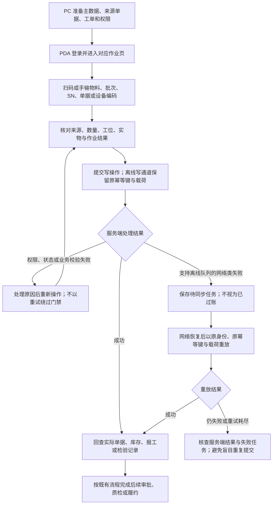
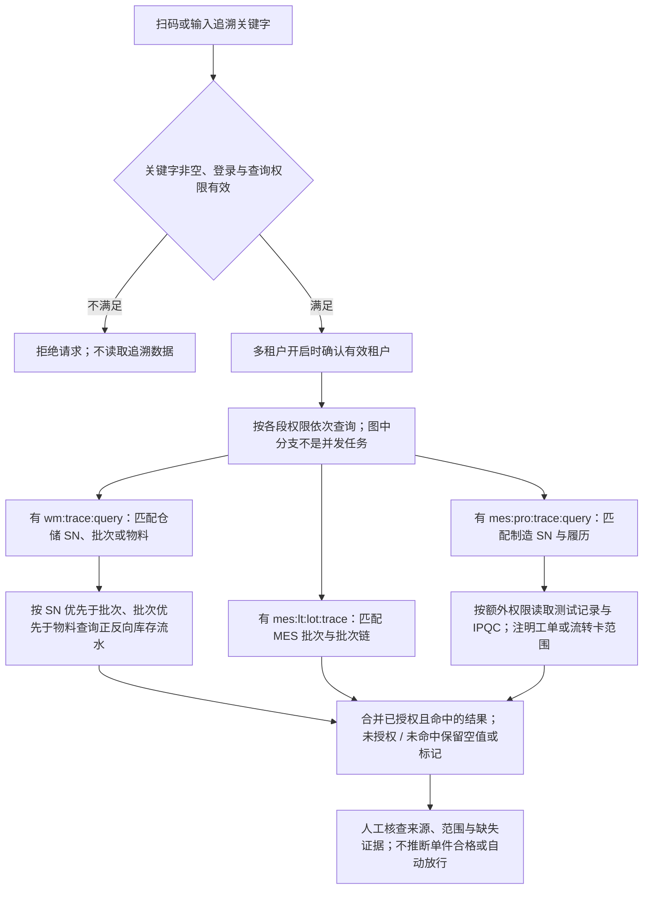

# PDA 扫码作业与追溯流程

> 核对日期：2026-10-13；后端代码基线：`plus` / `f343603a`。
> PDA 客户端核对来源：本地独立仓库 `nexus-pda` / `7a27994`（2026-10-12）；不据此推断远程分支或已安装 APK 的版本。
> 本文为 README 的补充流程，不计入既有 V4 用户手册的 29 张 draw.io / PNG 图。
> 描述当前实现与使用边界，不代表客户端已发布到所有机型、生产已部署或现场验收已完成。

[返回项目介绍](../../../README.md) · [现有业务流程图集](../README.md) · [Nexus-PDA 仓库](https://gitee.com/NexusERP/nexus-pda)

## 多端分工

| 终端 | 主要职责 | 边界 |
|------|----------|------|
| PC 管理端 | 主数据、单据、工单、权限、检验标准、审批与结果核查 | 后台配置不等于现场实物作业已完成 |
| Nexus-App | 移动协同、人脸打卡、标签拍照识别等 | 与 PDA 不共享业务页面；各平台需独立验证 |
| Nexus-PDA | 仓储、产线、质检和设备人员的扫码优先作业与统一追溯 | 使用当前人员权限；广播扫码、打印与网络恢复需真机验收 |
| Nexus-Station | 固定工位过站、SOP、上料、刷写 / 测试及外设联机 | 使用设备密钥通道；当前固定租户策略不能视作任意租户接入 |

以下 Mermaid 源码可在支持该格式的 Markdown 工具中预览。不支持渲染时，按步骤表阅读；关联仓储、三检、Station 与 DHR 流程另有 PNG 预览，不依赖 Mermaid 才能理解业务。

## 扫码作业与待同步

| 步骤 | 实际操作 | 必须核对的事项 |
|------|----------|----------------|
| 1. 准备 | PC 维护物料、仓库 / 工位、来源单据、工单、检验标准与权限 | PDA 页面可见不代表具备写权限，已有部署须核对菜单和授权 |
| 2. 扫码 | 使用键盘楔、机型广播、摄像头或手输定位对象 | 校验条码类型和当前业务范围，不把任何扫码结果直接视为可过账对象 |
| 3. 执行 | 收货上架、备料发料、移库、盘点、退料、上料交接、SN 绑定、报工、三检或点检 | 核对数量、来源、状态与实物；AQL 试算不替代检验记录和放行 |
| 4. 提交 | 由后端执行权限、租户、状态、数量及相应幂等校验 | 业务校验失败先处理原因；并非所有接口都具备同一离线能力 |
| 5. 待同步 | 支持离线写通道的网络错误保存队列，网络恢复后触发重放 | 待同步不是成功；身份、幂等键和原载荷不能随意更换 |
| 6. 复核 | 回查库存、单据、MES 报工、检验或设备记录 | 请求发送、MQ 发布、审批完成与最终业务生效是不同状态 |

离线队列只对接入该写通道的操作生效，不代表可在无网络时完成所有业务。登出 / 切换账号会清理原账号任务，应先处理或核对待同步作业；失败重试存在上限，不能承诺无限重放或零丢失。真机广播、打印、重复请求、断网恢复及结果不确定场景需单独验收。

## 统一追溯查询

当前只读入口：`GET /app/pda/trace?keyword=...`。关键字可为 ERP 批次号、仓储 SN、物料编码、MES 批次号或制造 SN，不执行库存 / 生产写操作，也不进入离线过账队列。

| 数据段 | 所需权限 | 当前返回范围 |
|--------|----------|--------------|
| 接口入口 | `wm:trace:query`、`mes:lt:lot:trace`、`mes:pro:trace:query` 任一项 | 允许进入不代表可访问所有段；多租户开启时缺少有效租户会拒绝 |
| ERP 仓储追溯 | `wm:trace:query` | 匹配仓储 SN / 批次 / 物料；按最具体维度读取正向、反向库存流水 |
| MES 批次链 | `mes:lt:lot:trace` | 批次档案与已有批次追溯结果；不被制造 SN 结果覆盖 |
| 制造 SN 履历 | `mes:pro:trace:query` | SN、已有工单追溯、流转卡工序记录、按 SN 匹配的工位报工 |
| 制造测试记录 | 在制造追溯权限基础上具备 `mes:flash:testrecord:query` | 按制造 SN 读取测试记录，返回对应授权标记 |
| 关联 IPQC | 在制造追溯权限基础上具备 `mes:qc:ipqc:query` | 按该 SN 的工单 / 流转卡范围读取过程检验，注明检验范围 |

边界说明：

- 仓储 SN 与制造 SN 独立匹配，不能因一段命中就覆盖另一段的识别结果。
- 仓储某个方向的流水查询异常可降级为该方向 `null`；不能据此宣称所有子查询异常都会自动降级。
- 未授权、未命中、源数据缺失或降级都不能解释为“没有风险”或“全部合格”。
- 流转卡工序记录是共享过程事实，不证明该单件 SN 已逐工序过站；IPQC 可能覆盖工单 / 流转卡，不自动等同于单件检验。
- CV 单次缺陷推理不会自动写入此追溯接口、QC / NCR 或 DHR；证据缺失不得靠物料与时间相近推断补齐。

## 关联流程

| 流程 | 可编辑图 | 静态预览 |
|------|----------|----------|
| 仓储作业 | [仓储管理](../erp/仓储管理流程.drawio) | [PNG](../erp/仓储管理流程.preview.png) |
| 质量门禁 | [三检制](../mes/三检制流程.drawio) | [PNG](../mes/三检制流程.preview.png) |
| SN 与组件 | [SN 追溯体系](../mes/SN追溯体系流程.drawio) | [PNG](../mes/SN追溯体系流程.preview.png) |
| 固定工位 | [Station 过站与上料](../mes/Station工位过站与上料流程.drawio) | [PNG](../mes/Station工位过站与上料流程.preview.png) |
| 批记录 | [生产履历与 DHR](../mes/生产履历与追溯看板流程.drawio) | [PNG](../mes/生产履历与追溯看板流程.preview.png) |

## 代码依据

后端依据：

- [AppPdaTraceController](../../../ruoyi-admin/src/main/java/com/nexus/web/controller/AppPdaTraceController.java)：接口、关键字校验与入口权限。
- [PdaTraceService](../../../ruoyi-admin/src/main/java/com/nexus/web/service/PdaTraceService.java)：租户校验、逐段授权、ERP 与 MES 聚合和仓储降级。
- [PdaManufacturingTraceService](../../../ruoyi-admin/src/main/java/com/nexus/web/service/PdaManufacturingTraceService.java)：制造 SN、工序、工位、测试 / IPQC 的读取范围。
- [PdaTraceVo](../../../ruoyi-admin/src/main/java/com/nexus/web/domain/vo/PdaTraceVo.java)与[PdaManufacturingTraceVo](../../../ruoyi-admin/src/main/java/com/nexus/web/domain/vo/PdaManufacturingTraceVo.java)：响应契约。

PDA 客户端依据为独立仓库的 `README.md`、`pages.json`、`composables/useScan.js`、`utils/offline-queue.js`、`utils/queue-holder.js`、`api/pda/trace.js` 和 `components/trace/ManufacturingTrace.vue`。它们不属于本仓库，升级客户端时需另行核对版本和真机结果；本文不将客户端源码复制进主仓库。
