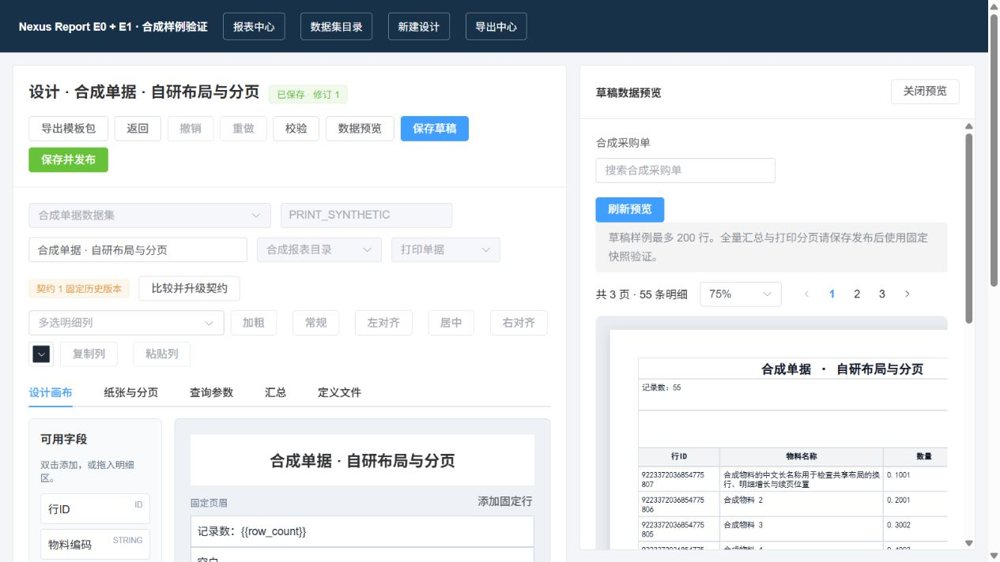
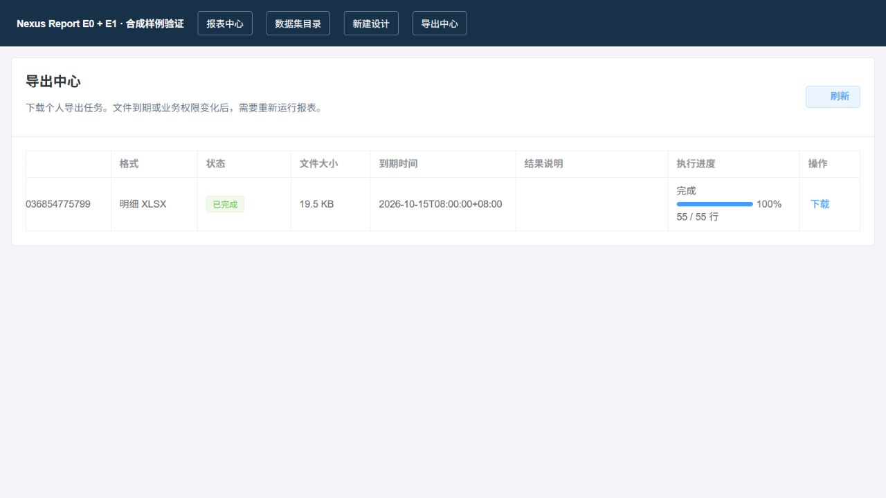

# 自研报表 E0 + E1 实施与验证报告

> 日期：2026-10-14；分支：codex/report-module-plan；开发基线：8bacd044。
> 对应 [扩展计划](./2026-10-14-system-report-extension-plan.md) 和 [八项实施工作包](./2026-10-14-system-report-e0-e1-implementation-plan.md)。
> 本报告记录代码、本机开发库、合成集成和浏览器验证。生产部署、业务人员签收和集群验收未执行。

## 1. 交付行为

| 工作包 | 实际结果                                                                                                                                            |
| ------ | --------------------------------------------------------------------------------------------------------------------------------------------------- |
| T01    | schema+engine固定执行器，正式schema 1/engine 1.0.0；新测试执行器与旧发布同时存在时，LIVE/SNAPSHOT、汇总、布局和PDF仍用旧绑定；未知/禁用版本明确拒绝 |
| T02    | 历史datasetVersion读取、存储/已安装checksum核对、差异和撤权复核；设计器旧字段不自动随head变化；升级同步目标参数，新增必填可在正常面板编辑           |
| T03    | 列多选、样式、复制/粘贴、列宽滑块、快捷键及undo/redo；DOCUMENT粘贴保持纸张宽度和整行固定区；列错误定位；编辑与预览实际分栏                          |
| T04    | 复制与模板包导入导出；源EDIT、目标ADD、依赖/engine/checksum、租户资源保护；ID默认值及源versionID清除；创建草稿；晚到回包不干扰新会话                |
| T05    | ERP单据/客户/供应商/仓库/物料六类白名单lookup，参数绑定与候选实体自身权限范围；采购订单/送货单报表入口，字符串ID及同模板切单据失效旧运行            |
| T06    | 有效lease/attempt下的进度阶段；三次自动尝试/轮、最多两轮手动重试，retryRound幂等，attempt不归零；原job/run/key/有效期固定；取消/失败/到期阶段一致   |
| T07    | 八段Micrometer耗时、低基数标签；SXSSF私有压缩临时文件，构造异常、取消与结束清理；5,000/100,000行容量样本                                            |
| T08    | 后端303用例、报表前端84用例、前端全量入口、类型/构建/定向lint；三份独立评审闭环，真实Spring/MySQL/认证下载和合成浏览器操作                          |

模块名保持ruoyi-report，业务provider/lookup实现留在ERP/MES，common-report提供跨模块契约。没有安装另一套第三方报表定义/设计/运行引擎。

## 2. 可复核命令与结果

后端相关选择器（Maven串行执行）：

```powershell
mvn -pl ruoyi-modules/ruoyi-report,ruoyi-modules/ruoyi-erp,ruoyi-modules/ruoyi-mes -am test '-DskipTests=false' '-Dprofiles.active=' '-Dtest=*Report*Test,DocumentLayoutTest,PrivateArtifactStoreTest,QualityTraceDatasetProviderTest' '-Dsurefire.failIfNoSpecifiedTests=false'
mvn -pl ruoyi-admin -am package '-DskipTests'
```

| 验证入口                | 结果                                                                                                |
| ----------------------- | --------------------------------------------------------------------------------------------------- |
| common-report           | 9个，失败/错误/跳过0                                                                                |
| system的报表关联测试    | 3个，失败/错误/跳过0                                                                                |
| ERP报表/provider/lookup | 31个，失败/错误/跳过0                                                                               |
| MES/质量追溯provider    | 10个，失败/错误/跳过0                                                                               |
| ruoyi-report            | 250个，失败/错误/跳过0                                                                              |
| 相关后端合计            | **303个通过**，BUILD SUCCESS                                                                        |
| admin及上游模块package  | BUILD SUCCESS；该命令明确跳过测试，不计为测试证据                                                   |
| npm run test:report     | **84个通过**，失败/取消/跳过0，包含51个真实组件setup交互用例                                        |
| npm run test:unit       | 七个Node Test汇总为 **1,839个**，失败/跳过0；入口还执行现有其他脚本检查，不将无汇总脚本虚增为用例数 |
| npm run type-check      | vue-tsc --noEmit通过                                                                                |
| npm run build:prod      | 完整生产构建通过；保留仓库Sass @import弃用和大chunk提示                                             |
| 定向ESLint              | 15个本轮变更Vue/TS目标通过；未执行全仓修复                                                          |
| 定向Prettier/Git        | 本轮变更前端/文档格式及git diff --check通过                                                         |

前端命令均在plus-ui下执行。相关后端并非ERP/MES全部业务测试；BUILD SUCCESS、本机通过及上述生产构建均不代表生产已部署。

本地原始日志保存在忽略目录`.dsh-tmp/report-p0/`：`e01-backend-final.log`、`e01-admin-build.log`、`e01-ui-report-final.log`、`e01-ui-unit-final.log`、`e01-ui-type-final.log`、`e01-ui-build-final.log`和`e01-ui-lint-final.log`。日志不纳入Git，不含对外展示的令牌或业务明细。

## 3. 真实后端和浏览器证据

最终admin JAR在本机dev启动实际Spring、master MySQL、Sa-Token及系统授权。受控合成provider提供两个不可变版本、55行精确数据和lookup；限定创建本次记录ID的报表资源。共32个合成检查标记通过，并得到`E01_SMOKE_COMPLETE`与`E01_SMOKE_SYNTHETIC_CLEANUP_COMPLETE`。

检查覆盖历史契约/diff、固定engine、模板包无源ID、导入草稿、复制不动源发布、精确ID、六个真实ERP候选投影、匿名访问拒绝、五类认证HTTP入口、进度围栏和重复手动轮次、三个持久导出任务的COMPLETED/55行、经认证PDF/XLSX_DATA/XLSX_LAYOUT下载、PDF中文和实际运行指标。六个真实ERP lookup采用随机合成搜索词，结果均为空；不读取或打印业务候选值。模板/契约等HTTP入口之外的service回归由真实Spring Bean直接调用，本报告不将它们写成全部HTTP调用。

浏览器加载项目真实原生Vue页面/组件，API使用忽略目录内合成fixture；布局样本来自真实Java生成的55行、3页RenderPlan。实际点击验证：固定历史字段、双列样式、复制为6列/撤销回4列/键盘重做、显式契约比较升级、Ctrl+S、ID候选选择、预览打开时编辑和属性可达、复制草稿、导入目标契约选择及重开清空、同编号原任务重试和阶段行数展示。浏览器fixture与真实后端联调是两份不同证据，未把合成页面当真实业务签收。





模板文件上传与真实ERP页面人工点击未作为本次浏览器证据；导入服务闭环已在真实Spring/MySQL执行，文件读取/导入会话及业务入口参数行为由组件回归覆盖。

## 4. 评审与修复记录

两份后端和一份前端独立只读评审最终通过，所有Critical/Important及本轮已指出的Minor均已关闭。评审过程没有并行Maven或写库。

- 历史diff末次撤权、发布绑定与事务ACL再检查、executor汇总结果与真实固定旧引擎运行回归。
- 仅运行权限用户lookup、不同实体部门范围误相交、GZIP构造异常raw stream清理。
- 普通过期状态EXPIRED而phase仍COMPLETED：测试先实际失败，修复同条条件UPDATE后成功；SUCCEEDED/FAILED均覆盖。
- 远程候选加载循环与旧分页失败回退新页码：实际浏览器复现，加门禁和稳定空内容后通过。
- 导入取消重开、迟到file.text、复制确认/创建晚回包、模板导出换路由、重试离页：失败回归先复现，随后修复会话/生命周期围栏。
- 升级取消打断历史读取、目标新增必填/类型变更、DOCUMENT粘贴布局、同模板单据参数变化、列重排选择漂移：七项回归先失败再通过，另有正向升级参数交互回归。

浏览器复核同时修正了未渲染的“复制”按钮及预览属性遮挡。样式变化仅做实际显示和构建核对，不额外编写镜像实现的样式测试。

## 5. 合成容量基准

测试程序位于`ruoyi-report/src/test/java/com/nexus/report/benchmark/ReportCapacityBenchmark.java`，只生成固定ID/DECIMAL字段，不读取业务数据库。Windows 11 10.0.26200、12逻辑CPU、物理内存34,001,219,584B；Java 21.0.10，Xms128m/Xmx1024m。每次为独立冷JVM，操作系统文件缓存未受控；10列（每列80pt，打印使用6pt字体）。计时从管线启动到产物关闭，不含JVM/Spring启动。

| 模式          | 行/列/页         | 耗时ms | heap内存池峰值之和B | JVM峰值RSS B | 明细XLSX B | pending文件 |
| ------------- | ---------------- | ------ | ------------------- | ------------ | ---------- | ----------- |
| DOCUMENT第1次 | 5,000 / 10 / 95  | 4,315  | 299,504,856         | 475,492,352  | 159,430    | 0           |
| DOCUMENT第2次 | 5,000 / 10 / 95  | 4,243  | 299,249,472         | 479,010,816  | 159,430    | 0           |
| TABLE第1次    | 100,000 / 10 / — | 4,948  | 144,090,440         | 319,356,928  | 3,229,375  | 0           |
| TABLE第2次    | 100,000 / 10 / — | 5,015  | 144,390,448         | 309,760,000  | 3,229,375  | 0           |

DOCUMENT执行流式快照、明细XLSX、固定计划/字体、PDF和样式XLSX；TABLE执行流式快照和明细XLSX。以流式XML检查实际工作表行数，pending临时文件为0。RSS轮询采集Java启动器树中实际JVM的working set，初次误采启动器的~10MB结果已弃用并重跑。heap列是各内存池peak usage之和，峰值不一定同一时点，**不是同时总堆峰值**。

两次耗时差异均低于20%；这是独立合成管线基准，不是SQL查询、并发吞吐、集群恢复、生产SLA或40列极限测量。100,000行仍为明细XLSX上限，不能据此提高打印5,000行/200页界限。私有GZIP临时文件异常关闭及孤立回收另由回归用例覆盖。

复测入口（先完成上述backend test/admin package，目录由测试创建）：

```powershell
java -Xms128m -Xmx1024m '-Dloader.main=com.nexus.report.benchmark.ReportCapacityBenchmark' '-Dloader.path=ruoyi-modules/ruoyi-report/target/test-classes' -cp ruoyi-admin/target/ruoyi-admin.jar org.springframework.boot.loader.launch.PropertiesLauncher 5000 DOCUMENT .dsh-tmp/report-capacity/document
java -Xms128m -Xmx1024m '-Dloader.main=com.nexus.report.benchmark.ReportCapacityBenchmark' '-Dloader.path=ruoyi-modules/ruoyi-report/target/test-classes' -cp ruoyi-admin/target/ruoyi-admin.jar org.springframework.boot.loader.launch.PropertiesLauncher 100000 TABLE .dsh-tmp/report-capacity/table
```

程序输出不包含RSS；RSS需另外按实际JVM进程采样。字体与机器变化时应重新建立可比较基线。

## 6. 数据结构与服务现场

本机master=ry-vue（MySQL5.7.14）先核对P0九表与活动任务0，执行 [E0/E1五列增量](../../../script/sql/update/2026-10-14-report-e0-e1.sql) 并重放核对：execution_phase、processed_rows、total_rows、retry_round、last_heartbeat。主SQL仅增加五行，P0新建表定义同步。本次没有重导主初始化、重跑积木删除或更改ERP/MES业务表。

最终只读回读：E01_SMOKE定义/数据集0、run/job0，原生已发布模板6、启用数据集6、新增列5。与 [数据库登记](../数据库增量变更记录.md) 一致。其他存量环境部署须先核对P0基线、目标与授权；默认值兼容新字段读取，不代表已经替历史终态任务回填阶段。

已核对IDEA参数文件确认原后端属于本工作区后，停止原PID22792用于测试。最终标准admin JAR以dev profile恢复在8080，实际监听JVM PID31028（Windows启动器PID16752）；仅关闭本轮报表fixture18080，保留原有frontend80、MySQL、Redis和RabbitMQ。恢复时沿用本机验证设置关闭MonitorAdmin注册和SnailJob，不声称生产调度验收。

恢复后匿名访问历史契约返回HTTP200、应用code401，符合现有统一响应约定；没有扩大放行路由。生产部署、真实ERP人工签收、完整无障碍审计、自由画布/整行批量、复杂参数联动、40列最大容量、吞吐及多节点共享存储仍未验证或未纳入本轮实现。
