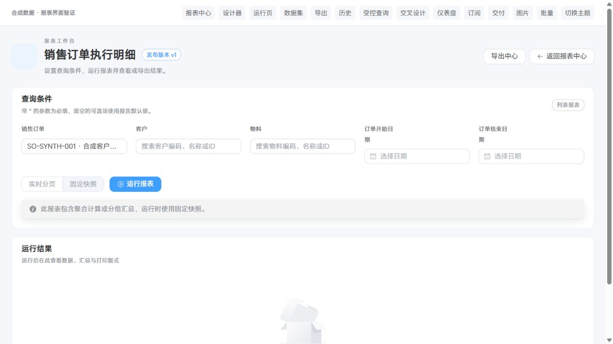
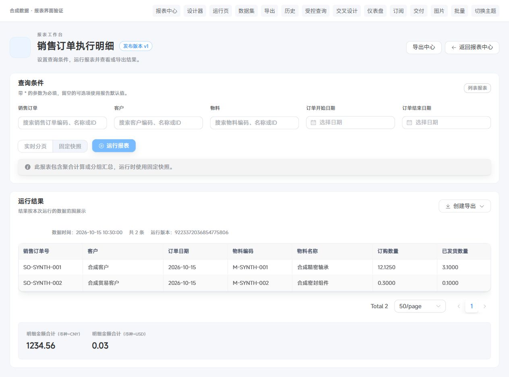

# 报表业务筛选与基础内容扩展验证记录

日期：2026-10-15；分支：codex/report-module-plan；开发基线：8a9d577f。本记录对应开发基线后的本轮报表优化，不能作为生产部署或人工验收结论。

## 实施结果

- 业务选择器支持名称、编码、完整ID搜索及按值回显；完整ID/DECIMAL仍为字符串。数据集样例、草稿预览与正式运行共用固定契约和授权绑定。
- 公共JdbcReportLookupProvider统一绑定参数、超时、租户/删除/组织隔离；ERP与MES在各自数据源注册候选。新增selected接口在查询前后复核身份、数据集资源及业务权限；列表权限用户可在样例中使用已授权候选。
- 新增ERP六类、MES两类数据集，使用实际安装结构中的字段，不变更旧六类provider版本一。销售/采购明细固定绑定父子租户与子表删除标志，财务字段单独校验权限和范围。
- 基础模板扩展至17类（14个数据集默认模板+3个变体）。新模板使用schema1/engine1.0.0，日期默认规则、列宽、中文状态和有维度的汇总已完善。完整清单及口径见[基础模板目录](../guides/报表基础模板目录与筛选口径.md)。
- 初始化只创建缺少的编码，保留同编码的用户草稿、自定义标题、发布版本、下线、归档及修订。没有自动初始化、执行SQL或向已有开发/生产库写入数据。
- 新增Java及TS/Vue具名契约、方法和测试辅助函数使用中文Javadoc/JSDoc；仅格式化本轮修改文件。

## 自动测试

| 范围 | 实际用例 | 失败 / 错误 / 跳过 | 证据 |
| --- | ---: | --- | --- |
| common-report | 16 | 0 / 0 / 0 | 完整ID、前导零、LIKE转义/注入、tenant/部门/删除、精确值与契约 |
| ERP报表 | 9 | 0 / 0 / 0 | 新6类数据集及已有取数/候选回归 |
| MES报表 | 4 | 0 / 0 / 0 | 新2类数据集、MES候选和旧质量追溯 |
| ruoyi-report | 332 | 0 / 0 / 0 | 编译、版本、模板、ACL、运行、打印、导出、私有存储和扩展回归 |
| Admin组合层 | 3 | 0 / 0 / 0 | 17模板全部编译、所有ID参数均有匹配绑定、字段权限裁剪后可编译 |
| 后端合计 | **364** | **0 / 0 / 0** | 59个测试类运行；基础数据集类名在ERP/MES各出现一次 |
| 前端全量 | **1885** | **0 / 0 / 0** | npm run test:unit，包含报表专项130项 |
| 前端报表专项 | **130** | **0 / 0 / 0** | 已包含在1885项中，不重复相加 |

最终库存流水“发生数量（原始值）”标签及原始负数断言调整后，额外重跑ERP FoundationDatasetTest 6项，全通过；不重复计入上述364项。最后一次筛选标签CSS调整后，重新通过定向Prettier、ESLint及生产构建。完整类型检查vue-tsc --noEmit通过。

后端完整命令由本地脚本.dsh-tmp/run-report-foundation-tests.ps1执行，脚本从以下五个目录选择全部Test.java类，解析为58个唯一测试类名（实际运行59个类）。同等可复现的PowerShell命令为：

```powershell
$testRoots = @(
  'ruoyi-common/ruoyi-common-report/src/test',
  'ruoyi-modules/ruoyi-report/src/test',
  'ruoyi-modules/ruoyi-erp/src/test/java/com/nexus/erp/report',
  'ruoyi-modules/ruoyi-mes/src/test/java/com/nexus/mes/report',
  'ruoyi-admin/src/test/java/com/nexus/report'
)
$reportTests = (rg --files @testRoots | Where-Object { $_ -like '*Test.java' } | ForEach-Object { [IO.Path]::GetFileNameWithoutExtension($_) } | Sort-Object -Unique) -join ','
mvn -pl ruoyi-admin -am test '-DskipTests=false' '-Dprofiles.active=' "-Dtest=$reportTests" '-Dsurefire.failIfNoSpecifiedTests=false'
mvn -pl ruoyi-modules/ruoyi-erp -am test '-DskipTests=false' '-Dprofiles.active=' '-Dtest=FoundationDatasetTest' '-Dsurefire.failIfNoSpecifiedTests=false'
```

前端在plus-ui下执行npm run test:unit、npm run test:report、npm run type-check、npm run build:prod。定向ESLint/Prettier覆盖API、ParameterForm/ParameterLookup、center/dataset/viewer/presentation及本轮测试脚本。构建通过；Sass旧导入及第三方模块externalized等仓库既有警告仍存在，不将其写成零警告构建。

本地日志（均为gitignored测试产物）包括.dsh-tmp/report-foundation-backend-tests.log、report-foundation-erp-final.log、report-foundation-ui-tests-final.log、report-foundation-ui-types-final.log、report-foundation-ui-build-final.log、report-foundation-ui-format.log和report-foundation-ui-lint.log。

## 失败测试与审查修复

公共候选、模板与新数据集先运行失败测试，再实施代码。H2建表仅从安装SQL提取列定义，保留真实字段和NOT NULL，不执行主安装脚本中的DROP/INSERT，不连接真实数据库。一次测试夹具因列注释含分号而被提前截断，修正为以表定义结束行截取；数值CASE映射随后显式CAST未知值为CHAR，避免H2将中文分支强制转换为整数。

只读代码审查确认两项前端缺陷，均已修复：

1. Element Plus远程选择器不会因既有el-option标签变化更新selectedLabel。固定已选项的key随标签/加载状态变化，使其重新注册；真实组件回归直接断言selectedLabel。去除修复的内存基线仍显示“正在读取采购订单名称…”，测试失败；当前代码返回PO-SYNTH · 合成供应商，测试通过。
2. OFFSET分页重叠时，去重后的候选数可能永远小于服务端total。改为记录原始消费条数，并在空页时结束；新增两项用例先复现重复请求第4/5页、空页后仍追加，再验证修复。

后端服务测试另外覆盖资源ACL撤销、字段/业务权限、查询后身份变化、错配候选结果，以及回显单个参数时不强迫填写其他必填参数。初始化回归验证自定义、OFFLINE、ARCHIVED记录不被覆盖或复活。

## 浏览器验证

使用真实Vue/Element Plus页面及本地合成API，测试端口18087。未登录真实用户、未请求现有后端、未触发真实初始化。

- 完整ID9223372036854775807预填后直接显示业务编码与名称，无需打开候选列表。
- 输入完整ID9007199254740993，展示对应候选，选中后名称正确；模型精度由自动测试另行断言。
- 数据集“字段与样例”→“数据样例”展示销售订单、客户、物料业务选择器。
- 基础目录显示17类合成模板；执行明细按精确小数显示，CNY与USD合计分别展示，分区名称使用中文。
- 390px窄屏的名称读取失败场景展示“原参数已保留”和“重试名称”；DOM宽375px不超过390px视口。窄屏截图工具失败，故仅记录DOM观察，不提供伪造截图。临时视口已重置。

截图均为合成数据，不证明真实数据筛选结果或生产验收：





[17类基础目录截图](../assets/report-foundation/foundation-center.png)

隔离Vite进程已按端口和命令行核对后停止。未启停用户后端或其他服务。浏览器工具在关闭临时标签页时发生超时，未将关闭尝试写成已完成清理；临时标签未标记为交付，交由应用按生命周期回收。

## 文件范围与使用方式

主要修改位置：common-report候选SPI及JDBC底座；ERP/MES report/adapter目录（8个新provider和候选绑定）；ruoyi-report的LookupController、LookupService、DatasetVersionService、Templates、DefinitionService；plus-ui的业务参数组件、API、数据集样例、中心入口、运行汇总展示与测试脚本；Admin组合测试和本文档/基础模板目录。

运行更新后的应用后，由有权限账号在报表中心点击“创建基础报表”，补齐缺少的模板。完整权限下最多17类，原6类都已存在时本轮最多新增11类。已有同编码定义继续保留，可按正常草稿/发布流程自行调整。

本轮没有新增物理表/迁移文件或执行现有SQL，没有写已有开发/生产库；现有E2–E7迁移状态保持不变。未验证真实开发库的字段基线、部署、生产数据、外部设备或人工端到端验收。用户已于2026-10-15明确授权将本轮改动提交到本地Git；未推送远程。
