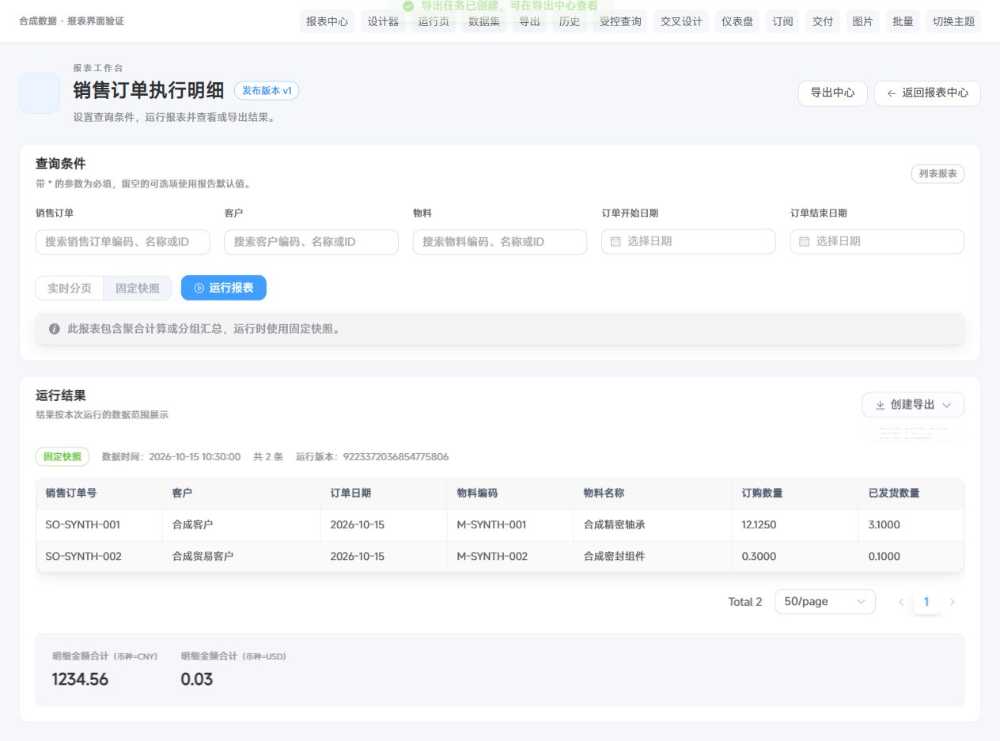

# 报表HTTP导出、空条件运行修复与本地初始化记录

日期：2026-10-15；分支：codex/report-module-plan；代码基线：ee6e4ccb。本轮修复、测试和初始化验证记录一并提交Git，具体提交以分支日志为准；本记录不代表生产部署或真实业务验收。

## 现场与原因

用户使用局域网HTTP前端，创建导出时直接调用crypto.randomUUID，出现TypeError并在生成请求键时中断。该API受安全上下文限制；浏览器仍可使用getRandomValues生成安全随机字节。核对参考：MDN Web Docs的Crypto.randomUUID与Crypto.getRandomValues条目。

原六份基础报表中，采购订单打印、送货单打印、来料检验追溯要求关联单据ID；原前端未在运行前校验，空参数直接进入服务端，DatasetAccessException又被统一翻译为“报表数据查询被拒绝或已停止”。可选的仓库/客户/日期筛选不能因此被强制要求填写。

初始化前只读核对目标为127.0.0.1的master数据源ry-vue，租户000000：6个ACTIVE数据集、6份已发布BASE_基础报表。上一轮17类是已安装代码模板目录，没有自动落库。用户随后明确授权在该本地库与租户调用初始化服务补齐缺项；本轮已完成，当前为14个ACTIVE数据集和17份已发布基础报表。

## 代码修改

- 新增plus-ui/src/utils/requestKey.ts：优先原生randomUUID；缺失时用真实Crypto.getRandomValues生成标准UUIDv4，并设置版本/变体位。安全随机能力也缺失时显示明确提示，不使用时间戳或Math.random。
- 运行页导出与订阅手动执行使用同一工具，网络失败重试仍复用原请求键，保留旧响应围栏及幂等行为。
- model.ts提供有效默认值合并及必填提示；运行、草稿预览、数据集样例在接口前校验缺少条件，可选条件保持可留空。
- ReportDefinitionService.parameters补齐模板加强的必填约束。空值不覆盖模板默认值；允许继承固定数据集默认值；缺少条件仅使用provider声明的中文标签生成400提示。
- published接口在原有资源检查与bindVersion授权成功后新增effectiveParameters，只包含模板声明的条件及其有效默认提示。模板默认值优先、固定descriptor默认值兜底；不改写DSL、版本JSON或checksum，不提前计算日期，不放宽dataset版本API权限。旧前端可忽略新增字段；新前端兼容旧响应的DSL，完整的默认继承修复需前后端同时更新。
- DatasetAccessException的INVALID_PARAMETER使用固定可操作提示，其他原始异常信息、SQL和提交的业务值仍不返回客户端。

## 验证

| 检查 | 结果 |
| --- | --- |
| 报表相关后端全部回归 | 60个测试类，371项通过，失败/错误/跳过均0 |
| 前端全量npm run test:unit | 1897项通过，含报表142项，不重复相加 |
| npm run type-check | vue-tsc --noEmit通过 |
| npm run build:prod | 通过，仓库既有第三方/Sass警告保留 |
| 定向ESLint、Prettier | 本轮修改源文件与测试脚本通过 |
| git diff --check | 通过 |

先复现失败测试：HTTP环境缺失randomUUID导致导出Promise拒绝；缺少安全随机时无反馈；必填单据为空仍调用API；后端没有执行模板加强的必填约束；空字符串覆盖模板自定义日期；参数异常没有安全筛选提示。实施后均通过。

代码审查另发现前端未考虑继承数据集默认值的P2兼容问题，已补充模型、viewer/designer组件与服务端不改写DSL的回归并修复；复审通过，未发现新的确定问题或published权限扩大。

浏览器使用真实Vue/Element Plus页面和合成API，在夹具入口明确禁用randomUUID，保留真实getRandomValues。点击“运行报表”→“创建导出”→“PDF打印文件”正常出现“导出任务已创建”；合成API检查请求键符合UUIDv4格式，浏览器error日志为空。必填订单为空时显示具体条件名，真实组件测试断言运行API调用次数为0。截图仅证明合成UI链路，不代表生产文件交付。

本地日志位于gitignored的.dsh-tmp/report-http-*；完整后端测试通过run-report-http-tests.ps1选择公共报表、ERP/MES报表、ruoyi-report和Admin组合层的全部Test类，Maven明确使用-DskipTests=false、空profiles.active及非零测试统计。

## 服务状态

已按用户既有授权重启当前工作区的NexusApplication。第一次重启因测试资源过滤把profiles.active置空，未加载数据源而失败；查明后显式使用原dev环境恢复。最终版本保持dev环境启动，已确认启动成功、8080监听，以及/report/definitions无凭证访问返回认证code401。该探测只验证服务与鉴权可用，未声称真实登录后的报表端到端验收。另从用户局域网地址读取前端requestKey.ts模块，HTTP200且已包含createRequestKey/getRandomValues实现，确认开发前端正在提供修复代码；用户需刷新旧页面。

IDEA原进程已被替换为后台Java进程，PID保存在.dsh-tmp/report-http/backend.pid；日志和启动参数文件均为本地忽略产物，不提交或输出敏感配置。合成UI测试进程已停止，临时浏览器标签已关闭。

## 已完成的本地初始化

2026-10-15 23:40（Asia/Shanghai），按用户明确授权完成本机master数据源ry-vue、租户000000的增量初始化。执行器复用当前编译产物中的真实ERP/MES提供者契约、SystemReportAuthorizationAdapter及ReportDefinitionService.bootstrap；先解析真实有效管理员账户和租户权限，再使用原有资源ACL、编译及发布流程。执行器只装配报表元数据所需依赖，没有启动第二个完整应用实例，也没有配置ERP/MES业务查询连接。

新增8个数据集编码：ERP_MATERIAL_CATALOG、ERP_CLIENT_CATALOG、ERP_VENDOR_CATALOG、ERP_STOCK_MOVEMENT、ERP_SALES_ORDER_LINES、ERP_PURCHASE_ORDER_LINES、MES_WORK_ORDER_TRACKING、MES_IQC_RECORDS。

补齐的11份基础报表编码为：

- BASE_ERP_MATERIAL_CATALOG
- BASE_ERP_CLIENT_CATALOG
- BASE_ERP_VENDOR_CATALOG
- BASE_ERP_STOCK_MOVEMENT
- BASE_ERP_SALES_ORDER_LINES
- BASE_ERP_PURCHASE_ORDER_LINES
- BASE_MES_WORK_ORDER_TRACKING
- BASE_MES_IQC_RECORDS
- BASE_ERP_STOCK_BALANCE_AVAILABLE
- BASE_ERP_SALES_EXECUTION_TOTALS
- BASE_ERP_PURCHASE_EXECUTION_TOTALS

验证结果：

| 核对项 | 初始化前 | 初始化后 |
| --- | --- | --- |
| ACTIVE数据集 | 6 | 14 |
| 已发布BASE_基础报表 | 6 | 17 |
| 发布版本关联有效固定数据集 | 6 | 17 |
| 正常服务权限绑定与编译通过 | 6 | 17 |

首次初始化和结果检查在本机事务内执行。原六份报表的全部定义字段、草稿正文、修订、发布指针、状态及所有原有发布版本均逐字段比较一致；六个既有数据集契约校验和也与当前代码一致。再次调用相同bootstrap服务后，rpt_definition、rpt_version、rpt_dataset、rpt_dataset_version、rpt_catalog及rpt_acl逐字段快照完全一致，未重复新增定义或版本；正常服务审计按设计追加，不纳入元数据幂等快照。事务提交后又通过独立只读SQL核对14个ACTIVE数据集、17份PUBLISHED基础报表和17条有效固定版本关联。

执行证据摘要保存在本地忽略目录.dsh-tmp/report-http/bootstrap-local-evidence.json，包含目标、前后数量、原定义及版本摘要、补齐编码和幂等验证结果；启动器、凭证环境、参数及日志不进入Git。此次只登记报表元数据，未执行DDL、主安装SQL或历史迁移，未改ERP/MES业务数据，未重跑积木清理或E2–E7迁移。后端仍以dev环境在8080运行。管理员刷新报表管理页面后可查看17份基础报表，资源可见范围仍遵循现有权限和ACL。
