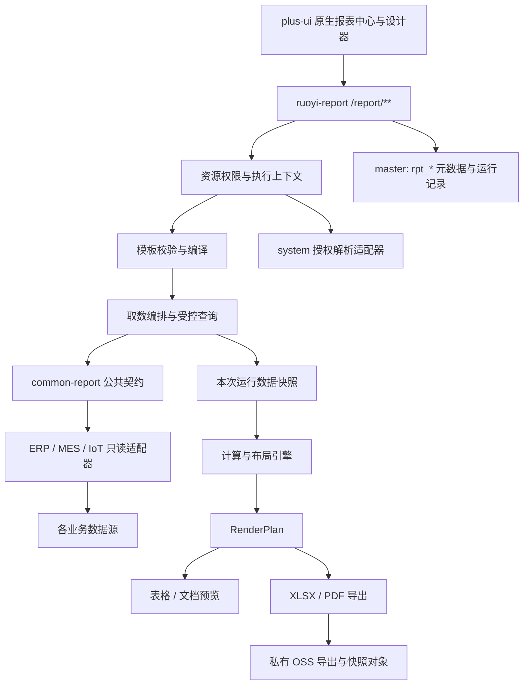
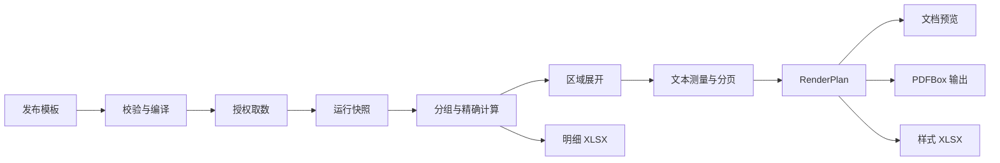

# Nexus-ERP 自研报表模块建设设计

> 文档编号：NexusERP-REPORT-2026-001
> 版本：v1.0
> 状态：2026-10-14 首期实施完成；本机验证见执行记录
> 创建 / 更新日期：2026-10-13
> 基线：`plus` 分支 `c51e0f13`；方案分支 `codex/report-module-plan`
> 关联：[源码调研](./2026-10-13-system-reporting-research.md)、[建设路线与验收](../plans/2026-10-13-system-reporting-construction-plan.md)

以下现有集成描述核对于 **2026-10-13、c51e0f13**，用于说明建设前基线；2026-10-14 变更后的事实见首期实施记录。

## 1. 建设结论与适用范围

建议新建 `ruoyi-modules/ruoyi-report`，自研报表定义格式、设计器、取数编排、计算与布局引擎、运行与发布管理。通过轻量的 `ruoyi-common/ruoyi-common-report` 契约接入 ERP / MES / IoT / 系统模块，首期随 `ruoyi-admin` 部署。用户已授权直接清理未投入使用的积木资产，原模块标识继续用于自研实现。

“独立”首先落实为代码、契约、数据表、API 和生命周期独立；首期采用模块化单体，后续有并发和部署需求再拆运行服务。“自研”要求核心定义与行为由项目拥有；Vue、ECharts、FastExcel、POI、PDFBox 等基础库可使用，但不将现成报表产品换名后作为核心引擎。

本文件是架构与建设范围建议，不是已批准的排期或逐行代码实施说明。2026-10-14 用户已批准首期实施、积木资产直接清理以及实施完成后的 Git 提交，实际状态以首期实施记录为准。

### 1.1 当前事实与不能直接推断的结论

| 核实事项     | 代码事实                                                                                                                                                                                      | 对建设的影响                                                                                       |
| ------------ | --------------------------------------------------------------------------------------------------------------------------------------------------------------------------------------------- | -------------------------------------------------------------------------------------------------- |
| 现有模块     | [ruoyi-report/pom.xml](../../../ruoyi-modules/ruoyi-report/pom.xml) 固定依赖 JimuReport / JimuBI 两个 Boot 3 Starter，均为 `2.3.2`；Java 源码仅有鉴权桥接                                     | 缺少项目自有模板、计算和导出核心，需要建设完整链路                                                 |
| 认证与权限   | 历史 `JimuReportTokenService`（2026-10-14 删除，可从 c51e0f13 查阅） 对接 Sa-Token，管理权限已限制管理员，兼容 URL token                                                                      | 新模块使用正常认证拦截和细粒度权限，不沿用 URL 登录令牌                                            |
| 表与配置     | [主安装 SQL](../../../script/sql/ry-vue.sql) 有 `jimu_report*` 等表；[application.yml](../../../ruoyi-admin/src/main/resources/application.yml) 排除清单主要是 `jm_report*`，并放行旧产品路由 | 命名和字段须按实际部署库确认；此差异本身不是已验证的运行漏洞                                       |
| 数据源       | 开发、生产配置声明 master / ERP / MES / IoT，未发现名为 report 的独立数据源                                                                                                                   | 不能沿用“已经有独立报表库”的假设；新元数据先落 master，取数按业务库分开                            |
| 已有业务报表 | ERP 销售、采购、库存、生产、财务等模块已有自有 Controller / Service；MES 还有业务报告接口                                                                                                     | 此类业务功能保留；仅通过经过审查的只读适配器复用，不能按名称含 report 就整体迁走                   |
| 更新故障     | 用户反馈上游更新后不可用；本次未获得相应版本对、错误日志与复现环境                                                                                                                            | POM 已固定版本，无法证明上游发布会自动改变当前部署；后续需区分主动升级、库迁移、资源路径和授权变化 |

基础技术以当前文件为准：Java 17、Spring Boot 3.5.12；前端 Vue 3 / TypeScript / Element Plus，已有 ECharts 6.0.0；根 POM 已管理 PDFBox 3.0.8，common-excel 使用 FastExcel。生产编排仍以 MySQL 5.7 为基线。详细证据和外部资料见调研文档。

## 2. 三种建设路径

| 路径                                    | 可取得的能力                               | 主要代价                                                                               | 本次取舍                                   |
| --------------------------------------- | ------------------------------------------ | -------------------------------------------------------------------------------------- | ------------------------------------------ |
| A：Fork AJ-Report 并长期维护            | 可较快取得大屏和初步 Excel 设计入口        | 本地实现为 Vue 2 / Boot 2 / Gaea；需要迁移认证、租户、查询和渲染，仍承担第三方核心维护 | 作为源码参考，核心独立实现                 |
| B：自研平台 + JasperReports / BIRT 引擎 | 可复用成熟打印、分页和导出机制             | 模板与底层行为受引擎版本影响，还需自研在线设计与安全边界                               | 适合另行批准的过渡方案；不作为本建设主路径 |
| C：自研定义、运行引擎和设计器 + 基础库  | 定义格式、权限、升级和运行行为可由项目控制 | 排版、公式、设计交互与兼容测试投入最高                                                 | **推荐；分阶段建设，先兑现高频 ERP 场景**  |

避免把能力范围扩大为完整 Excel、Power BI 或任意脚本运行平台。首批样本应来自真实报表清单，下面场景为提议，需要 G0 阶段用业务样本校准。

### 2.1 产品形态与交付边界

| 形态                   | 定义方式                                | 首期能力                                         | 后续能力                                 |
| ---------------------- | --------------------------------------- | ------------------------------------------------ | ---------------------------------------- |
| TABLE：业务分析列表    | 参数表单 + 数据集 + 列与分组配置        | 分页、排序、字段显示、受控汇总、明细 XLSX        | 查询目录、交叉汇总、钻取                 |
| DOCUMENT：业务打印单据 | 网格单元格 + 标题 / 明细 / 页眉页脚区域 | A4 横纵向、纵向明细展开、静态合并、重复表头、PDF | 横向展开、交叉表、嵌套主从、复杂分组     |
| DASHBOARD：经营仪表盘  | 组件布局 + 数据绑定                     | P0 暂不交付                                      | P1 常用图表、筛选联动；P2 大屏与刷新治理 |

P0 不提供任意 JDBC 连接配置、用户 SQL、外部 HTTP 数据源、用户脚本、匿名分享、报表数据回写、PDF 电子签章。签章属于现有签章服务的独立集成范围，普通报表导出不自动构成签署证据。

首批建议：库存余额、销售执行、采购执行三类列表；采购订单、送货单两类打印单据；一类 MES 质量追溯打印。财务法定报表可在已有财务 Service 的可信结果上做展示试点，科目口径和财务计算保持业务归属。

## 3. 模块与依赖架构



图中的箭头表示调用或数据流，Maven 依赖如下，不能用调用方向推导模块依赖：

| 模块                            | 职责与允许依赖                                                                                                                                          |
| ------------------------------- | ------------------------------------------------------------------------------------------------------------------------------------------------------- |
| `ruoyi-common-report`（新增）   | 数据集、授权、查询、类型和执行上下文契约；不依赖 report 或任何业务模块；不放数据库凭证                                                                  |
| `ruoyi-report`（复用）          | controller / domain / bo / vo / mapper / service；definition、compiler、query、expression、layout、renderer、export、runtime 子包；依赖必要 common 模块 |
| ERP / MES / IoT                 | 各自 `report/adapter` 包实现公共数据集契约，只依赖 common-report，不依赖 report 引擎                                                                    |
| system                          | `report/adapter` 提供用户有效性、角色、部门数据范围和权限解析，只依赖 common-report                                                                     |
| ruoyi-admin                     | 组装并注册所有实现；同一 provider code 冲突时启动失败；未安装的 provider 禁止发布和执行                                                                 |
| plus-ui                         | `src/api/report`、`src/types/report`、`src/views/report`、`src/components/report`；不通过 iframe 实现新设计器                                           |
| ruoyi-report（2026-10-14 更新） | 复用原模块标识，自研定义/运行/布局/导出核心；删除积木依赖                                                                                               |

首期不另起微服务、不复制 ERP 表、不对多个库做一次 SQL JOIN。跨库报表由适配器分段读取，以声明的业务键作有上限的批量匹配；每段校验租户与组织权限，并记录读取时间。需要一致时点的跨库统计应使用后续只读汇总快照，不能宣称跨库读取天然一致。

## 4. 自有报表定义与版本

### 4.1 稳定的 JSON DSL

DSL 包含 `schemaVersion`、报表形态、数据集版本引用、参数 schema、字段绑定、显示样式、区域和纸张规则。存储格式与任一前端编辑组件解耦；设计器状态如选区、拖拽临时值和撤销历史不写入发布模板。

下面是拟定义的 TABLE 模板片段；数据集、ID、名称均为规格示例，尚无对应业务实现。所有标识符按字符串传输。

```json
{
    "schemaVersion": 1,
    "kind": "TABLE",
    "code": "STOCK_BALANCE",
    "datasets": [
        {
            "alias": "stock",
            "datasetCode": "ERP_STOCK_BALANCE",
            "datasetVersionId": "1000000000000000001"
        }
    ],
    "parameters": [{ "name": "warehouseId", "type": "ID", "required": false }],
    "regions": [
        {
            "id": "detail",
            "type": "DETAIL_TABLE",
            "datasetAlias": "stock",
            "columns": [
                { "field": "materialCode", "label": "物料编码", "type": "STRING" },
                { "field": "quantity", "label": "数量", "type": "DECIMAL", "scale": 4 },
                { "field": "unitCode", "label": "单位", "type": "STRING" }
            ]
        }
    ]
}
```

发布时校验形态与区域组合、字段存在性与访问权、别名唯一性、参数映射、样式边界、合并区域冲突和资源容量。发布版本钉住数据集版本和 provider 契约版本；日后修改数据集不能静默影响旧报表。

### 4.2 草稿、发布、运行三种对象

- 草稿可修改，保存必须携带 `draftRevision`；冲突返回 409，不能覆盖另一设计者修改。
- 发布生成不可变版本，包含 DSL 校验和、数据集版本清单、最低引擎版本、发布人和时间；已发布内容不能原地更新。
- 运行固定一个已发布版本、参数、有效权限范围、引擎版本和数据读取时间；普通用户不能预览未发布草稿。

报表状态为 `DRAFT / PUBLISHED / OFFLINE / ARCHIVED`；编辑已发布报表产生新草稿，同时保持当前已发布指针。发布切换用事务和乐观锁，回滚仅切回兼容的历史发布版本。回滚模板不改变用户当前权限，也不回滚业务数据。

引擎升级必须提供受支持 schema 范围、纯格式迁移器和黄金样本回归。未知版本明确拒绝，不能自动猜测。provider 契约不再兼容时保留旧实现或阻止旧版本运行；不反序列化外部 Java 对象作为模板或运行结果。

## 5. 数据集与执行安全

### 5.1 P0：可信业务数据集

业务模块实现 `ReportDatasetProvider`：提供固定 code、契约版本、参数定义、字段类型、允许排序/过滤字段、支持的查询模式和只读查询方法。运行上下文由服务端建立，前端不能指定 tenant、actor 或连接名。

查询模式分为 `PAGE`、`AGGREGATE`、`SNAPSHOT_STREAM`。只有 Service 原有契约完全匹配时才复用；例如已有 Service 只返回汇总列表，不能据此假设其具备组织隔离、分页或完整明细导出能力，须补建专用 Mapper / 投影并审查。

`ReportAuthorizationPort` 从 system 获得当前用户有效性和权限范围。所有 provider 都接收显式 `ReportExecutionContext`，并对明细、汇总、字典、钻取、导出执行同一行/列策略。平台只做排版和已定义展示公式，不重写财务结转、库存价值或 MES 质量口径。

### 5.2 P1：受控查询目录

数据源管理登记逻辑名称、允许实体/字段、只读连接引用及查询策略。凭证留在环境或现有密钥配置，API 与模板不能返回用户名、密码或任意连接字符串。业务人员通过数据集目录选择字段、条件、排序和已批准关联。

受控查询树由服务端生成 SQL，所有值使用 JDBC 占位符绑定；列名、表名、排序方向只能由目录中的枚举映射。JSQLParser 用于校验生成结果及开发者登记的查询，不用关键字黑名单替代结构校验。继承现有 MyBatis-Plus 的依赖管理，不自行引入冲突版本。

v1 的查询边界为单数据源 SELECT、已登记实体、简单 INNER / LEFT JOIN、固定聚合函数、明确分页。拒绝 UNION、CTE、任意子查询、自定义函数、系统库、变量、文件操作、锁定读取、多语句和存储过程。高级 SQL 由后续单独规格扩展；P1 不向普通设计者提供自由 SQL 编辑/执行接口。

每个租户实体都必须加入租户条件；子实体通过登记的归属关系过滤；LEFT JOIN 被关联表先按策略过滤或在 ON 中施加正确条件，不能在 WHERE 中破坏外连接含义。子表缺少租户列时不能猜测归属。明细查询、count 和聚合共用一棵有效过滤树。

**直接 JDBC 不经过 MyBatis 插件。** 元数据 Mapper 可以复用租户插件；受控 SQL 仍须自行实施同等租户、组织与字段隔离，并使用专用只读账号及表级授权。`readOnly=true` 和禁止 UPDATE 的字符串检查不能替代数据库权限。

### 5.3 访问控制

有效访问权 = 登录与租户有效 + 菜单操作权限 + 报表资源 ACL + 使用数据集 ACL + 行/列策略。任何一项不满足均拒绝；“能打开报表中心”不直接取得报表数据。无 ACL 默认拒绝，创建者只取得明确的草稿管理权，发布/导出仍需独立权限。

权限建议统一使用 `report:definition:list/add/edit/remove/publish`、`report:dataset:list/manage`、`report:runtime:preview/export`、`report:acl:manage`、`report:audit:query`；P2 再增加 `report:schedule:manage`。数据集管理者能维护模板字段，但不能通过修改字段定义扩大自身业务取数权限。

所有 `rpt_*` 记录携带 tenant；子记录必须同租户校验；敏感字段在查询投影和聚合授权阶段处理，不能只在前端遮挡。超级管理员跨租户查看也需显式选择租户并留痕，不设置默认“全部租户”。

### 5.4 异步与缓存

后台任务只保存 tenant、actor ID、版本 ID、参数引用和任务身份；不保存 JWT 或复制请求 ThreadLocal。任务启动、文件交付时重新校验用户、权限和报表状态。运行保存授权范围与字段策略指纹；重新解析后指纹变化时，原快照及文件标记为不可交付并返回 SCOPE_CHANGED，用户按新权限建立新运行，不能把已有文件按原范围直接交付。provider 依据重新解析的显式范围执行，不能假设当前 `@DataPermission` 在无登录线程中仍可自动恢复原用户。

任务的动态租户使用 `TenantHelper.dynamic` 等现有可恢复作用域；自建上下文在 finally 关闭，并测试线程复用不会串租户。任何依赖 `LoginHelper` 隐式上下文的旧 Service 都须先改为可审查的只读适配契约，不能原样交给后台运行。

P0 仅复用同一次运行内的快照，不共享跨用户查询结果。P1 如引入缓存，键至少包含 tenant、actor / 权限范围指纹、策略版本、数据集版本、规范化参数和数据版本/有效期；读取缓存之前重新鉴权。涉及当前用户的字段必须纳入 actor，角色相同不能作为共享缓存依据。

## 6. 计算、展开、分页与多格式输出



### 6.1 数据类型与计算规则

运行值显式声明 STRING、ID、INTEGER、DECIMAL、BOOLEAN、DATE、DATETIME。ID 和大整数以字符串传输；DECIMAL 保留精确文本，在 Java 使用 BigDecimal。前端禁止用 Number 重新算金额或工业 KPI；现有 `safeExpression.ts` 可借鉴受限解析思路，其浮点计算不能直接用于财务报表。

首期表达式为受限 AST：字段/参数引用、常量、四则运算、比较、IF、COALESCE、ROUND、SUM、COUNT、MIN、MAX。禁止任意 JS / Python / Groovy / SpEL、反射、类访问、文件/网络调用。发布时检查依赖环、节点深度与类型；除零、字段缺失和精度溢出返回定位错误，不能静默补零。

NULL 与零区分，默认 NULL 传播，需要 COALESCE 才替换；ROUND 指定 scale 和舍入方式。日期明确业务时区和闭开区间；用户语言只影响显示。汇总明确 DATASET / GROUP / PAGE 作用域，分页不改变全量总计；COUNT count 与 COUNT field 的空值语义区分。

金额汇总按币种分区，数量汇总至少按物料和计量单位分区；跨单位必须由业务 provider 提供已批准转换结果。展示公式不能创造不存在的业务事实。

### 6.2 自研展开算法

P0 以“明细区域”为展开单位，同一行的物料、数量、单位来自同一条记录，不采用独立按列复制单元格的算法。处理顺序：确定区域依赖和排序 → 固定头区 → 对每条记录复制明细区域 → 统一计算行偏移 → 调整下方静态区域与合法合并 → 计算分组/全量汇总。

首期只支持纵向区域展开；禁止跨明细边界的动态合并，静态合并允许；一个 DOCUMENT 首期只允许一个可增长主明细区域。空数据按模板选择“仅表头与空提示”或“无明细单据”，不生成虚假数量为零的业务行。P1 横向展开/交叉表、P2 嵌套区域各自建立依赖规则和回归集。

### 6.3 排版与 RenderPlan

DOCUMENT 使用 pt 作为内部单位，A4 纵向约 595.28 × 841.89 pt；页面边距、列宽、行高、线宽与字体明确。文本测量使用已打包的批准字体和固定版本，测量后输出确定的换行位置；浏览器消费同一断行，不自行计算页面。

分页先扣除页眉页脚及重复表头，按实际行高装页。明细行默认不切分；超过整页可用高度的单行明确报错并定位。P0 不接受靠缩小字体悄悄改变版式。页码 / 总页数使用两遍计算；最后一页汇总与页脚空间提前参与分页。

RenderPlan 包含版本、运行 ID、逻辑行与分组、页面数、带坐标的文本/线条/图片、合并结构、格式化值和原始类型。页坐标与断行由服务端决定，支持范围内同一运行的预览和 PDF 内容/分页一致。字体缺字、图片尺寸未知、合并越界不能在导出时静默忽略。

PDFBox 负责写 PDF、嵌入字体和图像；文本布局、分页和表格规则由项目实现。文档预览先用 RenderPlan 渲染页面，打印交付以生成的 PDF 为验收基准。P0 不承诺复杂富文本、SVG、任意 CSS 或图表的 PDF 导出。

### 6.4 明细、样式两类 Excel

明细 XLSX 使用结构化数据输出，目标是完整字段、正确类型和便于分析；样式 XLSX 使用受支持的网格/合并输出，目标是业务版式。FastExcel 用于流式明细；POI 的兼容版本通过根依赖管理用于样式输出。两类结果需标注用途，不承诺 Excel 与 PDF 的像素级一致。

ID、前导零编码及超过 Excel 有效精度的数值写文本；普通 DECIMAL 在可表达范围内按声明样式写数值并保留服务器总计。字符串字段必须写字符串单元格，不能让 `= / + / - / @` 开头的文本成为公式；负数数值仍保持数值类型。P0 公式仅输出已算值，不导出可执行模板公式。大规模导出不能把全量 Cell / RenderPlan 装入 Web 请求堆。

### 6.5 同次运行一致性

TABLE 浏览默认按页实时取数，显示 `LIVE` 和读取时间，下一页可能反映新数据。DOCUMENT 及需要同一时点的导出采用 `SNAPSHOT` 运行，生成完整有上限的数据快照；预览与导出绑定 runId。LIVE 列表导出时建立新的 SNAPSHOT，并明确其时间，不能把当前显示页当成全量结果。

同一业务库的严格快照由 provider 在明确的只读事务内读取；大列表优先 keyset 分页或业务水位，声明一致性等级。业务无可用一致水位时只承诺读取窗口内快照。跨业务库标注 BEST_EFFORT 与各段时间；需要强一致的报表须另外建设业务快照。

## 7. 存储与 API 草案

### 7.1 元数据表

以下是建议的数据模型，尚未建表；正式 DDL 另随实现维护主 SQL 和存量迁移。

| 表                    | 关键内容与约束                                                                               | 阶段     |
| --------------------- | -------------------------------------------------------------------------------------------- | -------- |
| `rpt_catalog`         | tenant、父目录、名称、排序；禁止目录环，目录不自动授予数据权                                 | P0       |
| `rpt_definition`      | tenant、code、kind、草稿 DSL、draft_revision、published_version_id、状态                     | P0       |
| `rpt_version`         | definition_id、version_no、DSL、checksum、schema/engine 版本、数据集版本清单、发布留痕       | P0       |
| `rpt_dataset`         | tenant、code、provider/query 类型、草稿、启停状态                                            | P0       |
| `rpt_dataset_version` | dataset_id、version_no、provider 契约、参数/字段/查询快照                                    | P0       |
| `rpt_acl`             | tenant、resource_type/id、subject_type/id、action；唯一约束防重复授权                        | P0       |
| `rpt_run`             | tenant、actor、version、参数私有引用、状态、引擎版本、数据时间、一致性、快照/plan 引用、耗时 | P0       |
| `rpt_export_job`      | run、format、请求幂等键、状态、attempt、lease、文件引用、到期时间                            | P0       |
| `rpt_audit`           | actor、tenant、资源、动作、结果、参数摘要、traceId；不记录凭证与业务明细                     | P0       |
| `rpt_datasource`      | 逻辑连接、secretRef、目录及策略；不存前端可读取的密码                                        | P1       |
| `rpt_subscription`    | 版本、执行主体、触发计划、接收规则、启停；撤权时停止                                         | P2       |
| `rpt_legacy_mapping`  | 旧引擎/ID、新 definition/version、迁移状态与验证记录                                         | 迁移阶段 |

P0 9 张核心表不含迁移映射；编号为 ASSIGN_ID，沿用必要审计字段与租户实体。MySQL 5.7 兼容，DSL 使用 LONGTEXT + 应用层 schema 校验；不使用 8.0 专属 SQL。元数据采用单库事务，不在其中包入跨库长查询。code 在同租户内唯一且删除后不复用；版本号按父对象唯一。

快照、完整 RenderPlan 和导出文件进入私有 OSS，元数据保存对象 ID、校验和和到期时间。业务明细不放公开静态目录，P0 下载经认证服务代理交付，不直接给出可绕过后续鉴权的对象地址。新装定义同步 `script/sql/ry-vue.sql`；存量环境另建带适用基线、备份和可重放说明的迁移，并登记数据库变更记录。方案阶段不执行任何 SQL。

### 7.2 API 与兼容

| API                                            | 语义与权限                                    |
| ---------------------------------------------- | --------------------------------------------- |
| `GET/POST /report/definitions`                 | 可见列表 / 新建草稿，分别鉴权                 |
| `GET/PUT /report/definitions/{id}`             | 编辑读取 / 乐观锁保存，PUT 必带 draftRevision |
| `POST /report/definitions/{id}/validate`       | 编辑者校验草稿，不使用未授权数据              |
| `POST /report/definitions/{id}/draft-previews` | 编辑者预览，受小样本/容量限制，记录预览身份   |
| `POST /report/definitions/{id}/publish`        | 校验并生成不可变版本；携带草稿 revision       |
| `POST /report/definitions/{id}/offline`        | 阻止新执行，已有文件交付也重新校验            |
| `POST /report/definitions/{id}/rollback`       | 指向已存在、兼容的发布版本并留痕              |
| `GET /report/datasets`                         | 只列出有权限的数据集及可见字段                |
| `POST /report/datasets/{id}/samples`           | 管理/设计权限 + 数据 ACL；只能返回有界样本    |
| `POST /report/runs`                            | 只能由发布报表建立 LIVE / SNAPSHOT 运行       |
| `GET /report/runs/{runId}`                     | 当前状态及分段耗时，绑定 actor / tenant       |
| `POST /report/runs/{runId}/pages`              | 受控排序/分页或快照页读取，重新鉴权           |
| `POST /report/runs/{runId}/exports`            | 创建幂等异步任务；format 在受支持枚举内       |
| `GET /report/exports/{jobId}`                  | 查询状态；不能查询其他租户任务                |
| `GET /report/exports/{jobId}/download`         | 交付前重新鉴权、检查到期、记录审计            |
| `POST /report/exports/{jobId}/cancel`          | 本人或授权管理者取消，终态操作幂等            |
| `GET/PUT /report/definitions/{id}/acl`         | 资源授权管理，不能借授权扩大本人的数据范围    |

返回沿用 R / TableDataInfo、全局 Long 序列化及认证错误语义；不得用局部 ObjectMapper 绕过大数序列化。API 业务错误类型应明确 INVALID_TEMPLATE、SCOPE_DENIED、VERSION_UNSUPPORTED、QUERY_TIMEOUT、CAPACITY_EXCEEDED、SNAPSHOT_EXPIRED、SCOPE_CHANGED，并避免返回原始 SQL/数据库错误明细。

以上路由是拟定 API，不表示已注册。新 `/report/**` 使用正常认证链，不加入现有 security excludes；URL 不承载登录 token。文档预览和下载通过现有 Axios 认证/加密适配获取 JSON/Blob，二进制响应按现有导出接口规则专项验证。

## 8. 任务执行、容量与可观测性

运行状态为 `QUEUED → RUNNING → SUCCEEDED / FAILED / CANCELLED / EXPIRED`；导出任务另有 `CANCEL_REQUESTED` 中间态。任务用数据库抢占、owner 和有期限的 lease 控制并发；节点失败后重新抢占，最大 3 次尝试。取消只在关闭查询/输出流并清理临时对象后进入 CANCELLED。终态更新采用条件更新，防止完成与取消竞争覆盖。

重复请求唯一键为 tenant + actor + idempotencyKey，冲突时校验请求指纹；不允许用同一 key 偷换 format/runId。重试固定 runId 与同一快照，成功文件只交付一次；权限撤销或快照到期不自动换数据重跑。跨节点只恢复兼容引擎版本的任务。

P0 用数据库持久任务 + reporting 专用有界线程池，避免使用 AI executor 和无限 CompletableFuture。P1 队列化如采用 RabbitMQ，应按现有 QueueConstants/MQ 幂等约定设计，不能同时保留两个相互竞争的任务调度源。P2 订阅使用现有 SnailJob，由固定租户、授权主体执行，并逐接收人检查交付权限。

以下为 G0 要验证的**初始限制与目标**，不是既有 SLA：

| 项目         | 初始建议                                                                                                         |
| ------------ | ---------------------------------------------------------------------------------------------------------------- |
| 交互分页     | 默认 50、最大 200 行；数据集样本最大 200 行                                                                      |
| 查询时间     | 交互 10 秒；导出读取累计 120 秒；超时关闭 statement/connection 并测试生效                                        |
| 文档运行     | 最多 5,000 明细、200 页；超限提示改用明细导出                                                                    |
| 明细导出     | 默认 100,000 行、100 MB；按流和分块处理，超限明确失败                                                            |
| 模板容量     | 最多 2 MB、10,000 静态单元格、10 个数据集；P0 DOCUMENT 仅 1 个增长区                                             |
| 并发         | 每用户 1 个重导出、每租户 2 个、每节点 4 个；队列 100 个，有界拒绝并返回可重试错误                               |
| 保留期       | 运行快照/文件默认 24 小时；审计默认 180 天，由分类和用户政策校准                                                 |
| 性能验证环境 | 预生产 4 vCPU / 8 GB JVM，记录 MySQL 5.7、数据量/索引、应用与库的距离                                            |
| 验收目标     | 索引正确、10 万行测试库、10 个并发列表请求时，列表 P95 ≤ 2 秒；1,000 行文档 P95 ≤ 5 秒；10 万行明细导出 ≤ 120 秒 |

监控分别记录鉴权、编译、查询、计算、排版、导出、排队耗时以及行数/页数、超时、容量拒绝和任务失败；标签不携带客户名、参数明文或 SQL。业务异常与数据库异常用 traceId 关联。保留期清理按 tenant 执行，不能误删未到期或正在使用的对象。

## 9. 设计器与产品体验

原生 Vue 3 页面包括报表目录、数据集目录、列表设计、打印设计、运行预览、导出中心和发布历史。权限控制同时影响可见操作和后端执行。

列表设计用列配置、参数表单、排序/分组与允许的汇总；打印设计采用轻量自有网格，支持框选、固定行列尺寸、合法合并、字段拖入、纸张与页眉页脚设置、撤销/重做、冲突提示。P0 不内嵌完整在线 Excel 产品，不提供任意脚本配置窗口。

画布、属性面板和运行渲染采用不同模型，编译后才生成发布 DSL。浏览预览展示数据时间和一致性模式；导出中心显示运行版本、进度、失败原因和到期时间。业务用户不需要看到内部 SQL、连接池和引擎细节。

P1 仪表盘仅支持经过登记的 ECharts 配置和数据绑定；图表值来自同一查询与类型规则。页面刷新受限流、可见性暂停、去重请求和聚合缓存约束；不做逐组件无限轮询。图表到 PDF 的服务器渲染另行验证后才能宣称支持。

## 10. 未投入使用的积木资产清理（2026-10-14 授权变更）

用户确认积木报表尚未投入使用，授权直接移除相关代码、依赖、路由配置、菜单和物理表，不执行备份、转换、双跑或迁移。清理只涉及确认归属于积木的资产，不删除 ERP/MES 业务报告及业务数据。

继续使用既有 `ruoyi-report` 模块标识，移除旧 Starter 和 TokenService 后在同一模块中实现自研代码；公共契约使用 `ruoyi-common-report`。新接口统一为 `/report/**`，普通认证/鉴权链生效。

物理清理先确认实际本地配置和表名；执行显式积木表白名单，不用通配符 DROP 所有包含 report 的业务表。主安装 SQL 同步移除积木 DDL/DML，新增自研表与菜单，并登记执行环境。首期不建设遗留映射表或迁移工具。

## 11. 架构决策与评审要点

本方案建议锁定：独立 reporting 模块、先模块化单体、核心 DSL/引擎自研、P0 可信 Service 数据集、P1 受控查询目录、pt 文档布局、同次快照多格式输出、原生 Vue 3 设计器、按报表双跑迁移。

进入实施前的 G0 验收必须给出：实际报表清单及首批样本；租户/组织/财务口径确认；中文字体与 PDF/Excel 探针结果；容量和并发实验；模块接口及 DSL v1 冻结记录。若布局探针未达到要求，先缩小支持范围或记录变更后的路线，不能把尚未实现的能力写成首期承诺。

分阶段任务、文件落点、预期测试结果和迁移门槛以[建设路线与验收](../plans/2026-10-13-system-reporting-construction-plan.md)为执行入口；外部系统事实与源码证据以[调研文档](./2026-10-13-system-reporting-research.md)为入口。
